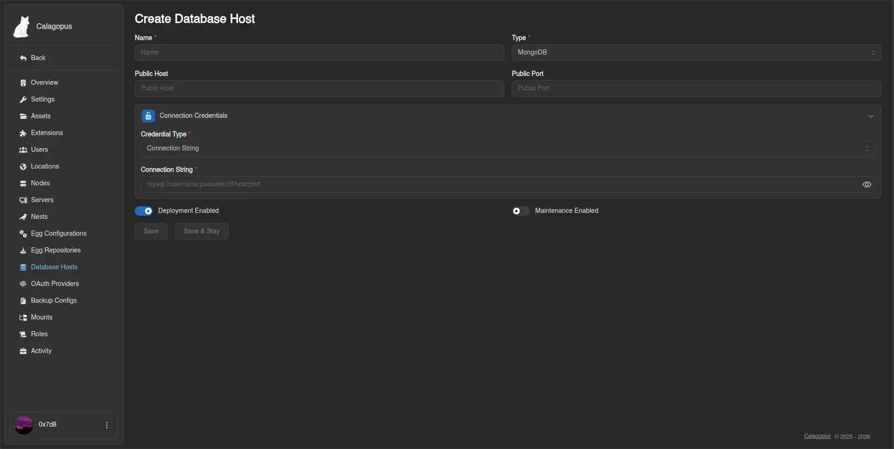
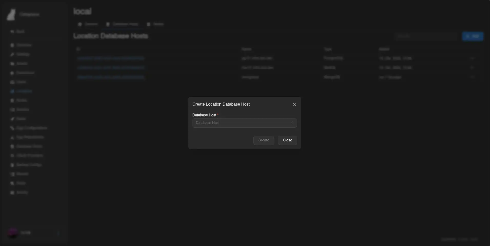

# MongoDB

This guide explains how to install and configure a **MongoDB** database server to use as a database host in the Calagopus Panel. Once set up, your users will be able to create MongoDB databases for their game servers directly from the panel.

::: info
The panel connects using a connection string and a privileged account to provision databases and users on demand. Each game server then receives its own isolated credentials.
:::

::: warning
MongoDB starts **without authentication enabled** by default. This guide creates a superuser first and then enables authentication. Don't skip this step.
:::

## Installation

Pick how you want to run it:

::::tabs key:dbhost
=== Docker Compose

Create a directory for the service and enter it:

```bash
sudo mkdir mongodb && cd mongodb
```

Create a `compose.yaml` with `sudo nano compose.yaml` and the following content. Authentication is intentionally disabled at first so you can create the initial superuser:

```yaml
services:
  mongodb:
    image: mongo:8
    restart: unless-stopped
    volumes:
      - ./data:/data/db
    ports:
      - '0.0.0.0:27017:27017'
```

Start the service and open a `mongosh` shell inside the container:

```bash
sudo docker compose up -d
sudo docker compose exec mongodb mongosh
```

### Create the Superuser

::: danger
This account can connect from **any IP address**. Use a long, randomly generated password; a weak password on an exposed port is a serious security risk.
:::

```js
use admin

db.createUser({
  user: "calagopus",
  pwd: "<strong-password>",
  roles: [
    { role: "userAdminAnyDatabase", db: "admin" },
    { role: "dbAdminAnyDatabase", db: "admin" },
    { role: "readWriteAnyDatabase", db: "admin" }
  ]
})
```

Exit the shell:

```js
exit;
```

### Enable Authentication

Update your `compose.yaml` to pass the `--auth` flag. The `ports` entry already handles exposure, so this is the only change you need:

```yaml
services:
  mongodb:
    image: mongo:8
    restart: unless-stopped
    command: ['--auth']
    volumes:
      - ./data:/data/db
    ports:
      - '0.0.0.0:27017:27017'
```

Restart the service and verify that authentication is working:

```bash
sudo docker compose up -d
sudo docker compose exec mongodb mongosh --username calagopus --password --authenticationDatabase admin
```

=== APT (Debian / Ubuntu)

Follow the [official MongoDB installation guide for Debian/Ubuntu](https://www.mongodb.com/docs/manual/administration/install-community/?linux-distribution=ubuntu&linux-package=default&operating-system=linux&search-linux=with-search-linux) to add the MongoDB repository and install the package, then enable and start the service and connect with `mongosh`:

```bash
sudo systemctl enable --now mongod
mongosh
```

### Create the Superuser

::: danger
This account can connect from **any IP address**. Use a long, randomly generated password; a weak password on an exposed port is a serious security risk.
:::

```js
use admin

db.createUser({
  user: "calagopus",
  pwd: "<strong-password>",
  roles: [
    { role: "userAdminAnyDatabase", db: "admin" },
    { role: "dbAdminAnyDatabase", db: "admin" },
    { role: "readWriteAnyDatabase", db: "admin" }
  ]
})
```

Exit the shell:

```js
exit;
```

### Enable Authentication and Remote Access

By default, MongoDB only listens on `127.0.0.1`. To enforce authentication and accept connections from the panel and Wings nodes, edit `/etc/mongod.conf`:

```yaml
security:
  authorization: enabled
net:
  bindIp: 0.0.0.0
```

Restart MongoDB and verify that authentication is working:

```bash
sudo systemctl restart mongod
mongosh --username calagopus --password --authenticationDatabase admin
```

=== RPM (RHEL / Fedora / Rocky / Alma)

Follow the [official MongoDB installation guide for RHEL/Fedora](https://www.mongodb.com/docs/manual/administration/install-community/?linux-distribution=red-hat&linux-package=default&operating-system=linux&search-linux=with-search-linux) to add the MongoDB repository and install the package, then enable and start the service and connect with `mongosh`:

```bash
sudo systemctl enable --now mongod
mongosh
```

### Create the Superuser

::: danger
This account can connect from **any IP address**. Use a long, randomly generated password; a weak password on an exposed port is a serious security risk.
:::

```js
use admin

db.createUser({
  user: "calagopus",
  pwd: "<strong-password>",
  roles: [
    { role: "userAdminAnyDatabase", db: "admin" },
    { role: "dbAdminAnyDatabase", db: "admin" },
    { role: "readWriteAnyDatabase", db: "admin" }
  ]
})
```

Exit the shell:

```js
exit;
```

### Enable Authentication and Remote Access

By default, MongoDB only listens on `127.0.0.1`. To enforce authentication and accept connections from the panel and Wings nodes, edit `/etc/mongod.conf`:

```yaml
security:
  authorization: enabled
net:
  bindIp: 0.0.0.0
```

Restart MongoDB and verify that authentication is working:

```bash
sudo systemctl restart mongod
mongosh --username calagopus --password --authenticationDatabase admin
```

::::

## Adding the Host to the Panel

The panel uses a **connection string** to connect to MongoDB.

1. Go to **Admin → Database Hosts → Create**.
2. Select **MongoDB** as the database type.
3. Enter the connection string:

```text
mongodb://calagopus:<strong-password>@<host>:27017/?authSource=admin
```

Replace `<strong-password>` with the password you set and `<host>` with the IP address or hostname of the database server.



4. Click **Save**. You will be able to verify the connection afterwards.

## Making the Database Host Show Up for Users

By default, new database hosts are not visible to any client API endpoints. To fix this, add the database host to the Locations Database Host List.

1. Go to **Admin → Locations** and click on the location you want to add the database host to.
2. Click the **Database Hosts** tab at the top.
3. Click **Add** and select the database host you just created from the dropdown, then submit.



::: info
For further reference on MongoDB configuration and user management, see the [official MongoDB documentation](https://www.mongodb.com/docs/).
:::
