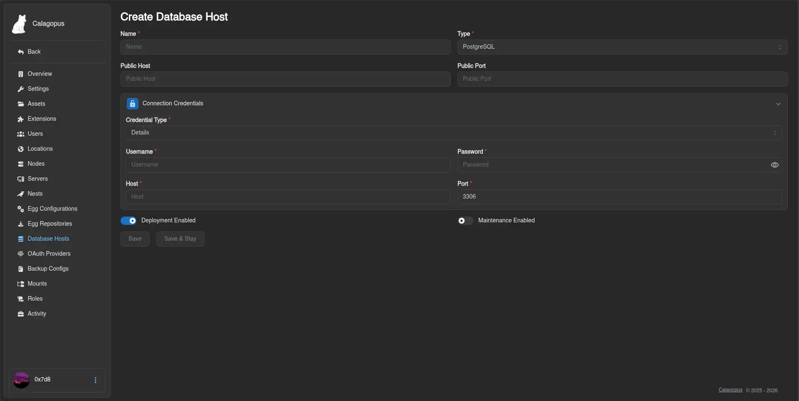
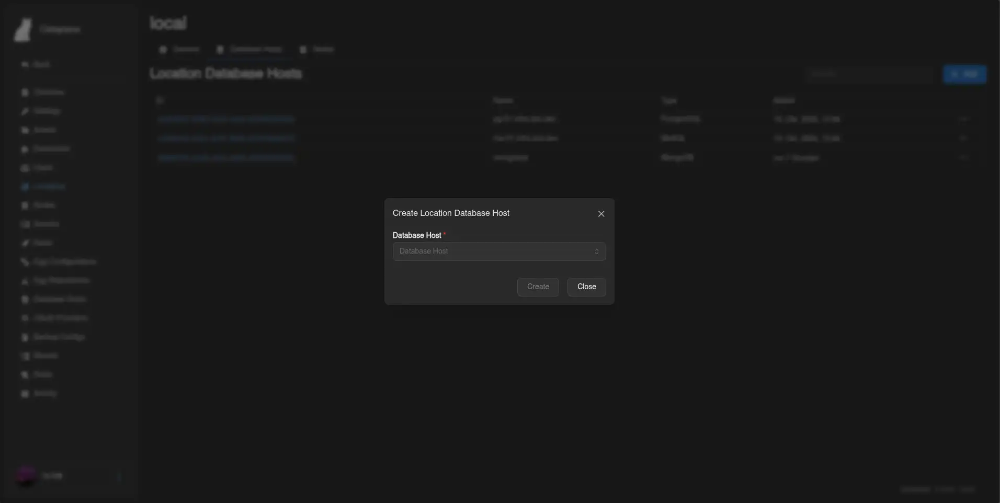

# PostgreSQL

This guide explains how to install and configure a **PostgreSQL** database server to use as a database host in the Calagopus Panel. Once set up, your users will be able to create databases for their game servers directly from the panel.

::: info
The panel connects to this host using a privileged account to provision databases and roles on demand. Each game server then receives its own isolated credentials.
:::

::: warning PostgreSQL 13 or newer
The panel drops databases with `DROP DATABASE ... WITH (FORCE)`, which PostgreSQL added in version 13. On older versions, recreating or deleting a database fails. Most current distributions ship a newer version, but RHEL-compatible 8.x installs PostgreSQL 10 unless you enable a newer module stream.
:::

## Installation

Pick how you want to run it:

::::tabs key:dbhost
=== Docker Compose

Create a directory for the service and enter it:

```bash
sudo mkdir postgres && cd postgres
```

Create a `compose.yaml` with `sudo nano compose.yaml` and the following content:

```yaml
services:
  postgres:
    image: postgres:18
    restart: unless-stopped
    environment:
      POSTGRES_PASSWORD: <strong-root-password>
    volumes:
      - ./data:/var/lib/postgresql
    ports:
      - '0.0.0.0:5432:5432'
```

Start the service, then open a `psql` shell inside the container to continue with user setup. The `ports` entry already exposes the port.

```bash
sudo docker compose up -d
sudo docker compose exec postgres psql -U postgres
```

=== APT (Debian / Ubuntu)

```bash
sudo apt update
sudo apt install -y postgresql
sudo systemctl enable --now postgresql
```

By default, PostgreSQL only listens on `127.0.0.1` and uses `ident` authentication for local connections, so update both. The config directory is typically `/etc/postgresql/<version>/main/`.

Edit `postgresql.conf`:

```ini
listen_addresses = '*'
```

Edit `pg_hba.conf` and add the following line to allow password authentication from any host:

```text
host    all             all             0.0.0.0/0               scram-sha-256
```

Restart PostgreSQL and connect as the default `postgres` superuser:

```bash
sudo systemctl restart postgresql
sudo -u postgres psql
```

=== RPM (RHEL / Fedora / Rocky / Alma)

```bash
sudo dnf install -y postgresql-server postgresql-contrib
sudo postgresql-setup --initdb
sudo systemctl enable --now postgresql
```

By default, PostgreSQL only listens on `127.0.0.1` and uses `ident` authentication for local connections, so update both. The data directory is typically `/var/lib/pgsql/data/`.

Edit `postgresql.conf`:

```ini
listen_addresses = '*'
```

Edit `pg_hba.conf` and add:

```text
host    all             all             0.0.0.0/0               scram-sha-256
```

Restart PostgreSQL and connect as the default `postgres` superuser:

```bash
sudo systemctl restart postgresql
sudo -u postgres psql
```

::::

## Creating the Panel User

Inside the `psql` shell you just opened, create a dedicated role that the panel uses to provision user databases:

::: danger
The role below can connect from **any IP address**. Use a long, randomly generated password; a weak password on an exposed port is a serious security risk.
:::

```sql
CREATE USER calagopus WITH PASSWORD '<strong-password>' SUPERUSER;
```

::: info
`SUPERUSER` allows the panel to provision databases and per-game-server roles without needing additional privileges.
:::

Each database the panel creates is owned by its own role, and the panel revokes the default `PUBLIC` privileges on it. PostgreSQL normally lets every role connect to every database; with those revoked, one game server's credentials can't connect to another server's database.

## Adding the Host to the Panel

1. Go to **Admin → Database Hosts → Create**.
2. Change the Credential Type to **Details**.
3. Fill in the form:

| Field        | Value                                         |
| ------------ | --------------------------------------------- |
| **Name**     | A friendly label, e.g. `PostgreSQL`           |
| **Host**     | IP address or hostname of the database server |
| **Port**     | `5432`                                        |
| **Username** | `calagopus`                                   |
| **Password** | The password you set above                    |



4. Click **Save**. You will be able to verify the connection afterwards.

## Making the Database Host Show Up for Users

By default, new database hosts are not visible to any client API endpoints. To fix this, add the database host to the Locations Database Host List.

1. Go to **Admin → Locations** and click on the location you want to add the database host to.
2. Click the **Database Hosts** tab at the top.
3. Click **Add** and select the database host you just created from the dropdown, then submit.



::: info
For further reference on PostgreSQL configuration, see the [official PostgreSQL documentation](https://www.postgresql.org/docs/).
:::
