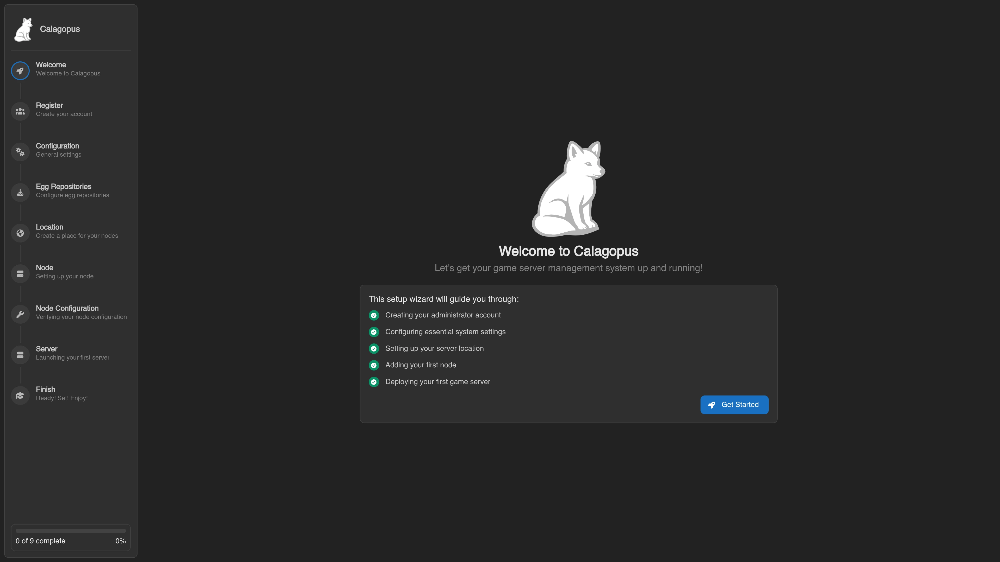

# Migrating from Pelican (Dockerized)

This guide is for Pelican installs running in Docker. If Pelican runs directly on the host without containers, use the [Standalone](./standalone.md) guide instead.

You point the Calagopus importer at a `.env` file with Pelican's database connection details, and it reads everything across. The Docker-specific part is building that file, because Pelican keeps its `.env` and SQLite database inside the `pelican-data` volume, and a database hostname inside its Docker network doesn't work from anywhere else.

API keys do not migrate. The hashes aren't compatible, and neither is the API, so old keys wouldn't work even if they were imported. See the [intro](../pelican.md) for the full reasoning.

## Before You Start

You need access to your Dockerized Pelican install, with its containers running, and Calagopus installed on the same machine. If you haven't installed Calagopus yet, follow the [installation guide](../../../panel/installation/index.md). Once you reach the Out-of-Box Experience (OOBE) screen, **stop**. Don't click through it, don't create the admin user.

::: warning Don't click through the OOBE
This guide uses a fresh Calagopus database. By default, the importer refuses a target that already has users, nodes, servers, nests, or locations. If you already completed the OOBE, either [reset the database](../index.md#resetting-the-calagopus-database), or if you need to keep its data, review [`--force`](../pelican.md#import-options) and run a dry run against the occupied target first.


:::

## Create the Environment File

The importer needs `APP_URL`, `APP_KEY`, and the database settings. It can read `mysql`, `mariadb`, `sqlite`, `sqlite3`, `pgsql`, `postgres` and `postgresql` databases. Check `DB_CONNECTION` in Pelican's `.env` if you're not sure which you're on; SQLite is the default.

Run the block for your database from the directory with Pelican's compose file. It copies Pelican's `.env` to `/tmp/pelican.env`, fixes the values that only work inside Pelican's containers, and prints the result so you can check it. Run `sudo -v` first so a password prompt doesn't swallow the rest of the pasted block.

::: code-group
```bash [SQLite]
sudo docker compose cp panel:/pelican-data/.env /tmp/pelican.env
sudo docker compose cp panel:/pelican-data/database/database.sqlite /tmp/database.sqlite
sudo chmod 600 /tmp/pelican.env /tmp/database.sqlite
sudo sed -i '/^APP_URL=/d;/^DB_CONNECTION=/d;/^DB_DATABASE=/d' /tmp/pelican.env
printf '\nAPP_URL=%s\nDB_CONNECTION=sqlite\nDB_DATABASE=/tmp/database.sqlite\n' "$(sudo docker compose exec -T panel printenv APP_URL)" | sudo tee -a /tmp/pelican.env > /dev/null
sudo cat /tmp/pelican.env
```
```bash [MySQL / MariaDB / PostgreSQL]
sudo docker compose cp panel:/pelican-data/.env /tmp/pelican.env
sudo chmod 600 /tmp/pelican.env
sudo sed -i '/^APP_URL=/d;/^DB_HOST=/d' /tmp/pelican.env
printf '\nAPP_URL=%s\nDB_HOST=%s\n' "$(sudo docker compose exec -T panel printenv APP_URL)" "$(sudo docker inspect -f '{{range .NetworkSettings.Networks}}{{.IPAddress}}{{end}}' $(sudo docker compose ps -q database))" | sudo tee -a /tmp/pelican.env > /dev/null
sudo cat /tmp/pelican.env
```
:::

Pelican's compose file doesn't ship a database service, so the second block assumes you added one called `database`. Change the name if yours differs. If the database runs outside Docker, leave `DB_HOST` as it is and use only the `APP_URL` part. If it's bound to a host port and Calagopus isn't in Docker, you can also use `127.0.0.1` for `DB_HOST`.

The result needs at least these lines, on top of whatever else Pelican's `.env` holds:

```sh
APP_URL=https://panel.example.com
APP_KEY=base64:xc5QXq4u3Qgi3zRP0Q9qq32mnZvl0lVY
DB_CONNECTION=mysql
DB_HOST=172.29.0.4
DB_PORT=3306
DB_DATABASE=pelican
DB_USERNAME=pelican
DB_PASSWORD=secret
```

On SQLite, `DB_CONNECTION=sqlite` and `DB_DATABASE=/tmp/database.sqlite` replace the database lines.

::: details Running Pelican on Windows
Copy Pelican's `.env` out with `docker compose cp panel:/pelican-data/.env pelican.env`, and edit it by hand to match the example above. This prints `DB_HOST`:

```powershell
echo "DB_HOST=$($(docker compose ps -q database) | foreach { docker inspect -f '{{range .NetworkSettings.Networks}}{{.IPAddress}}{{end}}' $_ })"
```
:::

## Run the Import

The commands depend on how Calagopus itself is installed. Pick the matching tab:

::::tabs
=== Docker

From the directory with your Calagopus `compose.yml`, copy the file into the container and validate without importing records. On SQLite, also add the database file first with `sudo docker compose cp /tmp/database.sqlite web:/tmp/database.sqlite`.

```bash
sudo docker compose cp /tmp/pelican.env web:/.env
sudo docker compose exec web calagopus-panel import pelican --environment /.env --dry-run --on-invalid=abort --report /tmp/pelican-import-report.json
```

Read the reported problems before continuing. The report is inside the `web` container; copy it out with `sudo docker compose cp web:/tmp/pelican-import-report.json ./pelican-import-report.json` if needed. Review the [import options](../pelican.md#import-options) to choose fixes or skipped rows. Then run the import interactively:

```bash
sudo docker compose exec web calagopus-panel import pelican --environment /.env
```

When the import finishes, restart the stack and remove the temporary files:

```bash
sudo docker compose down
sudo docker compose up -d
sudo rm -f /tmp/pelican.env /tmp/database.sqlite
```

=== APT/RPM, Binary

Validate without importing records:

```bash
cd /etc/calagopus
sudo calagopus-panel import pelican --environment /tmp/pelican.env --dry-run --on-invalid=abort --report /tmp/pelican-import-report.json
```

Read the reported problems before continuing. Review the [import options](../pelican.md#import-options) to choose fixes or skipped rows. Then run the import interactively:

```bash
sudo calagopus-panel import pelican --environment /tmp/pelican.env
```

When the import finishes, restart Calagopus and remove the temporary files:

```bash
sudo systemctl restart calagopus-panel
sudo rm -f /tmp/pelican.env /tmp/database.sqlite
```

On Windows, save `pelican.env` next to your Calagopus `.env`, use `--environment pelican.env` from that folder, and restart with `nssm restart "Calagopus Panel"`.

::::

The import walks through users, servers, nodes, allocations, eggs, and everything else. Small installs finish in seconds, larger ones take longer. The terminal shows validation findings and the planned record counts before the import writes data.

::: warning If the import errors out
Validation errors stop the import before it writes data. If the write phase fails, the importer rolls back the imported records; fix the reported problem and retry. If it says the data was imported but Panel settings could not be saved, keep the imported data and set the URL, name, and mail settings in the admin area. Do not rerun a successful data import just to repair settings. See [Troubleshooting](../pelican.md#troubleshooting) for the common errors.
:::

Log in with your existing Pelican credentials.

## What's Next

Your nodes keep their existing Wings install, so don't follow the Wings installation guide. Follow [Migrating Wings Nodes](../wings.md) on each one.

After migrating, regenerate any API keys used by external scripts. The old Pelican keys won't work, and the Calagopus API differs from Pelican's, so those integrations need updating regardless.
