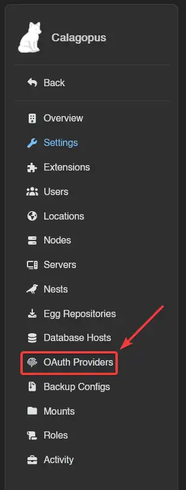
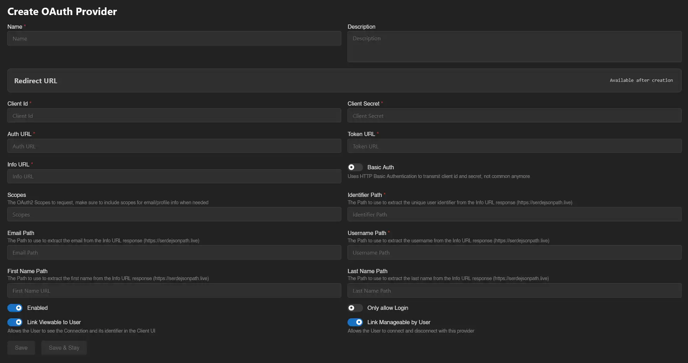

# Generic OAuth Setup

This guide covers setting up a generic OIDC OAuth provider for your Calagopus Panel. It first explains how to locate the required identifiers from your provider, then walks through the integration configuration.

### Example files

These are example files made by the community that you can use as a preset. You will need to replace `id.example.com` with your own OIDC provider.\
Pocket-ID: <a href="/oauth2/pocket-id.yml" download>Download <code>pocket-id.yml</code> ➚</a>\
Authentik: <a href="/oauth2/authentik.yml" download>Download <code>authentik.yml</code> ➚</a>

Both presets import the user's profile picture from the provider's `picture` claim. Pocket-ID always sends one. Authentik only does from version 2026.8 onwards, and on 2026.8.0 specifically the generated fallback avatars come back as a `data:` URI the panel won't fetch, so avatars there need a patched 2026.8.

If your provider isn't listed here, you may have to follow the steps below to adapt to your setup.

## Import from OpenID Discovery

In **Admin → OAuth Providers → Create**, click **Import from OpenID Discovery** and enter your provider's issuer URL or its complete `/.well-known/openid-configuration` URL. The Panel fills the endpoints and suggested profile settings for you. Review them, enter your client credentials, then save. See [OpenID Discovery](../../panel/features/admin/oauth-providers.md#import-from-openid-discovery) for the requirements and outbound-network restrictions.

If discovery is unavailable, fill the same fields manually using the steps below.

### Find the required identifiers

Most OIDC providers (hosted or self-hosted) expose a standard "well-known" URL. Depending on your provider, it is typically available at `/.well-known/openid-configuration` and returns a JSON object containing the 3 URLs needed below.

For example, if your provider's URL is `https://id.example.com`, add `/.well-known/openid-configuration` at the end, so you would go to `https://id.example.com/.well-known/openid-configuration`.

::: warning
If that file does not exist, you may need to refer to your provider's documentation to find the 3 URLs needed.
:::

Visit the well-known URL in a browser (e.g. `https://id.example.com/.well-known/openid-configuration`) and note the following 3 values:

| Identifier    | JSON Key                 |
| ------------- | ------------------------ |
| **Auth URL**  | `authorization_endpoint` |
| **Token URL** | `token_endpoint`         |
| **Info URL**  | `userinfo_endpoint`      |

On the same JSON object, look for the `claims_supported` key, and find the claims you need. Below are some JSON path examples that you could use, although you may need to tweak them a little for your specific provider.

| Identifier              | Example                | Required           |
| ----------------------- | ---------------------- | ------------------ |
| **Identifier Path**     | `$.sub`                | :white_check_mark: |
| **Email Path**          | `$.email`              | :x:                |
| **Username Path**       | `$.preferred_username` | :x:                |
| **First Name Path**     | `$.given_name`         | :x:                |
| **Last Name Path**      | `$.family_name`        | :x:                |
| **Avatar URL Template** | `{$.picture}`          | :x:                |

Finally, look for the `scopes_supported` key, and find the scopes you need. Usually, you should only put `openid`, `profile` and `email`, but it may depend on your provider.

Then, on your provider, set up a Client ID and Client Secret for Calagopus to use.

### Configuring the OAuth Provider

Once you have your URLs, your claims and your scopes, head to your Calagopus Panel's admin page, and click on `OAuth Providers` on the side.

Then, click on the Create button and you should arrive to a page similar to this:

On that page, fill out these fields according to the guide below. It will explain what each field represents and give you some examples for <a href="/oauth2/pocket-id.yml" download>Download <code>pocket-id.yml</code> ➚</a>.

## General Information

### Name <Badge type="tip" text="Required" />

The name of your provider, displayed on the user's OAuth list.

Example: `Pocket-ID`

### Description <Badge type="info" text="Optional" />

A description of your provider, useful for organization.

## OAuth Provider Config

### Client ID <Badge type="tip" text="Required" />

This is your Client ID that your provider has given you.

### Client Secret <Badge type="info" text="Optional" />

This is your Client Secret that your provider has given you. If your provider registered Calagopus as a public client without a secret, leave it empty and turn on [PKCE](#pkce).

## OAuth URLs

### Auth URL <Badge type="tip" text="Required" />

This is the Authentication URL that you have grabbed from the `authorization_endpoint` JSON key.

Example: `https://id.example.com/authorize`

### Token URL <Badge type="tip" text="Required" />

This is the Token URL that you have grabbed from the `token_endpoint` JSON key.

Example: `https://id.example.com/api/oidc/token`

### Info URL <Badge type="tip" text="Required" />

This is the User Info URL that you have grabbed from the `userinfo_endpoint` JSON key.

Example: `https://id.example.com/api/oidc/userinfo`

### Basic Auth <Badge type="info" text="Optional" />

Enable this if your provider transmits the Client ID and Client Secret via HTTP Basic Authentication. Do not enable this option unless you know what you are doing.

Example: Off

### PKCE <Badge type="info" text="Optional" />

Sends a Proof Key for Code Exchange (an `S256` code challenge) with every login. It is off by default. **Import from OpenID Discovery** turns it on only when the provider lists `S256` under `code_challenge_methods_supported`. Most modern providers support it, and public clients without a Client Secret usually require it.

Example: On

## Scopes and Paths

For all the paths, make sure to also add `$.` at the beginning, for example if your email path is `email`, you would do: `$.email`.

### Scopes <Badge type="warning" text="Recommended" />

The scopes used to get the user data via OIDC. The Panel accepts an empty list, but in practice you need them to extract the email, username, first name, last name, and potentially the identifier.

Example: `openid`, `email`, `profile`

### Identifier Path <Badge type="tip" text="Required" />

The Path to use to extract the unique user identifier from the Info URL response (https://serdejsonpath.live)

Example: `$.sub`

### Email Path <Badge type="info" text="Optional" />

The Path to use to extract the email from the Info URL response (https://serdejsonpath.live)

Example: `$.email`

### Username Path <Badge type="info" text="Optional" />

The Path to use to extract the username from the Info URL response (https://serdejsonpath.live)

Example: `$.preferred_username`

### First Name Path <Badge type="info" text="Optional" />

The Path to use to extract the first name from the Info URL response (https://serdejsonpath.live)

Example: `$.given_name`

### Last Name Path <Badge type="info" text="Optional" />

The Path to use to extract the last name from the Info URL response (https://serdejsonpath.live)

Example: `$.family_name`

## Avatars

### Avatar URL Template <Badge type="info" text="Optional" />

Where to fetch the user's profile picture from, so it becomes their panel avatar. Unlike the paths above this one is a URL, with `{...}` placeholders that get filled in from the Info URL response. Leave it empty and no avatar is ever imported.

Providers that return the picture URL in the profile response, the standard OIDC `picture` claim, only need the placeholder on its own, and the value is used as-is. If yours hands back pieces instead, build the URL around them, for example `https://id.example.com/avatars/{$.sub}.png`; each piece is then percent-encoded so it cannot break out of the URL you wrote. Note that this also applies to something like `{$.picture}?size=512`, which is no longer a lone placeholder and will not do what you want.

Example: `{$.picture}`

### Overwrite Existing Avatars <Badge type="info" text="Optional" />

Off, the avatar is imported for users who don't have one yet. On, it is re-imported on every login, replacing an avatar the user uploaded themselves.

Example: Off

## Options

### Enabled

Enable this if you want users to be able to access the panel via the custom provider.

### Only allow Login

Enable this if you don't want people registering accounts via your OIDC provider.

### Link Viewable to User

Allows the User to see the Connection and its identifier in the Client UI.

### Link Manageable by User

Allows the User to connect and disconnect with this provider

---

Click `Save` and your custom OIDC provider will be set up.

### Test the configuration

To test your configuration, head into your account settings, click `OAuth Links` in the sidebar, and connect your OIDC provider account. If everything works correctly, the provider will appear in your linked accounts list.

### Troubleshooting

| Symptom                                                           | Fix                                                                                                                                                                                                                                                                                                                                                                                                                                                                                               |
| ----------------------------------------------------------------- | ------------------------------------------------------------------------------------------------------------------------------------------------------------------------------------------------------------------------------------------------------------------------------------------------------------------------------------------------------------------------------------------------------------------------------------------------------------------------------------------------- |
| Error: "Redirect URI Mismatch" or "Invalid Redirect URI"          | The redirect URL in your OIDC provider doesn't match the one provided by Calagopus Panel. Go back to your Calagopus Panel OAuth provider configuration page, copy the exact Redirect URL shown, then update the redirect/callback URL in your OIDC provider's configuration to match exactly (including `https://`, trailing slashes, etc.) and save.                                                                                                                                             |
| Error: "Invalid URLs" or the connection fails immediately         | One or more of the OAuth URLs (Auth URL, Token URL, Info URL) is incorrect. Visit your OIDC provider's well-known URL, `https://your-provider/.well-known/openid-configuration`, and check that Auth URL matches `authorization_endpoint`, Token URL matches `token_endpoint`, and Info URL matches `userinfo_endpoint`. Update the URLs in your Calagopus Panel OAuth provider configuration and save.                                                                                           |
| Error: "Failed to extract user data", or missing user information | The JSON paths for extracting user data are incorrect. Check your OIDC provider's `userinfo_endpoint` response format, and use [serdejsonpath.live](https://serdejsonpath.live) to test your JSON paths against the usual values: Identifier Path (required) is usually `$.sub`, Email Path `$.email`, Username Path `$.preferred_username` or `$.username`, First Name Path `$.given_name`, and Last Name Path `$.family_name`. Update the paths in your Calagopus Panel configuration and save. |
| Error: "Invalid Scope" or "Insufficient Scopes"                   | The requested scopes aren't supported by your OIDC provider or are incorrectly configured. Visit your OIDC provider's well-known URL, `https://your-provider/.well-known/openid-configuration`, check the `scopes_supported` array, and make sure your configuration includes the necessary scopes, typically `openid`, `profile` and `email`. Update the scopes in your Calagopus Panel OAuth provider configuration and save.                                                                   |
| Error: "Invalid Client" or "Authentication Failed"                | Client ID, Client Secret, or Basic Auth configuration is incorrect. Verify your Client ID and Client Secret from your OIDC provider and update both values in your Calagopus Panel configuration. Check whether your provider requires HTTP Basic Authentication, and turn the **Basic Auth** option on or off to match, then save.                                                                                                                                                               |
| OAuth connection button doesn't appear                            | The OAuth provider isn't enabled in the panel. Go to your Calagopus Panel admin page, navigate to OAuth Providers, click your custom provider, turn the **Enabled** switch on, and save.                                                                                                                                                                                                                                                                                                          |
| Error: "Access Denied" after clicking authorize                   | The user denied permission, or the OIDC provider account has an issue. Try the authorization process again and make sure you click the authorization/consent button on your provider's page. Verify your account with the OIDC provider is active and verified, and check whether your OIDC provider requires additional configuration or permissions.                                                                                                                                            |
