# Google OAuth Setup

This guide walks through setting up Google OAuth for your Calagopus Panel.

::: warning
Google's login page leaks your email address in the `Developer info` popup, opened by clicking the app name:
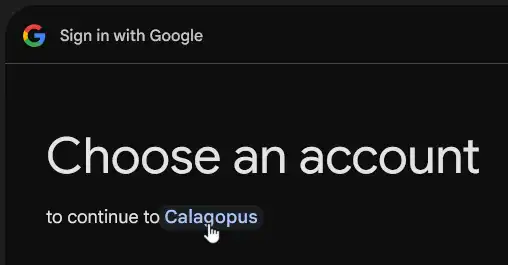

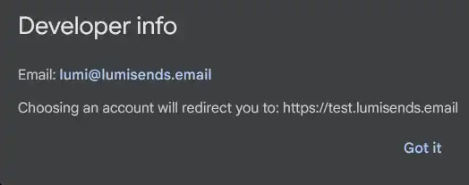

If you don't want your personal email to be shared, you have 2 options:

- **1. Create a separate Google account with a work email.** The work email is shown instead, keeping bot spam away from your personal address.
- **2. Don't use Google OAuth.** Use another provider from [this list](./index.md).
:::

### Prerequisites

To set up Google OAuth, you need:

- [A Google account](https://accounts.google.com)
- A running Calagopus Panel

### Downloading required files

Download the `google.yml` template to import the Google provider configuration without entering values manually.

Right-click the link below and save the file locally.

<a href="/oauth2/google.yml" download>Download <code>google.yml</code> ➚</a>

### Import the template config

Once `google.yml` has been downloaded, head to your Calagopus Panel's admin page, and click on `OAuth Providers` on the side.
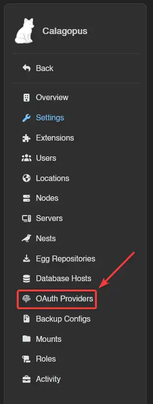

Then, click on the Import button and import the `google.yml` file.
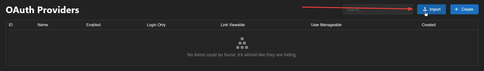

Once imported, click on the newly created Google provider's ID and you should arrive to a page similar to this:
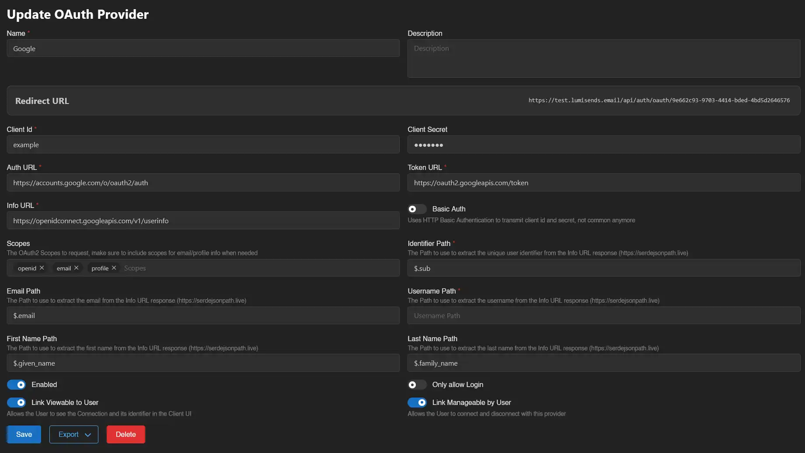

Copy the Redirect URL provided by the panel and proceed to the next step.

### Setting up Google OAuth

#### Select or create a Google Cloud project

Go to [Google Cloud console](https://console.cloud.google.com), for example, by clicking Console on [Google Cloud landing page](https://cloud.google.com/).
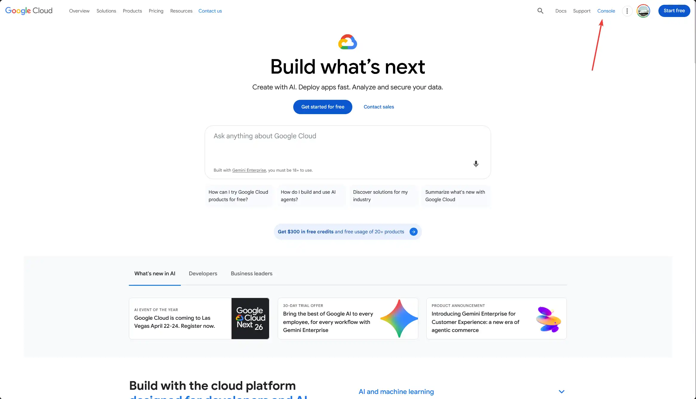

Once there, select a project that you want to use for the Google OAuth app.
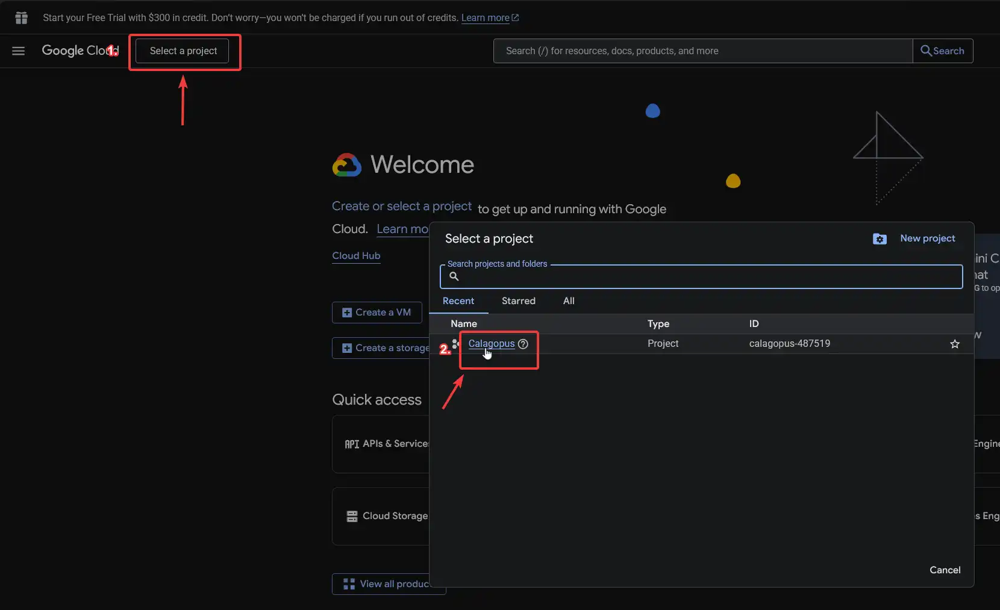

::: details How to create a project in Google Cloud?
In the `Select a project` pop-up, click `New project`.
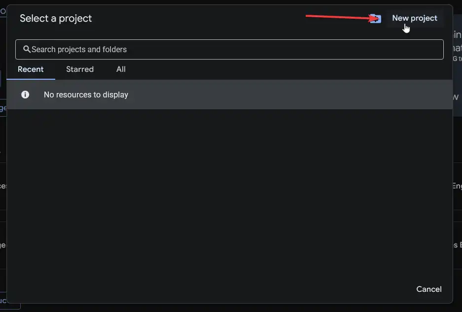

Pick a name for the project, in this case Calagopus. The organisation field can be left to no organization.
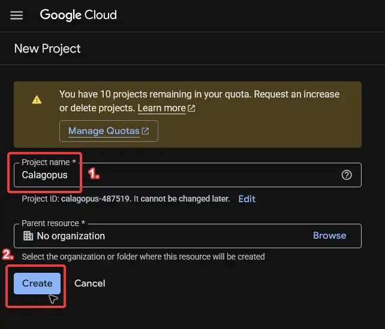

Once the project has been created, wait for all the other steps to complete and then select the project.
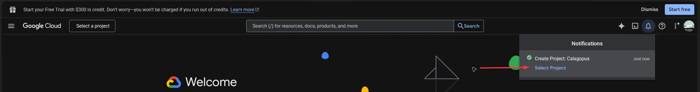
:::

#### Register the OAuth application

In the search bar, search for `APIs & Services`.
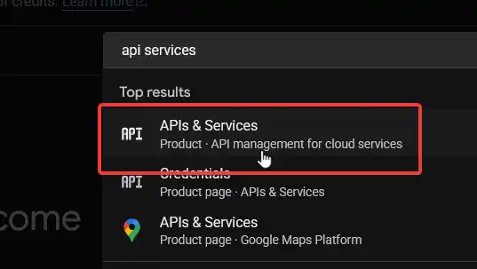

Then in the left sidebar, pick `OAuth consent screen` to begin the OAuth application registration.
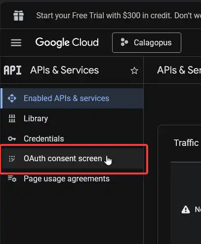

Then, on the `Google Auth Platform not configured yet` page, click on the `Get started` button.
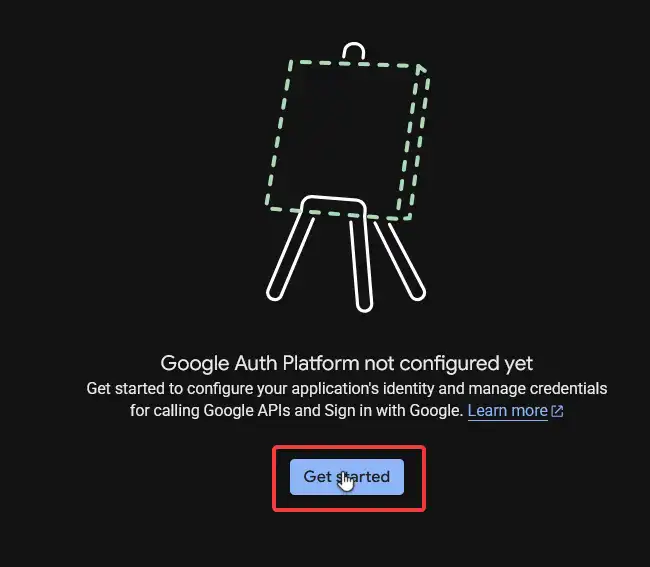

On the next screen, pick the name of the application to show on the login page and add your contact information. Then, click on `Next`.
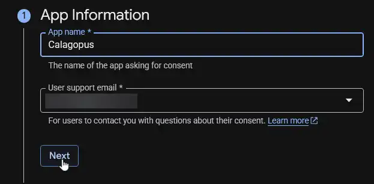

Choose `External` for the application type and then click `Next`.
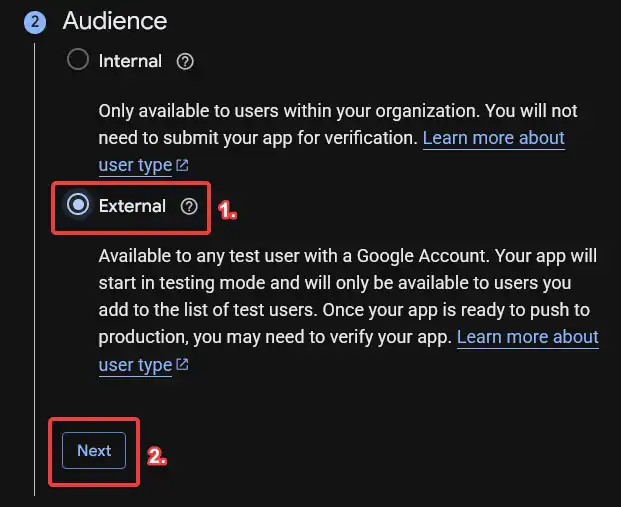

Add your contact information again, and then click `Next`.
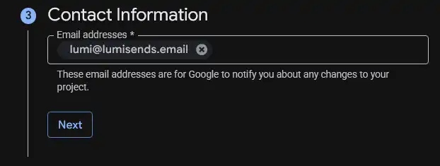

Accept the Google API Services: User Data Policy, and then click `Continue`, and then finally `Create`.
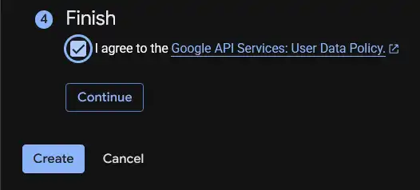

Go back to the `Branding` tab at the left sidebar, and scroll down until you find `Authorized domains`. Add a new domain, and enter the top private domain your Calagopus Panel is located on. For example, if your panel is `test.example.com`, you would put `example.com`. Finally, click the `Save` button.
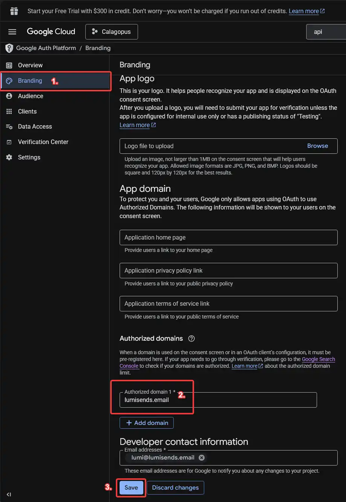

::: warning
Do NOT fill out the `App logo` field, as this will require getting your app verified, which can take some time.
:::

Next, go to the `Audience` tab, and publish the application.
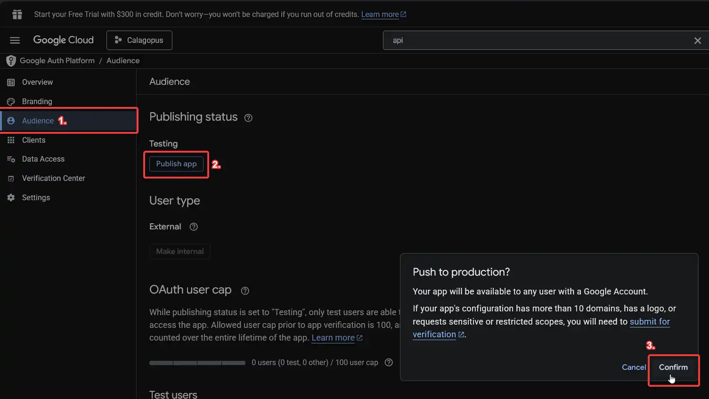

#### Issue an OAuth client and key for that application

Go back to the `APIs & Services` page. To do so, search for `APIs & Services` in the search bar.

Pick `Credentials` in the sidebar. Click `+ Create credentials` dropdown and select `OAuth client ID`.
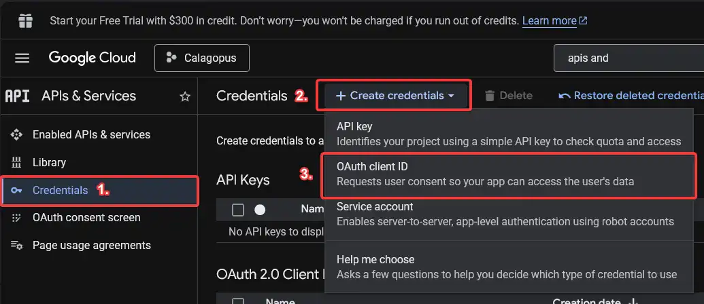

Pick `Web application` for the application type, type the name for the client, and add the redirect URL. Then, create the OAuth Client ID by clicking the `Create` button.
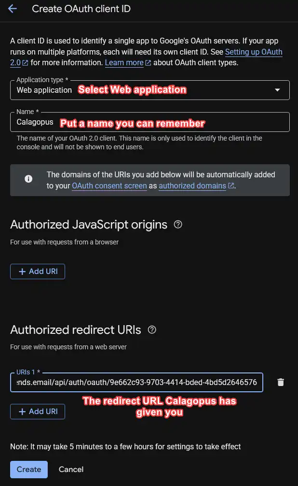

Copy both your Client ID and your Client secret, and then you can close Google Cloud. You will need those for the next step.
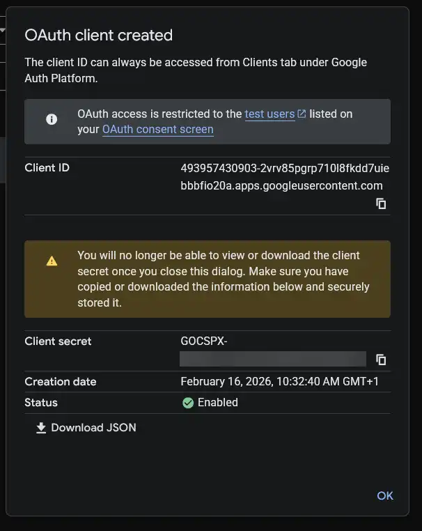

### Configuring the OAuth Provider

Back in the panel, enter the Client ID and Client Secret you copied from Google Cloud.

On the switches below, choose if you want to enable Google OAuth, only allow login, allow the user to view the connection and allow the user to link and unlink their accounts.

The template also fills in the Avatar URL Template, so a user's Google profile picture becomes their panel avatar the first time they log in. Clear that field if you'd rather leave avatars alone, or read [Avatars](../../panel/features/admin/oauth-providers.md#avatars) for what it does.

It should normally look like this:

Finally, save your changes.

### Test the configuration

To test your configuration, head into your account settings, click on `OAuth Links` at the sidebar, and connect to your Google account.
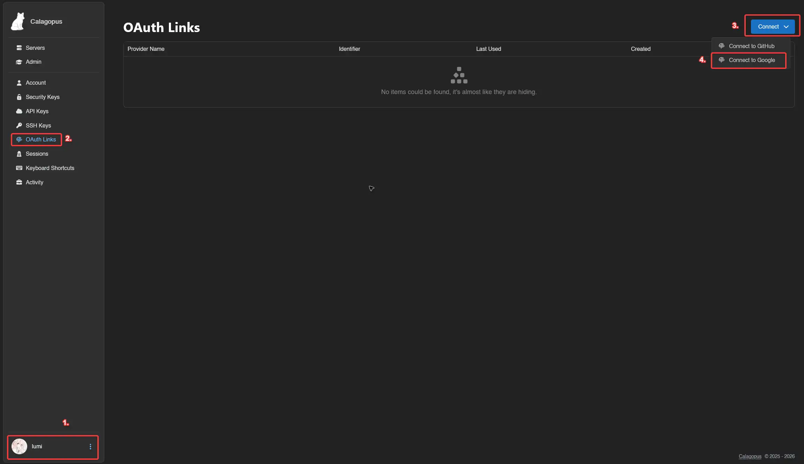

If everything works correctly, you should now be able to see your Google account in your list.
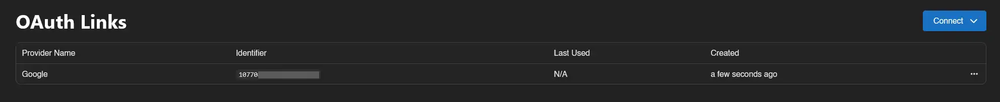

### Troubleshooting

::: details Error: "Redirect URI Mismatch" or "Invalid Redirect URI" {open}
The redirect URL in Google Cloud doesn't match the one provided by Calagopus Panel. Go back to your Calagopus Panel OAuth provider configuration page and copy the exact Redirect URL shown, then go to the [Google Cloud Console](https://console.cloud.google.com), navigate to APIs & Services → Credentials, click your OAuth 2.0 Client ID, and under "Authorized redirect URIs" make sure the URL matches exactly (including `https://`, trailing slashes, etc.) before clicking **Save**.
:::

::: details Error: "Invalid Client" or "Unauthorized Client" {open}
The Client ID or Client Secret is incorrect. Go to the [Google Cloud Console](https://console.cloud.google.com), navigate to APIs & Services → Credentials, click your OAuth 2.0 Client ID, copy your Client ID, create a new Client Secret by clicking **Add Secret** under "Client secrets", then update both values in your Calagopus Panel OAuth provider configuration and save.
:::

::: details Error: "Access Blocked: Authorization Error" with a message about the app not being verified {open}
Your Google OAuth app is in testing mode or not published. Go to the [Google Cloud Console](https://console.cloud.google.com), navigate to APIs & Services → OAuth consent screen, go to the **Audience** tab, click **Publish App**, and confirm the publishing action.
:::

::: details Error: "Invalid Domain" or other domain-related errors {open}
Your panel's domain is not added to the authorized domains list. Go to the [Google Cloud Console](https://console.cloud.google.com), navigate to APIs & Services → OAuth consent screen, go to the **Branding** tab, scroll to "Authorized domains", add your top-level domain (e.g. `example.com` if your panel is at `panel.example.com`), and click **Save**.
:::
