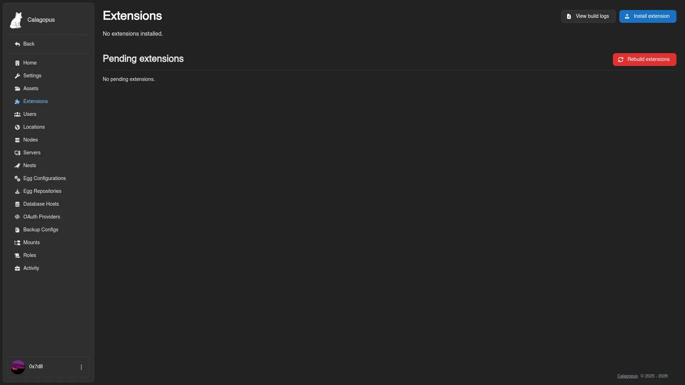

# Installing Extensions

Extensions ship as `.c7s.zip` files - a single archive containing both backend and frontend code. This page covers how to install one in your Calagopus Panel.

::: warning Requires the `:heavy` image or a development environment
Installing extensions requires the Panel to compile new code (yours, plus whatever the extension brings) at install time. The regular `:latest` and `:nightly` Docker images don't include the toolchain for that. You need either:

- The `:heavy` or `:nightly-heavy` Docker image variant, or
- A full local development environment

If you're not on the heavy docker image already, switch to the heavy variant first. See [Switching to the heavy image](./switching-to-the-heavy-image.md).
:::

Web installation, removal, rebuild, restart, and build log controls are unavailable when [`APP_DISABLE_EXTENSION_MANAGEMENT`](../environment.md#app-disable-extension-management) is enabled, even in the heavy image. Installed extensions still run and can be toggled, but since the panel can't restart itself from the web interface then, a toggle takes effect when you restart the container. The extension CLI remains available.

## Install an Extension

The steps depend on which environment you're running. Pick the matching tab:

::::tabs
=== With Docker

Once your stack is on `:heavy` or `:nightly-heavy`, you have two options.

**Option 1: Upload through the admin UI.** Open the Panel's extension management page, drop the `.c7s.zip` file into the upload area, and the Panel handles the rest - install, compile, and load.



**Option 2: Drop the file in directly and restart.** Copy the `.c7s.zip` into the Panel's `extensions/` data directory (with the default heavy compose stack, that's `./build/extensions` relative to your compose file), named `<identifier>.c7s.zip` the way the upload stores it, then restart the container:

```bash
docker compose restart web
```

The Panel detects the new file on startup and installs it. Watch the progress in the admin UI from Option 1, or wait - it shouldn't take more than a minute or two, even for complex extensions. To update an extension this way, overwrite the existing archive; a second archive for the same package under another filename makes the build fail with "already installed".

=== With Development Environment

Add the extension source to your tree:

```bash
panel-rs extensions add path/to/extension.c7s.zip
```

That gets the source in place but doesn't compile it yet. To compile and apply:

```bash
panel-rs extensions apply --profile balanced
```

`balanced` is the default and compiles the backend with cargo's `heavy-release` profile: dependencies are optimized, the Panel's own crates are built unoptimized and incrementally, so rebuilds after an extension change are quick and the result runs acceptably. `--profile dev` uses cargo's `dev` profile for everything and is the fastest to compile; `--profile optimized` uses the full `release` profile, which is what the published binaries use and takes much longer. Don't ship `dev`-built binaries to production; the speed comes at a real performance cost.

Cargo runs as many parallel jobs as the machine's memory allows: available memory (or the cgroup memory limit, whichever is tighter) divided by 2 GiB, capped at the CPU count. Override it with `-j`/`--jobs`, or set `CARGO_BUILD_JOBS`, which the heavy image's builds honour too. If the kernel kills the build for running out of memory on a cgroup v2 system, `apply` prints "cargo build was killed for running out of memory, retrying with a single job" and starts over with one job.

::: details Manual frontend + backend builds
If you'd rather drive the build steps yourself instead of going through `extensions apply`:

```bash
cd frontend
pnpm i # extensions may bring new dependencies
pnpm build:fast

cd ..
cargo b --profile heavy-release
# binary lands at ./target/heavy-release/panel-rs
```

Same end result; just more granular if you're debugging a build issue. If you manually added files/reset your internal-list meta extension, run `panel-rs extensions resync` to refresh the internal state before building.
:::

::::

## Troubleshooting

| Symptom | Fix |
| --- | --- |
| `/app/binaries is missing or is not a directory, mount it as a volume.` | You are on a heavy image without the four extra mounts. The supervisor checks `/app/binaries`, `/app/translations`, `/app/extensions` and `/app/repo/database/extension-migrations`, and names the first one it can't find. Add them as shown in [Switching to the Heavy Image](./switching-to-the-heavy-image.md). When switching back to a stock image, removing the mounts from `compose.yml` is enough. The `./build` directory on the host is leftover disk you can delete whenever you like. |
| The panel still reports the old version after `docker compose pull` | The heavy image caches the last successfully built binary under `./build/binaries` and keeps running it. Clear the cache and recreate the stack: `docker compose down`, then `rm -r ./build/binaries`, then `docker compose up -d`. If the dashboard keeps offering an update right after you installed it, look at the Extensions page first; the new version is in place, and the notice goes away once the extensions have finished compiling against it. |
| The build fails, or the browser shows a `504` while installing | The log says why. Open **Admin → Extensions** and use **View build logs**, which streams the log of the current or most recent build. On disk it's `./build/binaries/.state/builds/<build id>/build.log`, and a copy of the last failing build is kept under `./build/binaries/.state/failed/`. The build picks its job count from the memory it has and retries with a single job if the kernel kills it for running out of memory, which shows up in the log as "retrying with a single job". If a Rust build still stops without an error line after that, the single-job build ran out of memory too. Give the container more RAM (8 GB has been enough in reports so far), add swap, or build on a bigger machine and ship the image. |
| The build is stuck on "Compiling ..." for hours with an idle CPU | Press **Cancel build** on the Extensions page, then **Retry build**. If the container itself was killed mid-build, `docker compose down` followed by `docker compose up -d` restarts the build from the beginning. There's no lock file to clear by hand. |
| The last build failed, and the message names an extension | The alert lists the extensions it blames ("The build failed in ..."), and their cards carry a **Build failed** badge. Together with "These extensions are not built again until they change, or until you retry the build explicitly" it means one extension no longer compiles against the current panel, often after a panel update that the extension doesn't support yet. Read the panel's release notes before updating, remove or update the named extension, then retry the build. |
| The frontend is broken after updating an extension, with `useAuth must be used within a AuthProvider` or a crash on the Extensions page | A broken extension took the frontend bundle with it. Stop the stack, delete that extension's archive from `./build/extensions`, remove `./build/binaries`, and start again with `docker compose up -d --force-recreate`. If you can't tell which one it is, remove all archives from `./build/extensions`. Their data stays in the database, and you re-upload them one at a time. |
| `declares panel version requirement >=1.0.0 which allows panel versions older than 1.1.0` | The 1.1.0 extension API isn't compatible with older builds, so the panel refuses extensions that don't declare 1.1.0 or newer as their minimum. The extension's author needs to update it. |
| `this archive contains ... instead of the extension itself` or ``unable to find `Metadata.toml` in the uploaded archive`` | Marketplaces often deliver the extension as a zip inside a zip. Extract the download and upload the `.c7s.zip` from inside it. If the message says the files are inside a folder, the archive was re-packed; upload the original `.c7s.zip`. |
| The extension shows **Failed to start** | It crashed while starting, or its routes or CLI commands clash with the panel or another extension. The alert on the Extensions page shows the error. The panel runs without it; update or remove it, then restart the panel. |
| "Extension frontend missing" right after installing | Reload the page. |
| The extension builds and installs but does nothing | The `[package] name` in its `Cargo.toml` doesn't follow the `dev_<author>_<name>` identifier convention from [Extension File Structure](./file-structure.md). Extensions that add server pages may also depend on an egg feature flag being enabled on the egg. |
| A binary or package install can't install extensions | Only the heavy Docker images build extensions. For a binary install, build the panel yourself with the extensions included, see the [Development Environment](./dev-environment.md) guide. |
