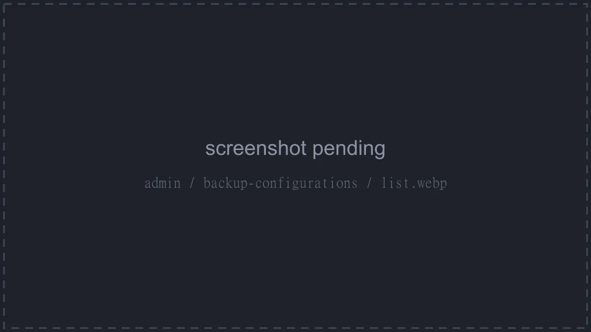
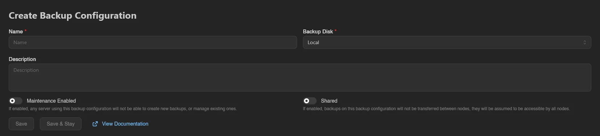
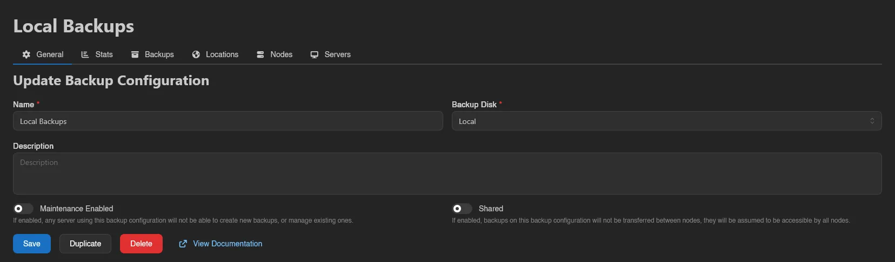
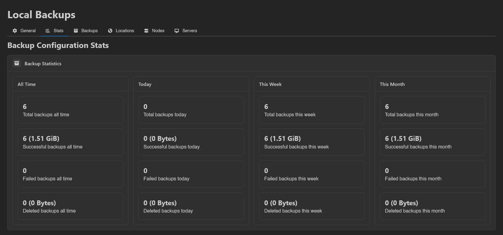
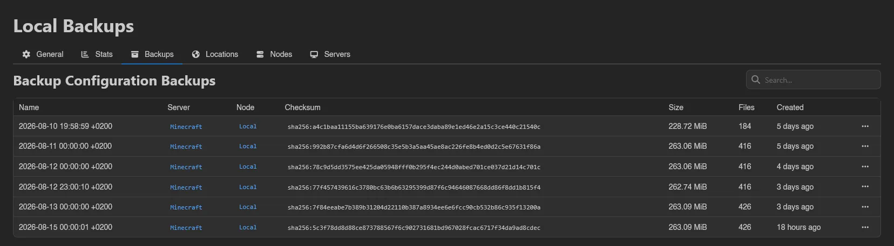
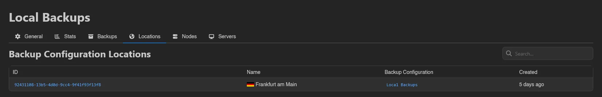
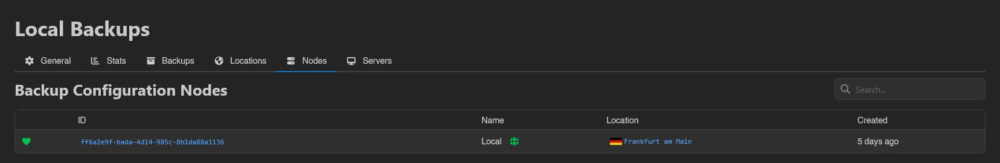
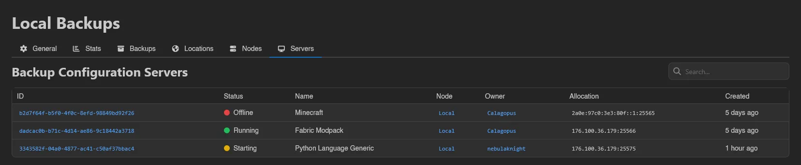

# Backup Configurations

Backup configurations (**Storage** > **Backup Configurations**) define where and how server backups are stored: local disk, S3, restic, Proxmox Backup Server, Kopia, or a filesystem snapshot.

::: info
This page only describes the admin UI surface. The full walkthrough, including every per-disk field, driver comparison, and assignment guide, lives at [Setting up Backup Configurations](../../../wings/advanced/backup-configurations.md).
:::

The list shows each configuration's **ID**, **Name**, **Disk**, and **Created**.

## Creating a Configuration

Click **Create**. The common fields are **Name**, **Backup Disk** (Local, S3, Ddup-Bak, Btrfs, ZFS, Restic, Proxmox Backup Server, or Kopia), **Description**, and two switches:

- **Maintenance Enabled**: "If enabled, any server using this backup configuration will not be able to create new backups, or manage existing ones."
- **Shared**: "If enabled, backups on this backup configuration will not be transferred between nodes, they will be assumed to be accessible by all nodes."

Picking S3, Restic, Proxmox Backup Server, or Kopia reveals a disk-specific settings section; the node-local disks need none. See the [per-disk field reference](../../../wings/advanced/backup-configurations.md#backup-disks) for what goes in each. Btrfs, ZFS, and Ddup-Bak show a warning with extra requirements when selected.

Finish with **Save** or **Save & Stay**; **View Documentation** links to the walkthrough above.

**Test** opens a dialog where you pick a node and click **Run Test**. The node checks the values currently in the form, saved or not. The dialog shows whether that worked and how long it took, plus the error Wings reported when it didn't. [Testing a Configuration](../../../wings/advanced/backup-configurations.md#testing-a-configuration) lists what each disk checks.

## Where Configurations Attach

A configuration takes effect once it's assigned to a **location**, **node**, or **server**; the panel picks the most specific one when a backup is created (server first, then node, then location). Assignment happens on those resources' own edit forms, each of which has a **Backup Configuration** field. See [Assigning a Backup Configuration](../../../wings/advanced/backup-configurations.md#assigning-a-backup-configuration).

Opening a configuration shows tabs for **General** (the edit form, plus **Duplicate** and **Delete**), **Stats**, **Backups**, and read-only **Locations**, **Nodes**, and **Servers** lists showing where it's currently assigned; the tab lists are all searchable.

**Stats** counts total, successful, failed, and deleted backups, with stored sizes, across all time, today, this week, and this month.

**Backups** lists every backup stored on the configuration: Name, **Kind**, **Source**, Server, Node, Checksum, Size, Files, Retention, and Created. Kind separates file archives from database dumps, and Source names either the server files or the instance a dump came from. **Retention** is filled in for backups that belong to a [backup group](../server/backups.md#backup-groups) or were taken by a [system backup policy](./system-backup-policies.md): a badge for the rule keeping the backup longest and the time the panel expects to delete it.

When there are failed backups, a **Delete Failed** button appears above the table (requires `nodes.backups`), showing how many it would remove. It asks for confirmation, keeps locked backups and any whose configuration is in maintenance, and runs in the background. A **Force** switch removes them even when the configuration is missing or the remote storage is unreachable, at the risk of leaving orphaned files behind.

A backup whose deletion still fails after the panel's eight automatic attempts is marked as a failed deletion. Since Panel 1.2.8, when there are any, a **Retry Failed Deletions** button with their count sits next to it (requires `backup-configurations.backups` and `nodes.backups`). It skips backups whose configuration is in maintenance, runs in the background, and has the same **Force** switch.

Managing configurations requires the `backup-configurations.create`, `backup-configurations.update`, and `backup-configurations.delete` admin permissions; **Test** works with either create or update, and the Backups tab uses `backup-configurations.backups`. See the [Permissions Reference](../dashboard/permissions.md).
