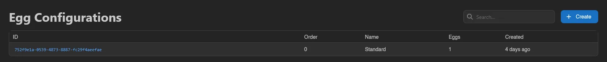
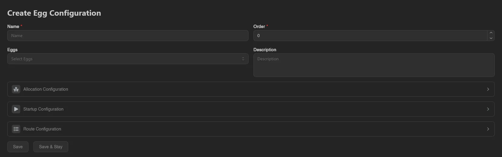
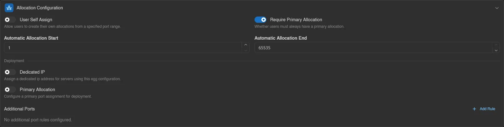
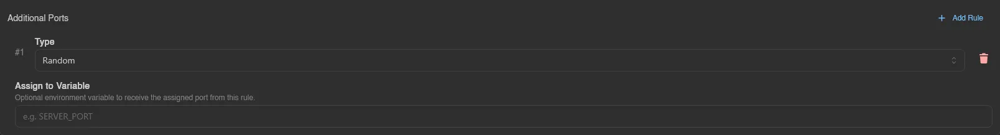
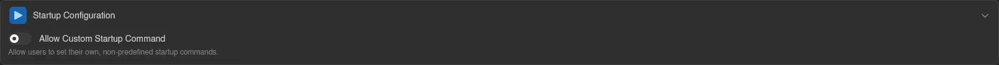
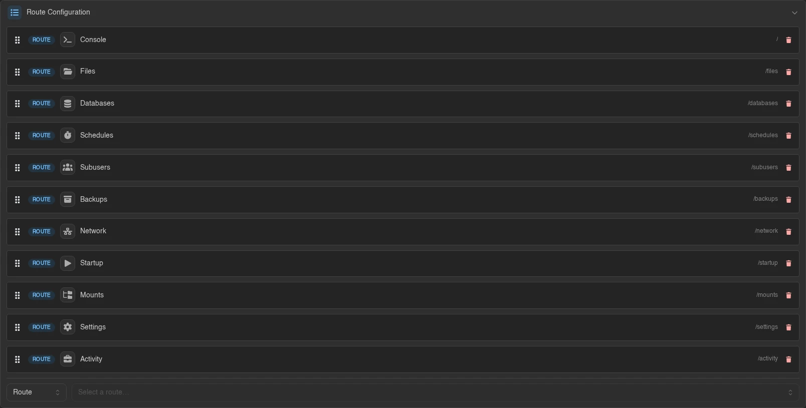
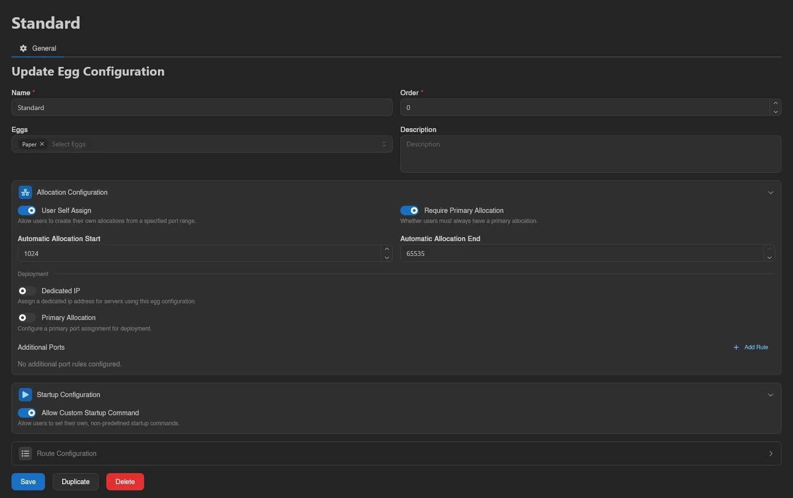

# Egg Configurations

An egg configuration is a named bundle of optional behavior plus a matcher that decides which servers it applies to, by their [egg or nest](./nests.md), [node](./nodes.md) or [location](./locations.md). The behavior covers how allocations are assigned, whether users may write their own startup command, which pages the server sidebar shows, and whether the firewall and private network are available. It's a Calagopus concept with no Pterodactyl equivalent, and it lets you define this behavior once instead of per egg.

The list shows ID, **Order**, Name, **Applies To** (a summary of the matcher, such as `Eggs (3)`), and Created. Use the search box to filter.

## How Configurations Stack

A server can match several configurations. All configurations whose matcher matches the server apply, sorted by their **Order** value (lowest first, creation date as tie-breaker), and each section (allocation, startup, page order) is taken from the last configuration in that ordering that defines it. [Feature Configuration](#feature-configuration) is the exception: it merges per feature, see below.

Because matchers can look at the node and location, the same egg can end up with different behavior on different nodes. Deployments resolve the allocation rules against the node the server is being placed on, and [server transfers](./nodes.md#servers) against the destination node.

If no configuration defines a section, the built-in defaults apply: self-assign off, primary allocation required, custom startup commands off, sidebar in its normal order, firewall and private network available. In practice: put your broad defaults at a low Order and targeted overrides at a higher one.

## Creating and Editing

Click **Create**, or open a configuration's ID to edit it. The base fields are **Name**, **Order**, **Description**, and **Applies To**, the matcher described below.

### Applies To

Pick a **Matcher Type**:

| Matcher Type | Applies when | Fields |
| --- | --- | --- |
| **Never (Applies to nothing)** | Never, which parks a configuration without deleting it | none |
| **All (Always applies)** | Every server | none |
| **AND (All must match)** | Every nested matcher applies | nested matchers |
| **OR (Any must match)** | At least one nested matcher applies | nested matchers |
| **NOT (Must not match)** | Its nested matcher does not apply | one nested matcher |
| **Eggs** | The server uses one of the selected eggs | eggs, grouped by nest |
| **Nests** | The server's egg belongs to one of the selected nests | nests |
| **Nodes** | The server runs on one of the selected nodes | nodes |
| **Locations** | The server's node is in one of the selected locations | locations |

New configurations start with an empty **Eggs** matcher. Each list holds up to 100 entries, and AND, OR and NOT groups nest at most three levels deep. If your panel has no eggs yet, an **Eggs** or **Nests** matcher shows a warning that there is nothing to select until a nest and egg exist.

Configurations created before matchers existed were migrated to an **Eggs** matcher with their old egg list, so they behave as before.

Below are four collapsible sections. Each has an enable toggle; a disabled section isn't defined by this configuration, so a lower-priority one (or the default behavior) applies.

### Allocation Configuration

The top half controls what users can do on their server's [Network page](../server/network/index.md):

- **User Self Assign**: lets users create their own allocations, drawn from the **Automatic Allocation Start** / **Automatic Allocation End** port range. Without a configuration enabling this, the client-side create button is rejected.
- **Require Primary Allocation**: whether users must always have a primary allocation.

The **Deployment** half controls automatic allocation assignment when servers are deployed through the deployment API (a manual allocation choice always wins over these rules):

- **Dedicated IP**: assign a dedicated IP address for servers using this configuration.
- **Primary Allocation**: pick the primary port from a **Primary Start Port** / **Primary End Port** range, with an optional **Assign to Variable** (e.g. `SERVER_PORT`) that receives the assigned port as an environment variable.
- **Additional Ports**: extra allocation rules, added with **Add Rule**. Each rule has a type: **Random**, **Port Range** (start/end), or one derived from the primary port, **Add to Primary**, **Subtract from Primary**, **Multiply Primary**, **Divide Primary** (each with a **Value**). Every rule also takes its own optional **Assign to Variable**.

### Feature Configuration

Turns server features on or off for the matched servers. Each feature is a three-way choice: **Inherit**, **Enabled** or **Disabled**.

Unlike the other sections, this one merges per feature. A feature left on **Inherit** keeps whatever a lower-order configuration set, so a broad configuration can disable a feature without every narrower one repeating it. A feature that no matching configuration sets stays enabled.

- **Firewall**: lets users manage [firewall rules](../server/network/firewall.md). When disabled, existing rules are kept in the database but no longer enforced, the Firewall tab disappears from the server's Network page, and the firewall API answers with "the firewall is not enabled for this server".
- **Private Network**: lets servers join the [private network](../server/network/connections.md) and connect to other servers. When disabled, the server is removed from the network until the feature is enabled again, the Connections tab disappears, and other servers can no longer connect to it.

Changes take effect right away for running servers: when a configuration is saved, when a node moves to another location, when an egg moves to another nest, and when a server switches egg.

### Startup Configuration

One switch: **Allow Custom Startup Command**. When off, users on the server's [Startup page](../server/startup.md) can only pick between the egg's predefined startup commands; when on, they can write their own.

### Route Configuration

Reorders the server sidebar for affected servers. Each entry shows its path and has a remove button; drag entries to reorder. The bottom row adds entries by type: **Route** picks a page, **Divider** (optionally named) groups them, **Redirect** (a name plus a destination URL) adds an external link. Divider and redirect names are translatable per language.

The icon button at the start of a route or redirect entry picks its sidebar icon from the Font Awesome solid, regular and brands sets, searchable by name. **Use Default Icon** goes back to the page's own icon (or the external-link icon for a redirect). The same picker is in the [Client Route Order](./settings.md#user) editor.

::: warning
Pages left out of the list are not just hidden from the sidebar, they become inaccessible for those servers. Only remove pages you genuinely want to cut off.
:::

## Duplicating and Deleting

When editing, **Duplicate** copies the whole configuration under a new name and **Delete** removes it (servers and eggs are untouched, only the layered behavior disappears).

::: info
These actions map to the `egg-configurations.*` admin permissions; see the [Permissions Reference](../dashboard/permissions.md).
:::
