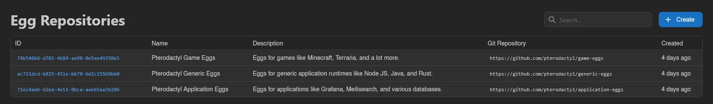
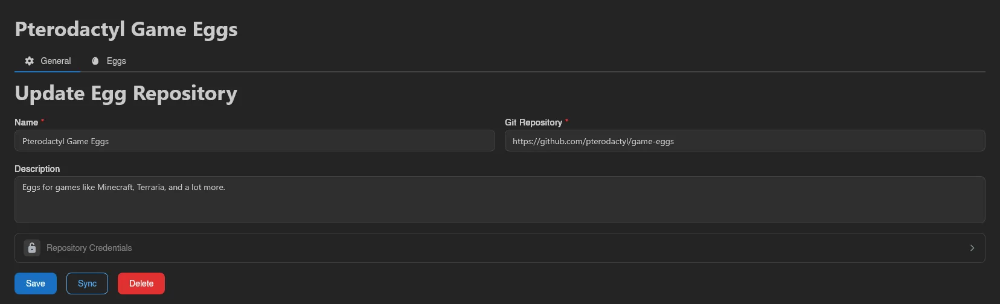
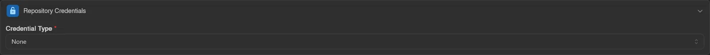
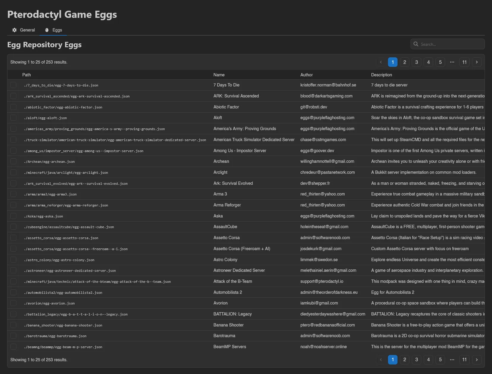
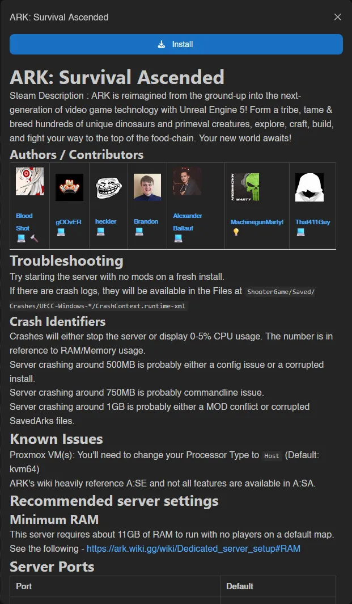

# Egg Repositories

Egg repositories connect Git repositories containing egg definitions to your panel, so you can browse and install eggs without downloading files by hand. This page describes the admin surface; the full setup and usage walkthrough, including importing and updating eggs, lives in [Setting up Egg Repositories](../../next-steps/egg-repos.md). The eggs of all your repositories together are browsable in the [Egg Library](./egg-library.md).

The list shows ID, Name, Description, **Git Repository**, and Created. Repositories you selected during the panel's first-time setup appear here already; use the search box to filter.

## Creating and Editing

Click **Create** and fill in **Name**, **Git Repository** (the repository URL), and an optional **Description**. Saving a new repository starts its first sync in the background straight away, so its eggs show up a moment later without pressing **Sync**. Opening an existing repository shows the same form on its **General** tab, next to the [Eggs](#eggs-tab) tab, with **Sync** and **Delete** alongside **Save**.

Two more fields control what happens after that:

| Field | What it does |
|---|---|
| **Default Nest** | "Eggs installed from this repository go into this nest unless another one is chosen." Install dialogs preselect it, and the API falls back to it when an install request names no nest. Optional; the **Can't find one? Create a new nest** link below the picker creates a nest in place. Deleting the nest clears the setting. |
| **Automatic Sync** | On by default. The repository is re-synced once a day, so new and updated eggs appear without anyone pressing **Sync**. |

For private repositories, enable the **Repository Credentials** section and pick a **Credential Type**: **None**, **Password** (a **Username** plus a **Password or Access Token**), or **Private Key** (a **Username** plus an SSH **Private Key** with optional **Passphrase**). Password credentials work with both `https` and `ssh` repository URLs; private keys require an `ssh` one. An `ssh` URL without credentials is refused ("ssh repositories need credentials, use an https repository url for public repositories").

Since Panel 1.2.7, `https` clones go through the same address filter as other outbound requests ([`APP_BLOCKED_CIDRS`](../../environment.md#app-blocked-cidrs)) and don't follow redirects: a repository URL that redirects fails with "repository redirected to ..., use that url instead", so enter the final URL.

## Syncing

Open a repository and hit **Sync**. The panel clones the repository, scans it for egg definitions (`.json`, `.yml`, `.yaml`, with any nearby README and banner image picked up for the preview drawer and the [Egg Library](./egg-library.md#available)), refreshes the repository's egg list, and drops entries that no longer exist in the repository. Syncing never installs or modifies eggs in your nests; it only updates what's available to install.

Repositories with **Automatic Sync** on are synced by a background task every day at 03:00 UTC, one after another. A failed sync is logged and the remaining repositories still run.

Each sync also stores a hash of every egg definition. Comparing it with the hash recorded on an installed egg is how the panel spots eggs whose repository version has changed. The hash covers only the egg definition, not its README or banner, and ignores the egg's UUID, so a sync that changes nothing in the egg itself won't flag an update.

### Banners

A banner is an image shown on the egg's card in the Egg Library and at the top of its README drawer. Banners come from files in the repository; the panel doesn't fetch them from anywhere else. While scanning, the panel looks for a file named `banner` with a `.png`, `.jpg`, `.jpeg`, `.webp` or `.gif` extension (case-insensitive) next to the egg file, then in each parent directory up to the repository root, and uses the first one it finds. A banner at the root therefore applies to every egg that has no closer one.

The source file may be at most 8 MiB and 4096 × 4096 pixels. A larger file is skipped, and the search carries on in the parent directories. The panel scales it down to fit within 960 × 480, keeping the aspect ratio, converts it to lossless WebP, and saves it in the panel's [storage](./settings.md#storage) under `publicdata/egg-repositories/`. Stored banners are named after a hash of the source file, so an unchanged banner is not stored again on the next sync. With local storage the panel also serves them with a one-year immutable cache header; banners stored in S3 don't get it from the panel. Banners that no repository egg uses any more are removed after the sync, and deleting the repository removes all of its banners. A banner that can't be decoded or stored is skipped with a warning in the log; the egg is still synced without one.

## Eggs Tab

The **Eggs** tab lists everything found by the last sync (Path, Name, Author, Description, Updated), searchable and paginated. Click a row to open its README (and banner, if it has one) in a drawer with its own **Install** button, use the install icon at the end of a row, or select eggs and **Install** them into a nest. Installing needs `eggs.create` and `nests.read`.

The install dialog preselects the repository's **Default Nest**, and its **Can't find one? Create a new nest** link creates a nest without closing the dialog. Eggs whose name already exists in the chosen nest are skipped rather than duplicated, and so are eggs that fail [egg validation](./nests.md#general); the toast reports how many were installed. See [the walkthrough](../../next-steps/egg-repos.md) for the install and update flows step by step.

::: info
Actions here map to the `egg-repositories.*` admin permissions (syncing needs `egg-repositories.sync`); see the [Permissions Reference](../dashboard/permissions.md).
:::
