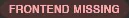
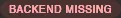
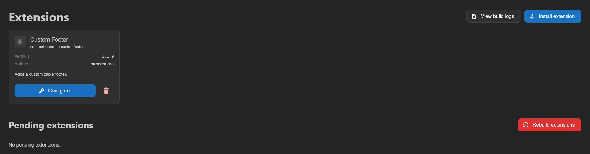
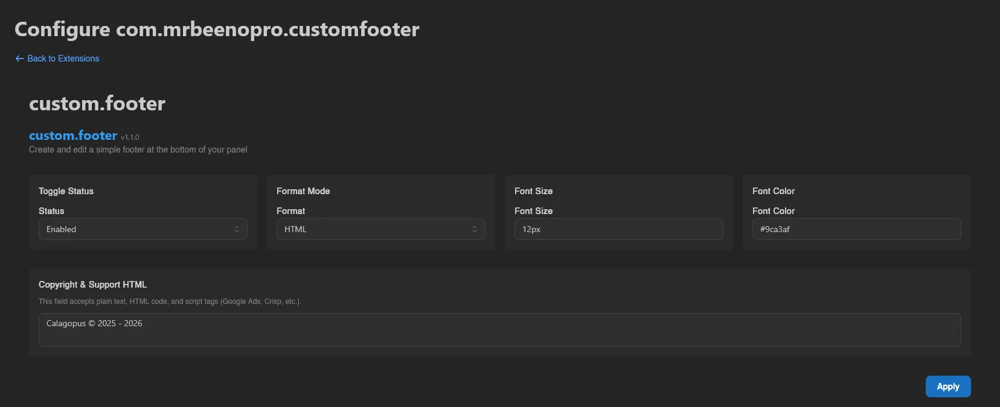
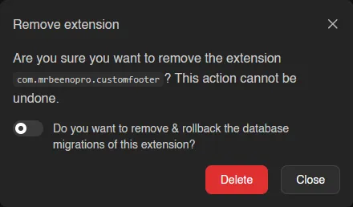
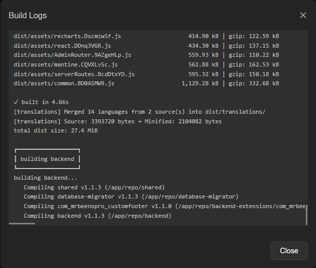

# Extensions

Extensions (**System** > **Extensions**) add features to the panel itself. This page shows what's installed and drives the build pipeline that compiles extensions into the panel.

::: info
The full installation walkthrough, including switching to the heavy image that extension building requires, lives at [Installing Extensions](../../extensions/installing-extensions.md). This page only describes the admin UI.
:::

Web installation, removal, rebuild, restart, and build log controls are unavailable when [`APP_DISABLE_EXTENSION_MANAGEMENT`](../../environment.md#app-disable-extension-management) is enabled, even in the heavy image. Installed extensions still run and can be toggled, but since the panel can't restart itself from the web interface then, a toggle takes effect when you restart the container. The extension CLI remains available.

## Installed Extensions

Each installed extension gets a card with its name, package name, **Version**, **Authors**, and description. Badges flag incomplete states:

   

**Configure** on a card opens the extension's own settings page at `/admin/extensions/<packageName>`. It's disabled, with a tooltip saying why, when the extension has no backend, ships no configuration page, or is currently disabled.

The switch next to it turns an extension **off without uninstalling it**: its entrypoints are skipped at boot, so its routes and background tasks stop existing, while its files, database tables and permission grants all stay put. Toggling shows a **Pending restart** badge until the panel restarts, and a **Disabled** badge afterwards.

Flipping it back on restores the extension as it was. See [Disabling Extensions](../../extensions/disabling-extensions.md) for exactly what a disabled extension stops doing.

An extension that crashes while starting, or whose routes or CLI commands conflict with the panel or another extension, is skipped and the rest of the panel starts normally. Its card gets a red **Failed to start** badge with **Configure** disabled, and an alert above the list, "Some extensions failed to start", names each one with the stage that failed and the error. Update or remove it, then restart the panel.

The trash icon removes an extension entirely, with a switch to also remove and roll back its database migrations. The code stops being included on the next rebuild, but the migration rollback happens immediately.

::: info
The extension pictured across this page is [Custom Footer](https://www.sourcexchange.net/products/custom-footer-for-calagopus) by mrbeenopro, available on SourceXchange and [GitHub](https://github.com/mrbeeenopro/custom-footer-for-calagopus).
:::

## Installing and Building

- **Install extension** uploads an extension `.c7s.zip`; you can also drag and drop files onto the page. An upload that isn't an extension archive is refused with a reason: a file that isn't a zip, a zip that contains the `.c7s.zip` instead of being it (extract the download first and upload the inner file), an archive re-packed with everything inside a folder, or a missing or unparseable `Metadata.toml`, `backend/Cargo.toml` or `frontend/package.json`. If the extension ships a license, you have to **Accept** it before it's added. The upload is checked before anything is written: an extension whose supported panel versions don't include the version the next build targets is refused, and a refused or unaccepted upload leaves no file behind. While a file uploads, a card above the installed extensions shows its progress with **Uploading**, and a cancel button until the last byte is sent; it switches to **Processing** while the panel checks the archive.
- Newly added extensions land under **Pending extensions** until you hit **Rebuild extensions**, which compiles everything and restarts the panel. Progress phases are shown live, and a running build can be stopped with **Cancel build**.
- The version the next build targets is the one the extension supervisor reports, which is not always the version currently running, for example while the panel has not yet restarted into a newer build. When the two differ, the page shows "The panel is serving a build for a different version" with both versions, and new extensions have to support the target one.
- **View build logs** opens the log of the current or last build, with a **Copy** button for the whole log. If a build fails, the alert "The last extension build failed" shows the reason and the **Rebuild** button becomes **Retry build**. When the log points at specific extensions, the alert names them ("The build failed in ... Update or remove them, then retry the build.") and their cards get a red **Build failed** badge. If adding an extension's archive to the build fails, that extension is named. For a failed compile or dependency install, the panel searches the error lines of the last stage that ran for each extension's identifier or package name, so an error that mentions no extension names nobody. Admins with `extensions.manage` also see "The last extension build failed." on the [admin home page](./index.md#home), with a **View extensions** link.

::: warning
Extensions can only be built when the panel runs the heavy Docker image and its extension supervisor is reachable; the page warns you when either is missing. See [Installing Extensions](../../extensions/installing-extensions.md).
:::

Viewing this page needs the `extensions.read` admin permission; installing, toggling, configuring and removing extensions all need `extensions.manage`. See the [Permissions Reference](../dashboard/permissions.md).
