# Nodes

A node is a machine running wings that hosts servers. This page covers the admin UI surface; for the step-by-step setup of a new node, follow [Configuring a New Node](../../../wings/next-steps/configure-node.md).

The list shows a health indicator, ID, Name, Location, and Created timestamp for each node. The heart is green when the panel can reach wings, yellow and pulsing when a wings update is available, grey when the latest version could not be determined, and broken red when the node is unreachable.

Next to the name, a badge shows whether the node can still take new servers:

| Badge | Meaning |
| --- | --- |
| **Deployment Enabled** (green) | The node can take new servers. |
| **Nearly Full** (yellow) | Allocated memory or disk is close to the node's limit. |
| **No Capacity** (orange) | Allocated memory or disk has hit the node's limit. |
| **Deployment Disabled** (red) | Deployment is turned off for this node. |

Hovering the badge shows allocated memory and disk against the node's limits, or "no node limit" where a limit is `0`. A red **Under Maintenance** badge sits alongside it while the node is in maintenance, and an All-in-One node (wings built into the panel container) gets a purple heart after its badges, separate from the health heart in the first column.

::: info
The capacity states compare allocated memory (including reserved container overhead) and allocated disk against the node's configured limits, whichever of the two is worse: **Nearly Full** from 90%, **No Capacity** at 100% or over. A limit of `0` is unlimited and never counts toward either.

**Deployment Disabled** takes precedence over any capacity state, and the allocation figures are cached for 30 seconds. These are the same numbers the [Allocated Resources](#overview) card breaks down per node.

The badge falls back to **Deployment Enabled** when the allocation figures cannot be loaded, so green on its own is not proof that the node has room.
:::

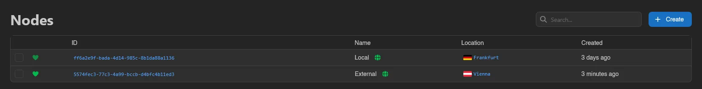

Select nodes with the checkboxes (the one in the table header selects the whole page), by dragging, or with `Ctrl+A` (`Escape` clears). An action bar appears with **Update Config**, which opens a YAML editor and applies the entered configuration to every selected node at once.

## Creating a Node

**Pair a Waiting Node** connects to an unconfigured Wings instance with the code from its logs and fills in detected resources. Use **Set Up Manually** to enter the fields yourself. See [Configuring a New Node](../../../wings/next-steps/configure-node.md) for both workflows.

Click **Create** in the top right (requires `nodes.create`). If no location exists yet, a create-location modal appears first.

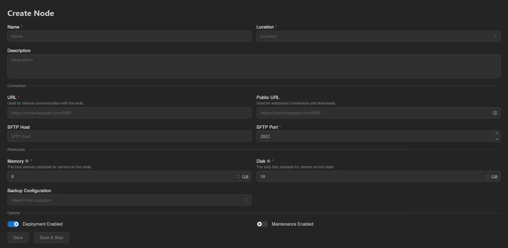

| Field | Description |
|---|---|
| **Name** | Required. A short, identifiable name. |
| **Location** | Required. The [location](./locations.md) this node belongs to. |
| **Description** | Optional notes. |

**Connection** section:

| Field | Description |
|---|---|
| **URL** | Required. "Used for internal communication with the node.", e.g. `https://node.example.com:8080`. If you leave the port off, a warning explains the panel will connect on the URL's implicit port instead of the wings default `8080`, with a one-click **Add :8080** button. |
| **Public URL** | Optional. "Used for websocket connections and downloads." by users' browsers. When editing, the globe button fills in a `wings-proxy` URL that routes browser traffic through the panel. |
| **SFTP Host** | Optional. Custom SFTP hostname shown to users; defaults to the URL's hostname. |
| **SFTP Port** | Required, default `2022`. |

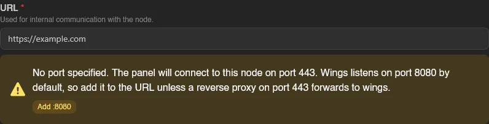

**Resources** section:

| Field | Description |
|---|---|
| **Memory** | Required, default 8 GiB. "The total memory available for servers on this node." `0` means no limit. |
| **Disk** | Required, default 10 GiB. "The total disk available for servers on this node." `0` means no limit. |
| **Backup Configuration** | Optional. Defaults to **Inherit from Location**. See [Backup Configurations](../../../wings/advanced/backup-configurations.md). |

**Options** section: **Deployment Enabled** (on by default) controls whether new servers can be deployed to this node. **Maintenance Enabled** (off by default) marks the node as under maintenance. New servers are not deployed to it while that is on, and users cannot interact with the servers it already hosts.

Hit **Save**, or **Save & Stay** to create another. These limits are what deployment checks, not the physical machine capacity, so setting them above the real hardware over-allocates the node.

## Overview

Two status badges up top: **Deployment Enabled** / **Deployment Disabled** and **Under Maintenance** / **Not Under Maintenance**.

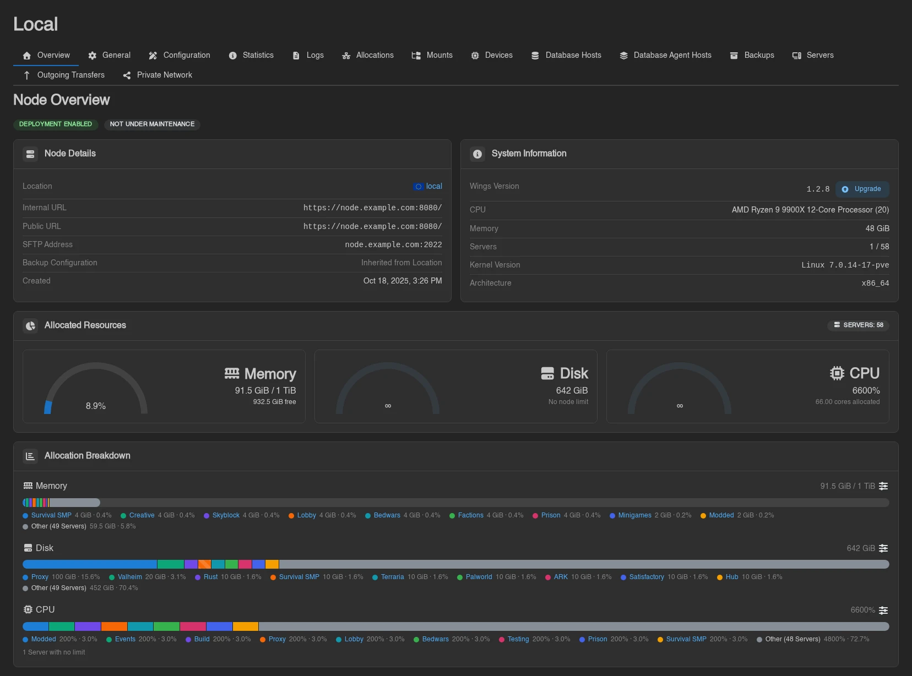

- **Node Details**: Location, Internal URL, Public URL, SFTP Address, Backup Configuration (shows **Inherited from Location** when the node has none of its own), Description, and Created.
- **System Information**: live data from wings - Wings Version (with an **Update Available** badge when outdated, **Latest Version Unknown** when the check failed, and an **Upgrade** button where wings can [upgrade itself](#upgrading-wings)), CPU model and core count, Memory, Servers (online / total), Kernel Version, and Architecture. Shows **Unavailable** when the node can't be reached.
- **Allocated Resources**: what servers on this node have been promised, with a **Servers** count. Memory and Disk show allocated / limit gauges with the free remainder (the gauge turns red at 90% and caps at 100% even when over-allocated); a limit of `0` shows **No node limit**. CPU is always uncapped and shows the total allocated percentage as "cores allocated". Reserved container memory overhead is listed separately.
- **Allocation Breakdown**: a stacked bar each for Memory, Disk and CPU showing which servers take up the allocation, largest first. Up to ten servers get their own colour and link to the server; with more, the top nine do and the rest are grouped as **Other**, suspended servers are striped, and **Memory Overhead** is its own segment. Servers with no limit for a resource are counted below its bar instead. The button next to each bar's total changes what it is measured against: **Configured Limit** (the default for memory and disk; CPU has no limit and defaults to **Allocated Total**), **Live Capacity** (what Wings reports for the machine, 100% per thread for CPU), **Allocated Total**, or a **Custom** value. The choice is saved to your account per node. A bar past its total shows how far it is **Overallocated**.

### Upgrading Wings

Since Panel 1.2.7, a node running Wings 1.2.7 or newer as a binary (a package or manual install, not a container) can be upgraded from the panel. The **Upgrade** button next to the Wings version needs the `nodes.upgrade` permission and only appears when Wings reports that it can upgrade itself. Containers, including the All-in-One image, never do; update those by pulling a new image, see [Updating Wings](../../../wings/updating.md).

The **Upgrade Wings** dialog names the repository and provider Wings downloads from. **Version** takes a release version such as `1.2.8`, or `latest` for the newest stable release, and is pre-filled with the latest version Wings found. Wings downloads the release, replaces its binary and restarts, so the node is unreachable for a few seconds; a **Restarting** badge shows until it comes back with a new version, for up to 90 seconds. The upgrade is recorded in admin activity as `node:upgrade`. Wings refuses an upgrade while servers are installing, restoring or transferring, or backups or file operations are running; see [Self-upgrades](../../../about/security.md#self-upgrades) for the full list of checks.

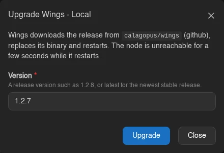

If the node's `config.yml` sets [`ignore_panel_wings_upgrades`](../../../wings/configuration.md#ignore-panel-wings-upgrades), Wings accepts the request but does nothing, and the panel says the node ignored the upgrade.

Where Wings can upgrade itself, the update check asks Wings about its own release source, which is what makes a fork's releases count as updates. Otherwise the panel compares the version with the latest official Calagopus release. A private fork, or a GitHub API rate limit, needs a [release token](./settings.md#updates).

## General

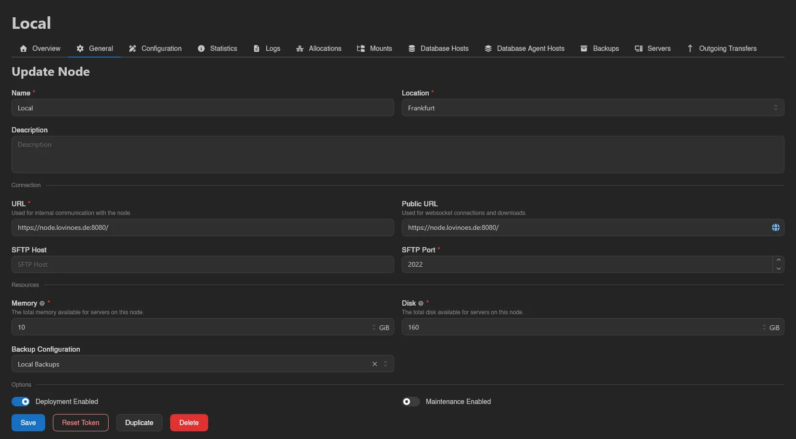

The same form as [creating a node](#creating-a-node), plus three extra buttons:

- **Reset Token** (requires `nodes.reset-token`): issues a new connection token. The wings config contains this token, so re-apply the configuration afterwards or the node loses contact.
- **Duplicate**: copies the node's settings under a new name.
- **Delete**: removes the node after confirmation.

Changing the node's **URL** also needs `nodes.read-token` since Panel 1.2.7, because the panel sends the node token to whatever that URL points at.

## Configuration

**Pair with Wings** accepts the code from an unconfigured Wings instance, or generates a single-use enrollment command that expires after 30 minutes. **Panel URL** overrides the address Wings uses to reach the Panel. Pairing needs `nodes.reset-token`; it is unavailable for All-in-One nodes. See the [pairing and enrollment guide](../../../wings/next-steps/configure-node.md).

Below that are the manual configuration tools needed to connect Wings to this node entry. These start collapsed behind **Reveal Configuration** because the output contains the node token (requires `nodes.read-token`). On an All-in-One node there is nothing to join, so **Initial Setup** is left out and the page opens straight on **Live Configuration**.

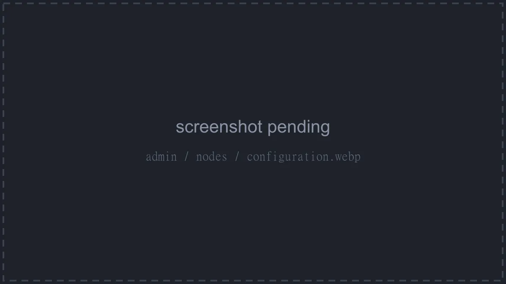

**Initial Setup** walks through three steps:

1. **Settings**: Panel URL ("The URL wings uses to reach this panel."), API Port ("The port wings listens on."), and SFTP Port. These generate the config below; a warning appears if the node URL's port doesn't match the API port.
2. **Apply Configuration**: the generated YAML to place into `/etc/calagopus-wings/config.yml`, or a copyable `calagopus-wings configure --join-data <...>` one-liner that does it for you.
3. **Verify Connection**: checks **Backend to Wings** (panel reaches the node) and **Frontend to Wings** (your browser reaches it; the console, downloads, and uploads depend on this one).

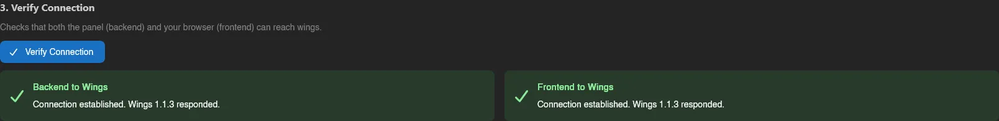

**Live Configuration** below edits the full `config.yml` of the running wings instance in a YAML editor. **Save Configuration** (or `Ctrl+S`) pushes it to the node. The editor lists options that cannot be changed from the web UI, and reports changes to those paths as ignored. Edit them on the Wings host instead; this includes `allowed_mounts` and `allowed_devices`. See the [Wings configuration reference](../../../wings/configuration.md) for every option. Leaving the page with unsaved edits in the editor asks you to confirm first. Without `nodes.read-token`, secrets in the config (the token, `remote_headers`, registry passwords, log driver options and restic environment variables) are shown censored. Since Panel 1.2.7 saving leaves censored values as they are on the node instead of overwriting them with the placeholder, and the `node:update-config` activity entry stores them censored.

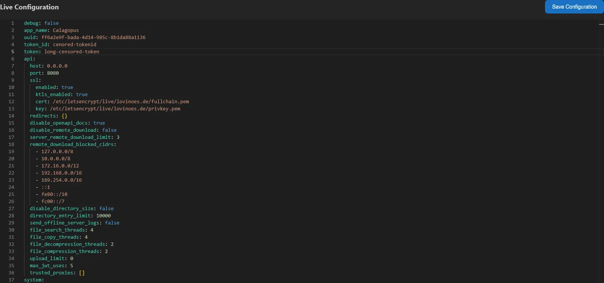

## Statistics

Live host metrics streamed from wings: CPU (model and threads), Memory (including how much wings itself uses), Disk, and Network gauges, followed by rolling **Graphs** for CPU Load, Memory Usage, Disk I/O (read/write), and Network Traffic (inbound/outbound).

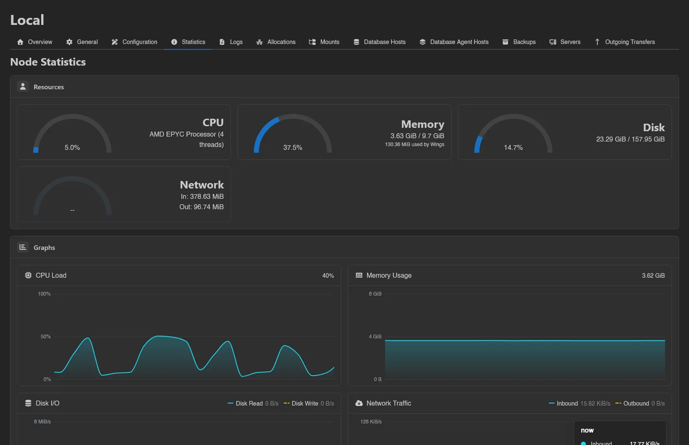

## Logs

Reads log files straight off the node. Pick a **Log File** (sizes shown in the dropdown), set **Lines** (default 1000), then **Load Logs** to view or **Download Full Log** to save it. The **Follow** switch tails the file live, with a connection indicator.

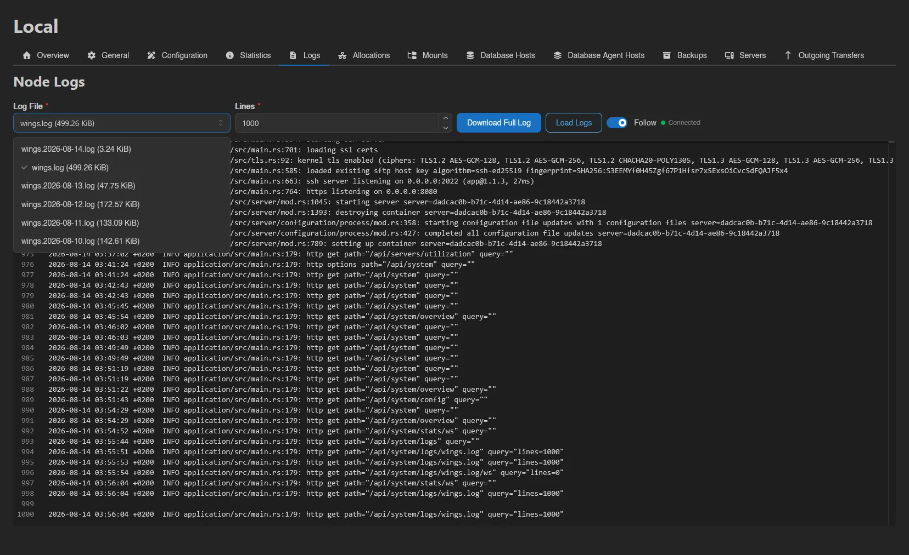

## Allocations

The node's IP:port pool that servers draw from (requires `nodes.allocations`). Columns: **ID**, **Server** (which server holds the allocation, if any), **IP**, **IP Alias**, **Port**, and **Created**. Filter by IP or port with the dropdowns next to the search box.

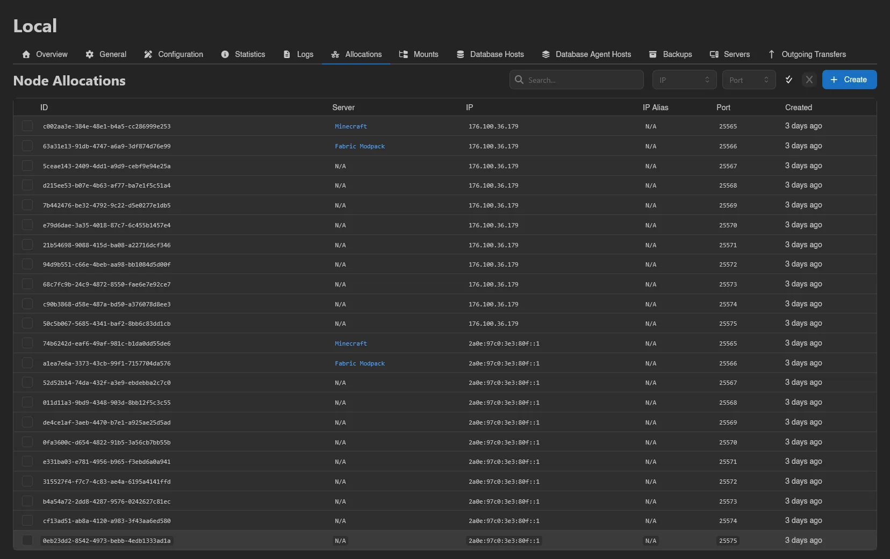

Click **Create** to bulk-create allocations: an **IP**, an optional **IP Alias**, and **Port Ranges** (single ports or ranges like `3000-4000`). The button shows how many allocations will be created.

The **IP** field suggests addresses as you type, in three groups: **All Addresses** (`0.0.0.0` and `::`), **Node Interfaces** (the addresses Wings finds on the host's network interfaces, leaving out loopback, link-local and Docker's own bridges), and **In Use** (IPs the node already has allocations on). The same field is used by **Update** and by the first-time setup's node step. Node interfaces need `nodes.read` and only appear when Wings runs directly on the host; a Wings running in a container reports none, even with host networking. You can still type any address.

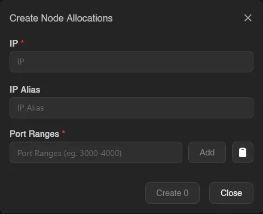

Select allocations (drag, checkboxes, or `Ctrl+A`) for the action bar: **Update** rewrites the IP or IP Alias of all selected at once, **Delete** removes them (also on the `Delete` key). See [Setting up Allocations](../../../wings/next-steps/setting-up-allocations.md) for guidance on choosing IPs.

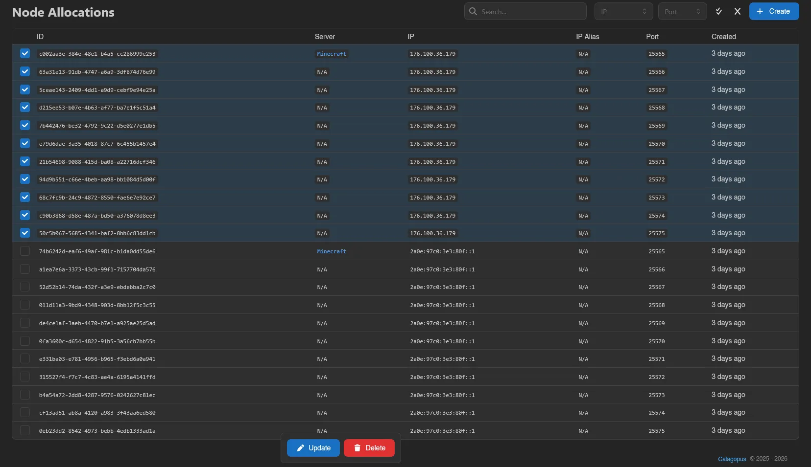

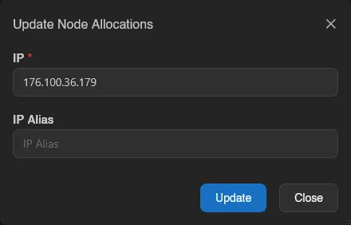

## Mounts

Which admin-defined [mounts](../server/mounts.md) are usable on this node (requires `nodes.mounts`). **Add** attaches an existing mount; removing a row only detaches it from the node. Wings must also allow the source path via [`allowed_mounts`](../../../wings/configuration.md#allowed-mounts).

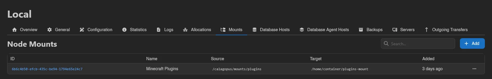

## Devices

The **Devices** tab assigns admin-defined [devices](./devices.md) to this node (requires `nodes.devices`). **Add** makes a device available here; removing it detaches its node assignment. The server's egg must also allow it, and Wings must allow its source in [`allowed_devices`](../../../wings/configuration.md#allowed-devices).

The mount and device assignment lists flag sources that are **Not Allowed on Node** by the node's configured allowlist. These checks compare paths only; see [mount feedback](./mounts.md#node-allowlist-feedback) and [device feedback](./devices.md#node-allowlist-feedback) for their limits.

## Database Hosts

Database hosts attached directly to this node (requires `nodes.database-hosts`). Servers on a node can use hosts attached to the node or to its location. **Add** attaches an existing host, deleting a row detaches it. See [Setting up Database Hosts](../../../additional/database-hosts/index.md).

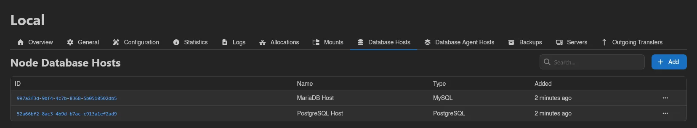

## Database Agent Hosts

Same attach/detach pattern for [database agent](../../../db-agent/index.md) hosts (requires `nodes.database-agent-hosts`).

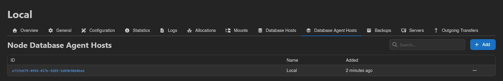

## Backups

Every backup stored on this node, regardless of which server it belongs to (requires `nodes.backups`).

| Column | Shows |
| --- | --- |
| **Kind** | Separates file archives from database dumps. |
| **Source** | Names either the server files or the instance a dump came from. |
| Name, Server, Checksum, Size, Files, Created | As on the server-level backups list. |

Restore, export to files, detach and reattach apply to file backups only; dumps get **Reassign** instead, which moves them to another database instance of the same type, optionally on a different server. The **Only show detached backups** switch filters to backups no longer linked to any server, and also decides which failed backups the button below clears. A warning icon marks backups whose server now lives on a different node; those aren't viewable from the client area.

When there are failed backups, a **Delete Failed** button appears above the table (requires `nodes.backups`), showing how many it would remove. It asks for confirmation, keeps locked backups and any whose configuration is in maintenance, and runs in the background. A **Force** switch removes them even when the configuration is missing or the remote storage is unreachable, at the risk of leaving orphaned files behind.

A backup whose deletion still fails after the panel's eight automatic attempts is marked as a failed deletion. Since Panel 1.2.8, when there are any, a **Retry Failed Deletions** button with their count sits next to it (requires `nodes.backups`). It skips backups whose configuration is in maintenance, runs in the background, and has the same **Force** switch. With **Only show detached backups** on, it only retries detached backups.

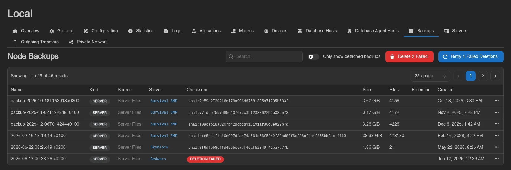

Right-click a backup for:

- **Download**, with a format submenu for streaming backups.
- **Restore**: pick a target server, optionally empty its filesystem first, and optionally restore the startup settings.
- **Export to Files**: unpack the backup into a server's filesystem at a destination directory, as an archive file.
- **Reattach** / **Detach**: link the backup to a server, or unlink it without deleting anything. Reattaching is not a transfer tool: unless the backup is on shared storage, the target server must be on the same node.
- **View Metadata**: the backup's raw metadata as JSON.
- **Delete**, with a **Force** switch that removes the backup even if its configuration is missing or the remote storage is unreachable (may leave orphaned files behind).

For the user-facing side, see [server Backups](../server/backups.md).

## Servers

All servers on the node, in the standard admin server list (ID, Status, Name, Node, Owner, Allocation, Created). The header buttons run mass actions against every server on the node, each with a count and a confirmation: **Start**, **Restart**, **Stop** (require `nodes.power`), and **Transfer** (requires `nodes.transfers`).

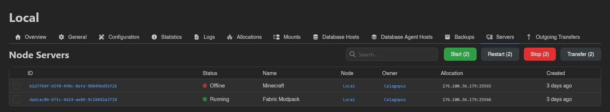

Select individual servers (checkboxes, drag, `Ctrl+A`, or click while holding `S`) to run the same actions on just the selection. The checkbox in the table header selects or clears every server on the current page.

**Transfer Servers** moves servers to another node:

| Field | Description |
|---|---|
| **Node** | The destination node. |
| **Allocation Mode** | How allocations map onto the destination node; the six modes are listed below. |
| **Transfer backups** | "Whether to transfer backups along with the servers." |
| **Delete source backups** | Deletes the transferred backups on the source node once the transfer finishes. |
| **Archive Format** / **Compression Level** | How the server data is packed for the move: `.tar` or `.itaf`, plain or compressed as `.gz`, `.xz`, `.lz`, `.bz2`, `.lz4`, or `.zst`; the level is **Best Speed**, **Good Speed**, **Good Compression**, or **Best Compression**. |
| **Multiplex Channels** | Extra parallel HTTP connections for split archives, 0 to 16. |

The six **Allocation Mode** options, with the caveats their dropdown entries state:

- **None**: scraps all allocations; the server is not automatically assigned new allocations on the destination node.
- **Randomize primary allocation**: removes additional allocations.
- **Randomize all allocations**: recommended to avoid incompatibility issues with the destination node.
- **Preserve port numbers** (the default): reuses the same port numbers on the destination node where available, falls back to random allocations otherwise.
- **Assign allocations based on Egg deployment configuration**: only works if an [egg configuration](./egg-configurations.md#allocation-configuration) with allocation settings applies to the egg on the destination node, and that node has compatible allocations. Configurations are matched against the destination node and its location, not the source.
- **Self-assign new allocations based on Egg port range**: only works if the egg has a port range and the destination node has compatible allocations.

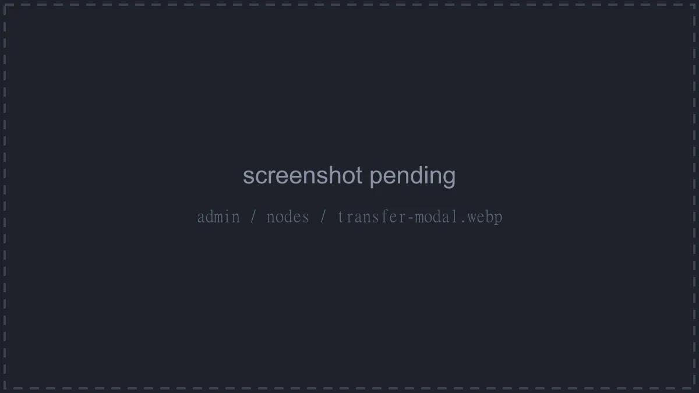

After confirming, you're taken to the **Outgoing Transfers** tab. Transfers cannot be undone.

## Outgoing Transfers

Live view of transfers currently leaving this node (requires `nodes.transfers`): ID, Progress, Archive Rate, Network Rate, Name, destination Node, Owner, and Created, updating in real time over a websocket.

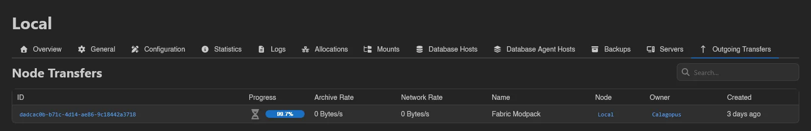

## Private Network

This tab puts the node on the **private network** (requires `nodes.tunnel`). Once it is on, the servers it hosts can join and be [connected privately](../server/network/connections.md) to servers on any other node that is also on the network: "Traffic goes node to node over an encrypted tunnel and never touches the public internet."

The tunnel daemon has to be turned on for the node first, and it is off by default on a standalone node: see [`tundra.enabled`](../../../wings/configuration.md#tundra-enabled). A fresh All-in-One install has it on already; an older one does not, and its **Configuration** tab is where you turn it on. **Host** defaults to the node URL's hostname, or the panel URL's on an All-in-One node, since its own URL is a loopback address. Three alerts cover the cases where the node cannot take part:

| Alert | Meaning |
| --- | --- |
| **Unreachable** | "The node could not be reached, so its side of the network could not be checked." |
| **Not supported** | "This node **cannot run the private network**. It is either turned off in the node configuration, or the node uses rootless Docker, which is unsupported." |
| **No certificate** | "This node has **not reported a certificate**, so no peer can open a connection to it. Restart the node's tunnel daemon to re-enrol it." Peers dial a node by its certificate, so until one is reported nothing can connect to it. |

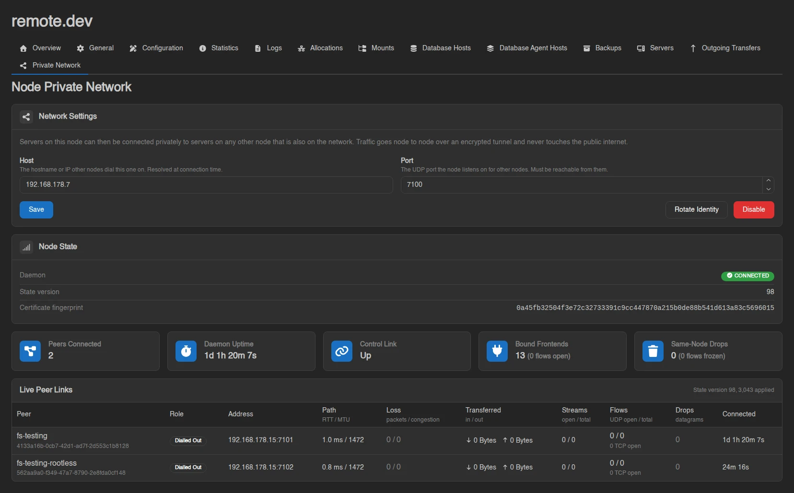

**Network Settings** holds the two fields peers need to find this node, and **Enable** puts it on the network:

| Field | Description |
|---|---|
| **Host** | "The hostname or IP other nodes dial this one on. Resolved at connection time." Defaults to the hostname from the node's URL. |
| **Port** | "The UDP port the node listens on for other nodes. Must be reachable from them." Default `7100`. It is a UDP port, not the wings API port. |

**Node State** below reports whether the daemon is **Connected**, the state version it is on, and the certificate fingerprint it enrolled with.

**Rotate Identity** replaces that certificate: "Peers sever their connections to this node immediately. It re-admits itself with a fresh certificate within a minute, and connections re-establish on their own."

**Disable** takes the node back off, and it is disruptive: "Every connection to and from the servers on this node is dropped, and those servers lose their private addresses."

### Live Peer Links

While the node is reachable, the page streams the daemon's own metrics over a websocket. Five tiles across the top give **Peers Connected**, **Daemon Uptime**, **Control Link**, **Bound Frontends** and **Same-Node Drops**.

Below them there's a row per peer node, with its **Role** (**Dialled Out** if this node opened the connection, **Accepted** if the peer did), its **Address**, and then: **Path** (RTT and MTU), **Loss**, **Transferred**, **Streams**, **Flows**, **Drops**, and how long it's been **Connected**.

::: info
All `nodes.*` admin permission keys are listed in the [Permissions Reference](../dashboard/permissions.md).
:::
