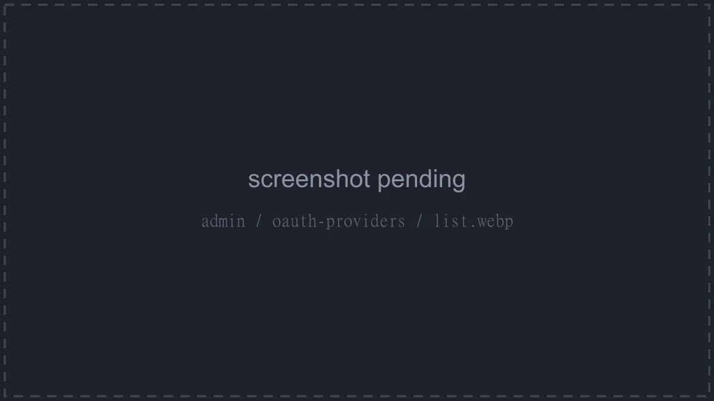
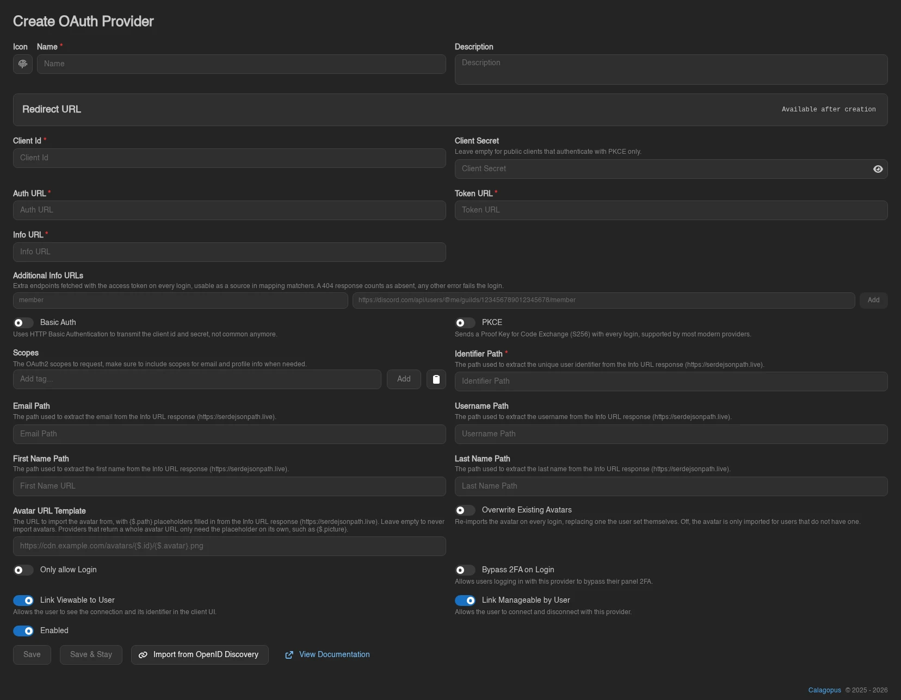
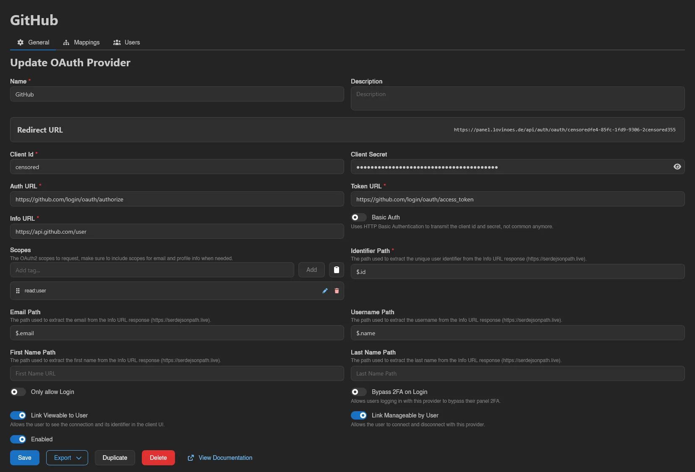
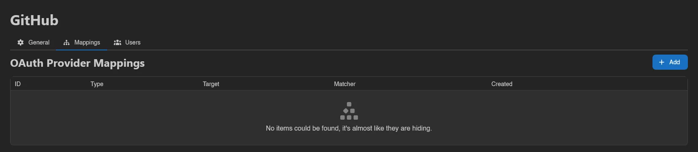
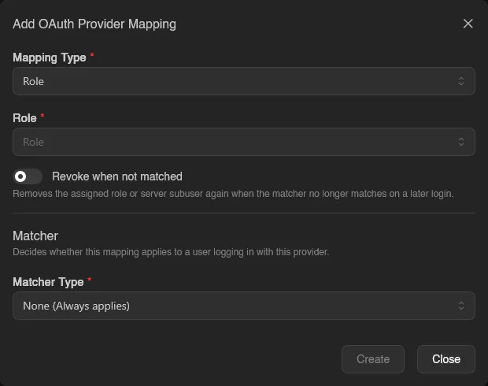
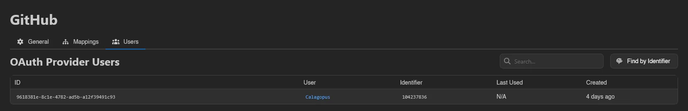

# OAuth Providers

**OAuth Providers** under **Users & Access** let users log in to the panel (and link their account) through an external OAuth2 service like Discord, GitHub, or Google. This page covers the admin UI; for step-by-step walkthroughs of registering the app on each provider's side, see [Setting up OAuth](../../../additional/setting-up-oauth/index.md).

The list shows ID, Name, Enabled, Login Only, Link Viewable, User Manageable (all Yes/No), and Created. The four flags come straight from the provider form:

| Flag | Meaning |
| --- | --- |
| **Enabled** | Whether the provider can be used at all. |
| **Login Only** (**Only allow Login**) | Users with an existing link can sign in, but signing in never registers a new panel account from the provider's profile. |
| **Link Viewable** (**Link Viewable to User**) | "Allows the user to see the connection and its identifier in the client UI." |
| **User Manageable** (**Link Manageable by User**) | "Allows the user to connect and disconnect with this provider." |

The last two control what users see on their own [OAuth Links](../dashboard/oauth-links.md) page.

## Creating a Provider

**Create** (requires `oauth-providers.create`) opens the form. Name and an optional description come first. The icon button next to **Name** picks the icon shown on the provider's **Login with** button, from the same Font Awesome picker as the [route editors](./egg-configurations.md#route-configuration); without one, the button keeps the default fingerprint icon. After those comes a **Redirect URL** card: it reads "Available after creation" until the provider exists, then shows `<panel URL>/api/auth/oauth/<uuid>`, the callback URL you register with the external provider. With [Additional URLs](./settings.md#additional-urls) configured, the card lists one redirect URL per address, and each address you want OAuth logins on needs its own registered with the provider.

| Field | Notes |
| --- | --- |
| **Client Id** | Required. The client id from the external provider's app registration. |
| **Client Secret** | The client secret from the same registration. Leave it empty for a public client that only authenticates with PKCE. |
| **Auth URL** / **Token URL** / **Info URL** | Required. The provider's authorization, token, and user-info endpoints. |
| **Additional Info URLs** | Optional. Extra endpoints, each under a key, fetched with the user's access token on every login so [mapping matchers](#matchers) can read them. See [Additional Info URLs](#additional-info-urls). |
| **Basic Auth** | "Uses HTTP Basic Authentication to transmit the client id and secret, not common anymore." |
| **PKCE** | "Sends a Proof Key for Code Exchange (S256) with every login, supported by most modern providers." Off by default. Turn it on when the provider supports it. Public clients without a client secret usually need it. |
| **Scopes** | "The OAuth2 scopes to request, make sure to include scopes for email and profile info when needed." |
| **Identifier Path** | Required. Extracts the unique user identifier from the Info URL response. |
| **Email Path** / **Username Path** / **First Name Path** / **Last Name Path** | Optional paths for profile fields, used to fill in accounts registered through this provider. |
| **Avatar URL Template** / **Overwrite Existing Avatars** | Optional. Import the user's profile picture from the provider, see [Avatars](#avatars). |
| **Only allow Login** / **Bypass 2FA on Login** / **Link Viewable to User** / **Linkable with API Keys** / **Link Manageable by User** / **Enabled** | The behavior switches; **Only allow Login**, **Link Viewable to User**, **Link Manageable by User** and **Enabled** are [explained above](#oauth-providers). |

The path fields use JSONPath syntax (see [serdejsonpath.live](https://serdejsonpath.live)) evaluated against the Info URL response. They never read the additional info URLs.

On every login the Panel fetches the Info URL with the user's access token. The request times out after 10 seconds and the response may be at most 1 MiB. Any error, a 404 included, fails the login with "failed to fetch oauth user info".

::: warning
**Bypass 2FA on Login** "Allows users logging in with this provider to bypass their panel 2FA." Only enable it when the provider enforces equivalent security itself.
:::

**Linkable with API Keys** lets a billing integration such as [Paymenter](../../../integrations/paymenter.md) link its customers to this provider with an API key. Anyone who controls the provider's identifiers can sign in as every linked account, so only turn it on for a provider you trust the integration to assign identifiers for.

Finish with **Save** (or **Save & Stay** when creating). An existing provider also offers **Export** (as JSON or YAML), **Duplicate**, **Delete**, and a **View Documentation** shortcut to the setup guides.

While **Enable Password Login** is off in [Settings](./settings.md#application), the panel refuses to delete or disable the last enabled provider, since nobody without a security key would be able to sign in afterwards. Turn password login back on first if that is what you want.

### Additional Info URLs

Some providers keep useful data behind endpoints other than the user-info one, Discord's guild membership being the usual example. **Additional Info URLs** lets you list up to 8 of them as key and URL pairs. Keys are 1 to 64 characters of letters, digits, `_`, or `-`, and each URL must be an `http` or `https` URL of at most 2048 characters.

The Panel fetches all of them in parallel with the Info URL on every login, using the same access token, timeout, and size limit. A URL that answers 404 counts as absent, so a matcher reading it simply does not match. Any other error fails the login with "failed to fetch additional oauth user info (key)", rather than letting a temporary outage revoke mappings the user should keep.

The responses are only used by [mapping matchers](#matchers), through their **Source** field. Identifier, profile paths, and the avatar template still read the main Info URL.

For example, to grant a role to members of one Discord server, add the `guilds.members.read` scope, add an info URL with the key `member` and the URL `https://discord.com/api/users/@me/guilds/123456789012345678/member` (your server's ID in place of the number), and create a mapping with a **Field Exists** matcher on source `member` and path `$.joined_at`. Discord answers 404 for users outside the server, so the mapping only applies to members. With **Revoke when not matched** on, leaving the server removes the role on the next login.

## Import from OpenID Discovery

On the creation page, **Import from OpenID Discovery** fills the form from a provider's discovery document. Enter its issuer/base URL, such as `https://auth.example.com/realms/example`, or the complete URL ending in `/.well-known/openid-configuration`.

The import fills endpoints, scopes, profile paths, and supported authentication options. It enables PKCE automatically when the document advertises `S256`. A UserInfo endpoint is required: the Panel reads the profile from that endpoint and does not use an ID token in its place.

Review the result, supply your **Client Id** and **Client Secret** where required, and save the provider. Discovery does not create a provider by itself or keep its settings synchronized later. Claims and scopes are taken from the document when listed; when those lists are absent, the form uses common OIDC defaults. Check that your provider actually returns every configured profile field, especially email and username.

Discovery requests follow [`APP_BLOCKED_CIDRS`](../../environment.md#app-blocked-cidrs), which blocks private and loopback addresses by default. A provider reachable from your browser may still be blocked from the Panel host.

## Avatars

**Avatar URL Template** pulls the user's profile picture from the provider. Leave it empty and the panel never touches avatars. Fill it in and every login or link through the provider imports the picture it points at. The download runs in the background, so a slow or unreachable image host never holds up the login.

The template is a URL with `{...}` placeholders, each holding a JSONPath into the Info URL response. What happens to a resolved value depends on where its placeholder sits:

- A template that is *only* a placeholder, such as `{$.picture}`, is used verbatim. This is what most OIDC providers need, because the profile response already carries the full image URL.
- Anywhere else the placeholder stands for one path or query component and its value is percent-encoded, so a provider cannot smuggle a different URL into the rest of the template. Discord, which hands back an id and an avatar hash instead of a URL, needs `https://cdn.discordapp.com/avatars/{$.id}/{$.avatar}.png`.

That second rule catches people out when they try to tack something onto a whole-URL placeholder. `{$.picture}?size=512` is no longer a lone placeholder, so the entire picture URL gets percent-encoded into the path of a URL that goes nowhere. Either use the placeholder alone, or spell the whole URL out around the pieces the provider gives you.

A placeholder that resolves to nothing (missing, `null`, or an empty string) means "this user has no avatar" and quietly skips the import. A template that resolves to something other than an `http` or `https` URL is an error instead: the login still goes through, but the panel logs a warning and the user keeps whatever avatar they had.

The download goes through [`APP_BLOCKED_CIDRS`](../../environment.md#app-blocked-cidrs), so an avatar on a private or loopback address is refused by default.

The download accepts the same formats as an upload, PNG, JPEG, WebP, or GIF, and ends up as the same 512x512 WebP, but the limits around it are its own: at most 8 MB and 2048 pixels on either side, with no minimum size.

**Overwrite Existing Avatars** decides who gets one. Off, the import only runs for users who have no avatar at all, leaving anything they uploaded themselves alone. On, it runs every time and replaces theirs, though a picture whose URL has not changed since the last import is recognised and not downloaded again. [Frozen](./users.md) accounts are skipped either way.

## Import

Next to **Create**, **Import** (requires `oauth-providers.create`) accepts a provider definition as a `.json`, `.yml`, or `.yaml` file, either through the file picker or by dragging the file anywhere onto the list. This is the counterpart of **Export**: it recreates the whole provider configuration, endpoints, paths, scopes, and flags included.

::: info
Exports never contain the client credentials. An imported provider comes in with **Client Id** set to the placeholder `example` and an empty **Client Secret**. Open it and set the real values before pointing users at it.
:::

## Mappings

The **Mappings** tab automates access: whenever a user logs in through this provider, every mapping whose matcher applies takes effect. Adding one requires `oauth-providers.update`; the table shows ID, Type, Target, Matcher, and Created.

**Add** opens the mapping form:

- **Mapping Type** decides what is granted:
  - **Role** assigns a panel [role](./roles.md); pick the **Role**.
  - **Server Subuser** adds the user as a [subuser](../server/subusers.md); pick the **Server**, the subuser **Permissions**, and optionally **Ignored Files**.
- **Revoke when not matched**: "Removes the assigned role or server subuser again when the matcher no longer matches on a later login", handy for mirroring, say, a Discord role into a panel role.

::: info
You cannot create a mapping that grants more than you hold yourself. A mapping whose role or subuser permissions exceed your own is rejected with `permissions: more permissions than self`. The same guard applies when editing a role that already grants permissions you lack. Through an API key, "what you hold" is also limited to the key's own permissions.

Since Panel 1.2.7, some changes need a root admin signed in to the panel; an API key, even a root admin's, is refused. That covers creating a provider with **Bypass 2FA on Login**, and changing an existing provider's Client Id, Auth URL, Token URL, Info URL, Additional Info URLs, Scopes, Identifier Path, **Only allow Login**, **Bypass 2FA on Login** or **Link Manageable by User** ("only administrators can change how an oauth provider identifies users, how they may sign in with it or who may link accounts to it"). Creating or duplicating a provider with **Linkable with API Keys** on, or switching it on or off, is limited the same way ("only administrators can create an oauth provider that api keys may link accounts to"). Linking an OAuth identity to someone else's account from the admin area is likewise limited to root admins in a session; anyone else can only link their own account, also from a session. From Panel 1.2.8 there is one exception, for integrations such as [Paymenter](../../../integrations/paymenter.md): an API key holding `users.oauth-links` and `users.impersonate` may link identities through a provider with **Linkable with API Keys** on, but only to accounts it could impersonate, so never to admins or to roles with permissions the key lacks.
:::

### Matchers

The **Matcher** decides whether the mapping applies to a login. Pick a **Matcher Type**:

| Matcher Type | Applies when | Fields |
| --- | --- | --- |
| **None (Always applies)** | Every login through this provider | none |
| **Never (Applies to nothing)** | No login at all | none |
| **AND (All must match)** | Every nested matcher applies | nested matchers |
| **OR (Any must match)** | At least one nested matcher applies | nested matchers |
| **NOT (Must not match)** | Its nested matcher does not apply | one nested matcher |
| **Granted Scopes** | The login granted the listed OAuth scopes | **Scopes** |
| **Field Exists** | The profile response contains the field | **Source**, **Field Path** |
| **Field Equals** | The field equals the value | **Source**, **Field Path**, value |
| **Field Contains** | The field contains the value | **Source**, **Field Path**, value |
| **Field Starts With** | The field starts with the value | **Source**, **Field Path**, value |
| **Field Ends With** | The field ends with the value | **Source**, **Field Path**, value |

**AND**, **OR**, and **NOT** nest further matchers, so conditions can be combined freely. Field paths use the same JSONPath syntax as the provider's profile paths.

The **Source** select only shows up once the provider has [Additional Info URLs](#additional-info-urls). It picks which response the path is evaluated against: **Info URL** (the default) or one of the additional keys. A source that answered 404 on this login never matches.

## Users

The **Users** tab (requires `oauth-providers.read`) lists every account linked to this provider: ID, User, Identifier, Last Used, and Created. **Find by Identifier** looks up which panel user owns a given provider-side identifier, useful when all you have is, for example, a Discord user ID.

