# Settings

Everything panel-wide that isn't its own admin page lives under `/admin/settings`, split into twelve category tabs. Saving any category requires the `settings.update` permission.

Unsaved changes stay in the form while you switch between settings tabs. Leaving settings with a draft prompts you to confirm. These drafts live only in the current page session; save each tab to keep its changes after a reload.

::: info
The **Application** tab has an **Advanced mode** toggle in the top right. It reveals the fields marked *advanced* below, and the preference is saved to your account, so it follows you to other devices.
:::

## Application

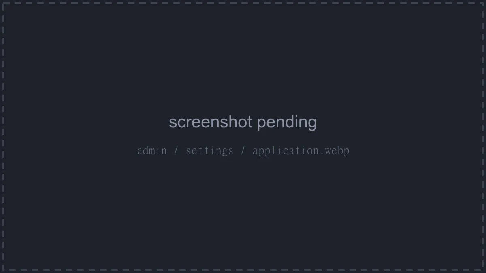

The tab is split into **General**, **Branding**, **Authentication**, **Sessions** (shown in advanced mode only), and **Telemetry** sections, in the order of the table below.

| Field | Description |
| --- | --- |
| **Name** | The name of this panel installation |
| **Language** | The panel's default language |
| **URL** | The public URL of the panel |
| **Additional URLs** | Other addresses the panel is also reachable at, up to 32 (*advanced*). See [Additional URLs](#additional-urls) |
| **Icon** | URL of the panel icon; suggests files uploaded under [Assets](./assets.md) |
| **Icon (Light Mode)** | Optional separate icon for light mode (*advanced*) |
| **Banner** | Optional banner image URL, also suggested from Assets |
| **Banner (Light Mode)** | Optional separate banner for light mode (*advanced*) |
| **Two-Factor Authentication Requirement** | Who must enable 2FA: **Admins**, **All Users**, or **None**. Affected users without 2FA are blocked from everything except setting it up and logging out |
| **Accepted Two-Factor Methods** | Which enrolled factors satisfy the requirement above: **TOTP**, **Security Key**, and/or **Email**. Defaults to TOTP and security keys. Since Panel 1.2.7, a user who is required to use two-factor and has an accepted factor is only offered accepted factors at login, so an email code can't stand in for TOTP when Email isn't accepted |
| **Email Two-Factor** | Let users receive a one-time login code by email as a second factor. Requires a mail transport |
| **Require Email Verification** | New accounts must open a verification link before they can use the panel, including SFTP and SSH. Requires a mail transport |
| **Enable Registration** | Let anyone create an account on this panel |
| **Enable Password Login** | Let users sign in with a username and password. Turning it off leaves OAuth providers and security keys as the only way in |
| **Session Cookie** | Name of the session cookie (*advanced*) |
| **Session Duration (seconds)** | How long login sessions last (*advanced*) |
| **Enable Telemetry** | Allow Calagopus to collect limited and anonymous usage data to help improve the application. [What is collected and published](/docs/about/telemetry) |

**Preview Telemetry** (requires `stats.read`) shows the payload your panel would send, so you can judge for yourself. The receiving server adds two fields the panel does not send, so they are not in the preview: the country the submission arrived from, and its arrival time. [Telemetry](/docs/about/telemetry) covers both, and what gets published. Disabling telemetry asks for confirmation.

Enabling registration also asks for confirmation and points out that doing it without a [captcha](#captcha) configured may be a mistake.

Turning **Enable Password Login** off asks for confirmation too, because it reaches further than the login page. With it off, local registration, the forgot-password flow and SFTP password authentication all stop working as well, subusers can only be added by the email of an existing account (since Panel 1.2.8), and everyone needs an [OAuth provider](/docs/panel/features/admin/oauth-providers) or a [security key](/docs/panel/features/dashboard/account#security-keys) to get in.

Public key authentication over SFTP keeps working. The per-account **Password Login** switch disappears while the panel-wide one is off, since there's nothing left for it to decide.

Four combinations are rejected when you save, with an error rather than a silent fix:

- *"at least one two-factor method must be accepted while two-factor is required"* - you cleared **Accepted Two-Factor Methods** while the requirement is anything other than None.
- *"email two-factor and email verification require a mail transport to be configured"* - one of the two email options is on while [Mail](#mail) is set to no transport.
- *"an enabled oauth provider is required before password login can be disabled"* - there is nothing left to sign in with, so turning off **Enable Password Login** would lock out the whole panel.
- *"a link to an enabled oauth provider or a security key is required before password login can be disabled"* - the panel has a way in, but **you** do not. Link your own account first, or register a security key.

### Additional URLs

A panel served under more than one address, say a public domain and a LAN address, lists the extra ones here. **URL** stays the main address. For each request the panel looks at the host it came in on, and if it matches one of the configured URLs (host and port), it uses that URL instead of the main one for:

- the session cookie's `Secure` flag, so an `http://` LAN address can log in next to an `https://` main URL,
- OAuth redirects, so a login started on one address comes back to it,
- links in the emails users trigger themselves: verification, password reset and email change,
- console WebSocket, download and upload links for a node that runs through the panel's `/wings-proxy`.

Links in emails the Panel sends on its own, avatars, and other files kept in [filesystem storage](#storage) use the main **URL**. Browsers on an additional address must be able to reach it. [Pairing and enrollment](../../../wings/next-steps/configure-node.md#use-an-enrollment-command) use the configured Panel URL matching the request host, unless you supply an explicit **Panel URL** override. A host that matches nothing falls back to the main URL, so a spoofed `Host` header cannot inject an unconfigured address. Behind a reverse proxy, the Panel reads `X-Forwarded-Host` only from addresses listed in [`APP_TRUSTED_PROXIES`](../../environment.md#app-trusted-proxies).

Trailing slashes are stripped and duplicates of the main URL are dropped on save. Two more things need setting up per address: every URL needs its own redirect URL registered with each [OAuth provider](./oauth-providers.md) (the provider page lists one per configured URL), and [security keys](#webauthn) only work on addresses under the **RP Id**.

## Metadata

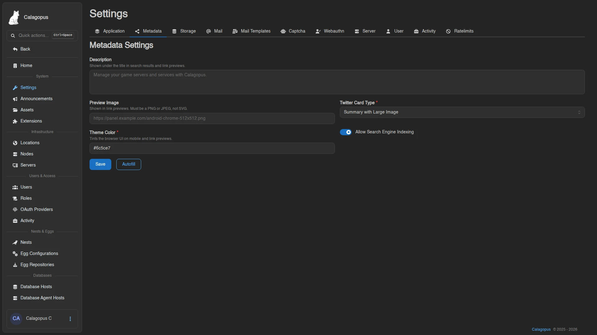

Controls the `<head>` of the panel's own page: what search engines record and what a link to your panel looks like when it is pasted into Discord, Slack, or a social app. These values are rendered into the HTML the panel serves, so they apply before anyone logs in.

| Field | Description |
| --- | --- |
| **Description** | Shown under the title in search results and link previews. Left empty it falls back to "Manage your game servers and services with *name*." |
| **Preview Image** | The image shown in link previews (`og:image`). Suggests files uploaded under [Assets](./assets.md). Must be a PNG or JPEG, **not** an SVG, since most preview scrapers refuse SVG. A bare path is resolved against the panel **URL**; a full `http(s)://` address is used as is. Empty falls back to the panel's `android-chrome-512x512.png` |
| **Twitter Card Type** | **Summary** for a small square thumbnail, or **Summary with Large Image** for a full-width banner |
| **Theme Color** | Hex color that tints the browser UI on mobile and the accent bar on some link previews. Defaults to `#6c5ce7` |
| **Allow Search Engine Indexing** | On sends `robots: index, follow`; off sends `noindex, nofollow` |

**Autofill** fills **Description** and **Preview Image** with the defaults described above, which is the quickest way back to a working starting point.

::: info
`noindex` is a request, not an access control. It asks well-behaved crawlers to stay out; it does not hide the panel. Keep a private panel behind real authentication rather than relying on this switch.
:::

## Storage

Where the panel stores uploaded files such as profile pictures and admin assets. Pick a **Driver**:

- **Filesystem**: a single **Path** on the panel's disk.
- **S3**: **Access Key**, **Secret Key**, **Bucket**, **Region**, **Public URL**, **Endpoint**, and a **Using path-style URLs** toggle. The `assets/`, `avatars/`, and `publicdata/` subdirectories must be publicly accessible over the **Public URL**; that's where admin assets, user avatars, and extension public data are served from. Avatars are uploaded with `Cache-Control: public, max-age=31536000, immutable`, since every avatar path is unique to its content. If you put a CDN in front of the bucket, let it pass that header through.

::: warning
Changing the driver makes the panel look for existing assets in the new location. Move them over manually, or they'll turn up missing.
:::

## Mail

How the panel sends email. Pick a **Provider**:

| Provider | Fields |
| --- | --- |
| **None** | Outgoing email disabled |
| **SMTP** | **Host**, **Port**, **TLS Mode** (**None**, **STARTTLS**, or **Implicit TLS**), **Skip Certificate Validation**, **HELO/EHLO Domain**, **Username**, **Password**, **From Address**, **From Name** |
| **Sendmail Command** | **Command**, **From Address**, **From Name** |
| **Filesystem** | **Path**, **From Address**, **From Name**; writes messages to files under the path instead of sending them |

**HELO/EHLO Domain** is the name the panel announces itself with when it opens the SMTP connection. Left empty it sends `[127.0.0.1]`, which providers like Google Workspace reject; set it to the panel's own domain in that case.

**Send Test Email** opens a small modal, prefilled with your own address, to verify the configuration actually delivers. While the saved provider is **None** the button stays disabled with the tooltip "Save an email provider before sending a test email.", so save the new provider first.

## Mail Templates

The emails the panel sends, editable per template. The tab requires `email-templates.read`; saving requires `email-templates.update`.

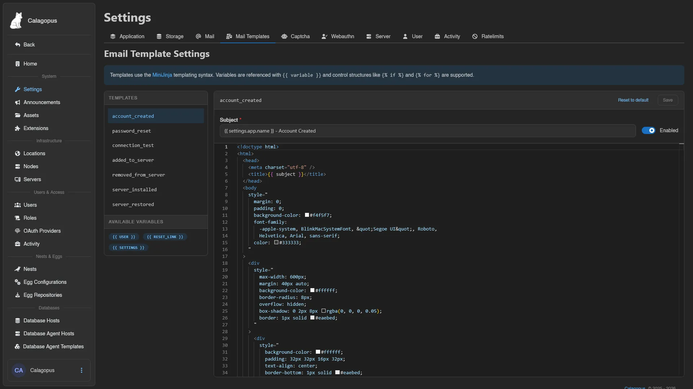

Pick a template from the **Templates** sidebar to edit its **Subject**, an **Enabled** toggle, and the HTML content in the editor. The built-in templates cover account creation, password resets, email verification, login codes for email two-factor, the connection test, being added to or removed from a server, and server installs and restores.

The **Available Variables** box lists everything you can reference in that template. Templates use the [MiniJinja](https://github.com/mitsuhiko/minijinja) syntax: variables as <code v-pre>{{ variable }}</code>, control structures like `` and ``.

**Reset to default** discards your custom template and restores the built-in one. This cannot be undone.

### Variables and Languages

Every user receives mail in the language set on their account. Addresses that do not belong to a user get the panel's default language. A template has one layout for all of them: the wording lives in **Variables**, small text fragments the template references as <code v-pre>{{ vars.name }}</code>, and each variable can carry a value per language.

The **Variables** section below the subject lists the fragments a template uses. Built-in templates ship with **System** variables such as `greeting`, `intro`, `button` and `footer`, with translations maintained alongside the panel's own. Pick a language from the selector on a variable to see and edit its value for that language. An empty field uses the default shown inside it, so you only have to fill in what you want to change.

When a user's language has no value of its own, the panel uses your English value if you set one, then the built-in translation for that language, then the built-in English text. So once you customise a variable in English, every language without its own value gets that English wording. Fill in the other languages you serve.

A variable's value is itself a MiniJinja snippet and can use the same variables as the template, for example <code v-pre>Hello <strong>{{ user.username }}</strong>,</code>. The rendered fragment is inserted into the template as is, so HTML inside a variable works, while values like <code v-pre>{{ user.username }}</code> inside it are escaped. The subject is rendered as plain text, so keep HTML out of variables you use there.

**Add Variable** creates a **Custom** variable for the current template, which you can reference from the template's content or subject. Use the reset icon on a system variable to drop your values for every language, and the delete icon to remove a custom one.

**Global Variables** in the sidebar holds variables that every template can reference, handy for a shared signature or support address. A template variable with the same name takes precedence over a global one.

The `language` variable holds the language code a mail is rendered in, which the built-in templates put on the `<html>` tag.

## Captcha

Captcha protection for the panel; set this up before you [enable registration](#application). When configured, the captcha renders on the [login, register, and forgot-password pages](../auth/index.md) and in the server [subuser invite modal](../server/subusers.md). Pick a **Provider**:

| Provider | Fields |
| --- | --- |
| **None** | No captcha |
| **Turnstile** | **Site Key**, **Secret Key** |
| **reCAPTCHA** | **Site Key**, **Secret Key**, a **V3** toggle, and **Score threshold** when V3 is on |
| **hCaptcha** | **Site Key**, **Secret Key** |
| **Friendly Captcha** | **Site Key**, **API Key** |
| **Cap** | **Instance URL**, **Site Key**, **Secret Key** |

For **Cap**, enter the **Instance URL** of your Cap server, such as `https://cap.example.com`, and its site and secret keys. The URL must use HTTP or HTTPS and cannot contain embedded credentials, a query string, or a fragment.

Both sides talk to the Cap instance directly. The widget in the visitor's browser calls `{Instance URL}/{Site Key}/`, and the Panel verifies each solution by posting to `{Instance URL}/{Site Key}/siteverify`. The instance therefore has to be reachable from your users' browsers and from the Panel host. The Panel's verification request does not go through [`APP_BLOCKED_CIDRS`](../../environment.md#app-blocked-cidrs), so an instance on your LAN works as long as browsers can reach it too. The Panel adjusts its Content Security Policy for Cap on its own (`'wasm-unsafe-eval'` and a per-request script nonce), so there is nothing to add to a reverse proxy.

For **reCAPTCHA V3**, **Score threshold** is the minimum accepted score, from `0` to `1`, with a default of `0.5`. Scores below it are rejected; increasing it makes the check stricter. It does not affect reCAPTCHA V2.

## Webauthn

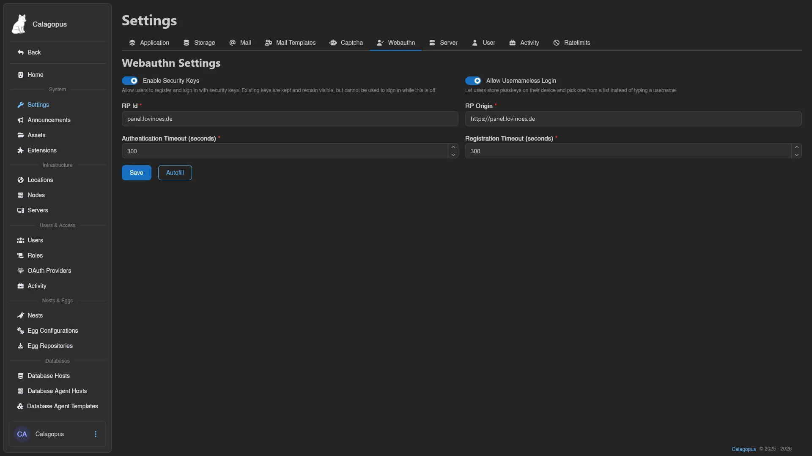

The settings behind [Security Keys](../dashboard/security-keys.md) and the login page's [passkey options](../auth/login.md#sign-in-with-a-passkey).

| Field | Description |
| --- | --- |
| **Enable Security Keys** | Allow users to register and sign in with security keys. Existing keys are kept and remain visible, but can't be used to sign in while this is off |
| **Allow Usernameless Login** | Let users store passkeys on their device and pick one from a list instead of typing a username |
| **RP Id** | The WebAuthn relying party ID |
| **RP Origin** | The WebAuthn relying party origin |
| **Authentication Timeout (seconds)** | How long a sign-in prompt waits before giving up |
| **Registration Timeout (seconds)** | How long a registration prompt waits before giving up |

**Autofill** fills **RP Id** and **RP Origin** from the panel's own address. It refuses to run when the panel is served from a bare IP address, since WebAuthn doesn't work there.

::: warning
Changing the **RP Id** breaks all existing WebAuthn credentials and forces users to re-register their devices.
:::

## Server

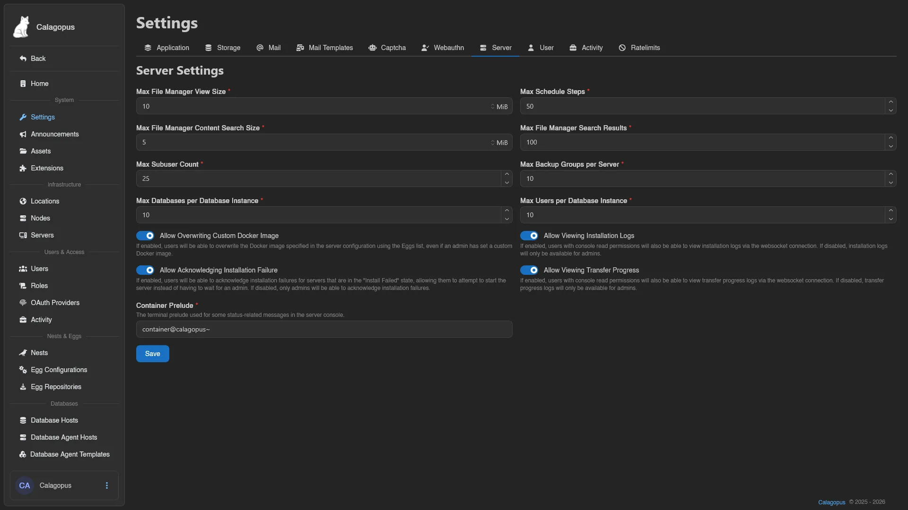

Limits and behavior toggles that apply to all servers on the panel, split into **File Manager**, **Limits**, **Networking**, **Database Instances**, **Console & Lifecycle**, and **Trash** sections.

| Field | Description |
| --- | --- |
| **Max File Manager View Size** | Largest file the file manager will open |
| **Max File Manager Content Search Size** | Largest file the file-content search will look inside |
| **Max File Manager Search Results** | Cap on results returned by a file search |
| **Max Subuser Count** | Maximum subusers per server |
| **Max Schedule Steps** | Maximum number of steps per schedule |
| **Max Backup Groups per Server** | Maximum backup groups each server can have |
| **Max Firewall Rules** | Maximum [firewall](../server/network/firewall.md) rules per server |
| **Max Firewall Rule Sources** | Maximum sources a single firewall rule may list |
| **Max Private Connections per Server** | Maximum [private network](../server/network/connections.md) connections a server may open to other servers |
| **Max Private Ports per Server** | Maximum ports a server may offer to the servers connected to it privately |
| **Max Databases per Database Instance** | Database cap per managed database instance |
| **Max Users per Database Instance** | User cap per managed database instance |
| **Allow Overwriting Custom Docker Image** | Users can pick a different Docker image from the Eggs list even when an admin has set a custom image |
| **Allow Viewing Installation Logs** | Users with console read permission can watch installation logs; otherwise they're admin-only |
| **Allow Acknowledging Installation Failure** | Users can acknowledge a failed install and try starting the server instead of waiting for an admin |
| **Allow Viewing Transfer Progress** | Users with console read permission can watch transfer progress logs; otherwise they're admin-only |
| **Container Prelude** | The terminal prelude used for some status-related messages in the server console |
| **Trash Retention** | How long deleted files stay in a server's [trash](../server/files.md#trash), in days. Defaults to 7; 0 turns the trash off |
| **Clear Trash at Disk Usage** | Percentage of a server's disk limit at which the oldest trash entries are removed. Defaults to 90; 0 only clears the trash when a write would exceed the limit |
| **Allow Changing Trash Settings** | Users with the `settings.trash` permission can give their server its own trash settings. On by default |

The database instance limits apply to [managed databases](../../../db-agent/index.md) created through database agent hosts.

### Trash

The two trash values are defaults for every server that has no trash settings of its own. A server gets its own values from its [Settings](../server/settings.md#trash) page, or from the admin [Management](./servers.md#trash) tab, which works even with **Allow Changing Trash Settings** off. Turning that switch off hides the card from users but leaves custom values that were already saved in place.

Files in the trash count towards the server's disk limit, and Wings clears them as described under [Storage and Expiry](../server/files.md#storage-and-expiry). Saving these settings does not sync servers to Wings. The Panel decides whether a delete goes to the trash from the new defaults, but Wings keeps the old values until it loads that server's configuration again. After raising the default retention from 0, **Move to Trash** fails with `trash is disabled for this server` on every server still using the defaults. Restart Wings, or sync each affected server, for example by saving its trash card on the server's Settings page. Changing a single server's trash settings applies right away.

## User

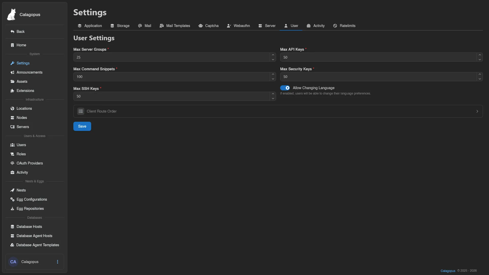

Per-account limits for [Dashboard](../dashboard/index.md) features, followed by a **Permissions** section with what users may change about their own account.

| Field | Description |
| --- | --- |
| **Max Server Groups** | Cap on [server groups](../dashboard/servers.md) per user |
| **Max API Keys** | Cap on [API keys](../dashboard/api-keys.md) per user |
| **Max Command Snippets** | Cap on [command snippets](../dashboard/command-snippets.md) per user |
| **Max Security Keys** | Cap on [security keys](../dashboard/security-keys.md) per user |
| **Max SSH Keys** | Cap on [SSH keys](../dashboard/ssh-keys.md) per user |
| **Max Synced Settings** | Cap on how many settings an account may sync across devices |
| **Max Synced Setting Size (bytes)** | Largest value a single synced setting may hold |
| **Allow Changing Language** | If enabled, users can change their language preferences. The login, register, and other auth pages then show a language picker when more than one language is available, and a first-time visitor gets the closest match to their browser languages, falling back to the panel default. New accounts are created with the language picked during registration |
| **Allow Changing Avatar** | If enabled, users can upload and remove their own [avatar](../dashboard/account.md#avatar). With it off, the Avatar card is hidden from the Account page. On by default |

Below the limits, **Client Route Order** is a collapsible section: enable it to reorder the pages of the user dashboard sidebar for everyone. Drag entries to reorder, and use the row at the bottom to insert extra entries: a **Route**, a **Divider**, or a **Redirect** (a name plus an external URL). Routes and redirects can each get their own icon from the icon button on their row. It's the same editor egg configurations use for the [server sidebar](./egg-configurations.md#route-configuration).

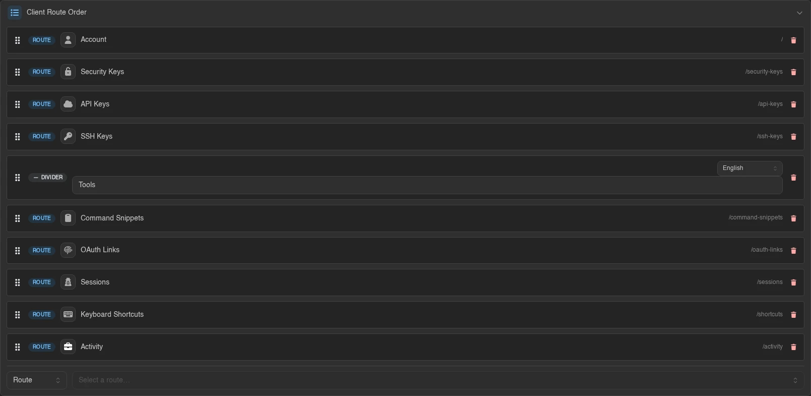

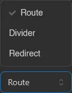

## Activity

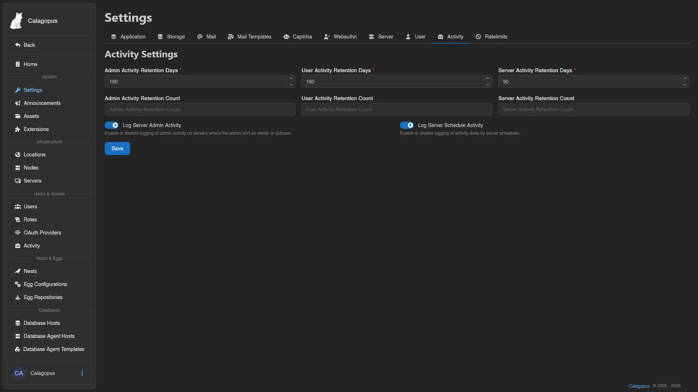

Retention for the three activity logs and what gets logged.

**Admin Activity Retention Days**, **User Activity Retention Days**, and **Server Activity Retention Days** control how many days entries are kept in each log. The matching **Retention Count** fields optionally cap the number of entries kept as well.

| Field | Description |
| --- | --- |
| **Log Server Admin Activity** | Log admin activity on servers where the admin isn't an owner or subuser |
| **Log Server Schedule Activity** | Log activity done by server schedules |
| **Hide Server Activity IPs** | Hide IP addresses in server activity logs, even from users who hold `activity.read-ip`. **None** (the default), **Admins**, or **All Users** |

**Admins** hides the address on entries made by an admin account or by someone impersonating a user, which keeps staff addresses out of a customer's log. **All Users** hides every address. Either way, a user with `activity.read-ip` still sees the IP on entries they made themselves (not ones made while someone impersonated them). The setting applies to the per-server [Activity](../server/activity.md) page for everyone, admins included; the admin and account activity logs are unaffected.

## Ratelimits

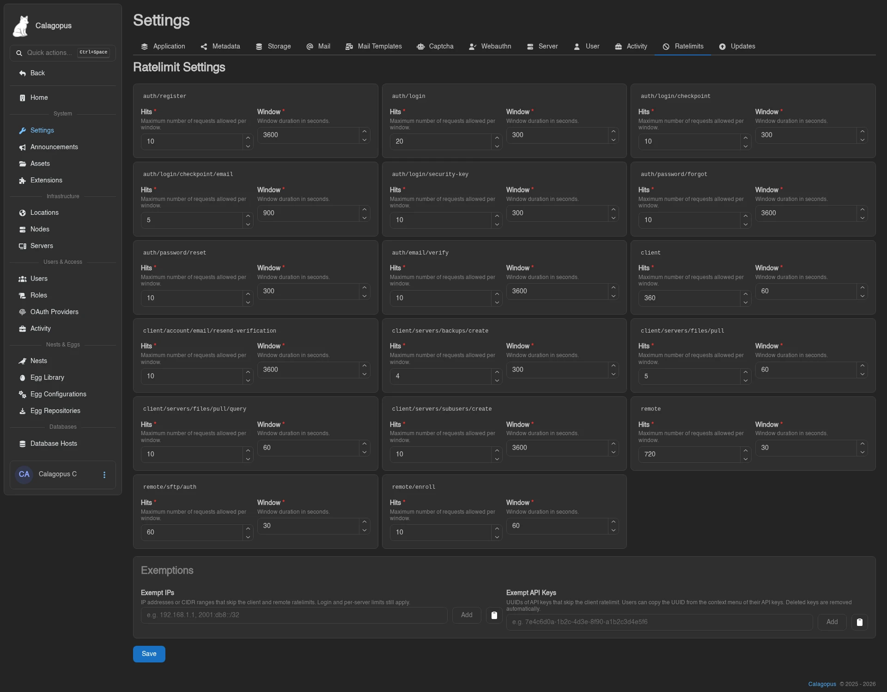

Per-endpoint API rate limits. Each endpoint card has two values: **Hits**, the maximum number of requests allowed per window, and **Window**, the window duration in seconds.

Endpoints covered: `auth/register`, `auth/login`, `auth/login/checkpoint`, `auth/login/checkpoint/email`, `auth/login/security-key`, `auth/password/forgot`, `auth/password/reset`, `auth/email/verify`, `client`, `client/account/email/resend-verification`, `client/servers/backups/create`, `client/servers/files/pull`, `client/servers/files/pull/query`, `client/servers/subusers/create`, `remote`, `remote/enroll`, and `remote/sftp/auth`.

**Remote Enroll** limits redemption of node enrollment codes to 10 requests per 60 seconds by default. Its settings key is `remote_enroll`; it is separate from the general remote API limit.

`client/servers/subusers/create`, added in Panel 1.2.8, defaults to 10 requests per 3600 seconds. It is counted twice, per IP and per account, so a single user cannot get around it by switching addresses.

### Exemptions

The **Exemptions** card below the endpoint grid lets trusted callers skip the two broad per-IP limits.

| Field | Description |
| --- | --- |
| **Exempt IPs** | IP addresses or CIDR ranges that skip the `client` and `remote` limits |
| **Exempt API Keys** | UUIDs of API keys that skip the `client` limit; a key only counts as exempt while it is enabled and used from one of its allowed IPs |

Exemptions only cover the `client` and `remote` limits. The login, registration, and password limits still apply to exempt IPs, and the per-server limits (backup creation, file pulls) and the subuser creation limit still apply to exempt keys.

Users can copy a key's UUID from the context menu on their [API Keys](../dashboard/api-keys.md) page. Saving refuses UUIDs that don't belong to an existing key, and a background job removes the UUIDs of keys that were deleted afterwards.

If the panel runs behind a reverse proxy, make sure `APP_TRUSTED_PROXIES` is set correctly, since IP exemptions match against the client address the panel resolves from the forwarded headers.

## Updates

Release tokens for upgrading [nodes](./nodes.md#upgrading-wings) and [database agent hosts](./database-agent-hosts.md#upgrading-the-agent) from the panel: **Wings Release Token** and **Database Agent Release Token**. Both are optional. The tab's notice explains when you need one: when nodes or database agent hosts upgrade from a private fork, or when the GitHub API rate limits unauthenticated downloads.

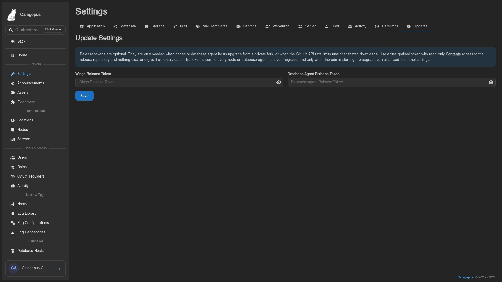

Use a fine-grained token with read-only **Contents** access to the release repository and nothing else, and give it an expiry date. The tokens are encrypted at rest and censored when the tab is reopened. The panel hands the token to the daemon with upgrade checks and upgrade requests, but only when the admin doing it also has `settings.read`; for everyone else the request goes out without it.
