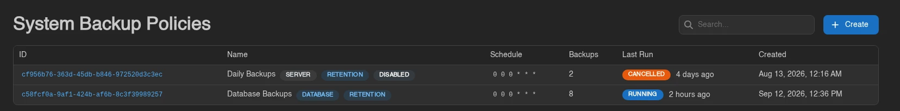
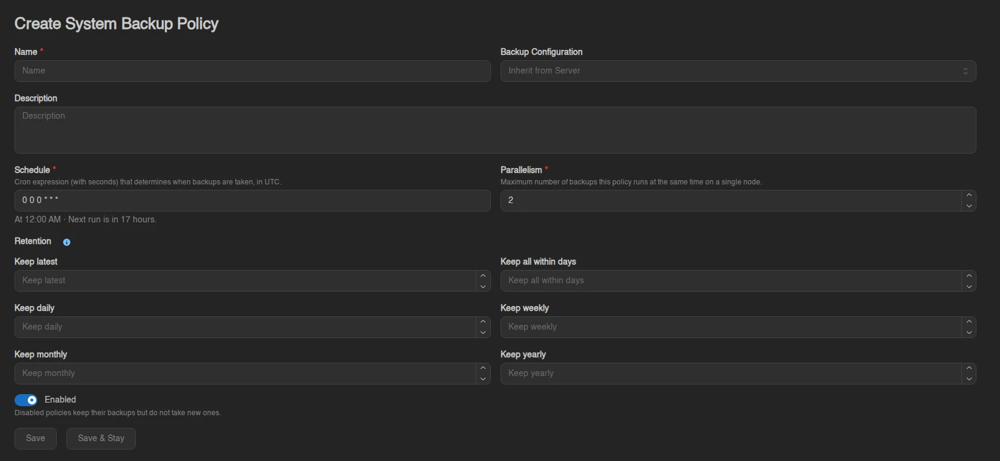
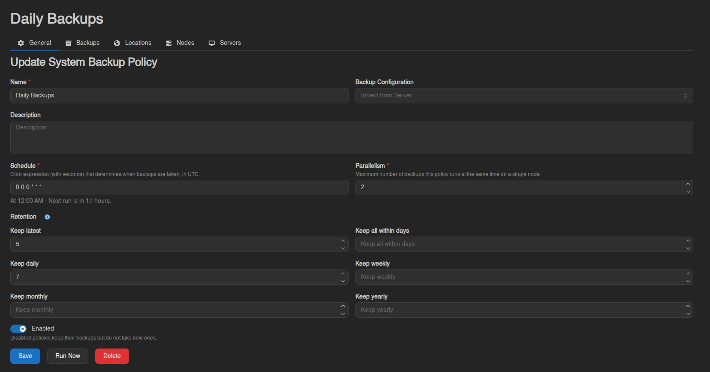
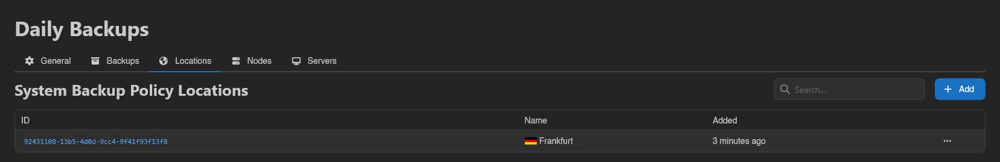
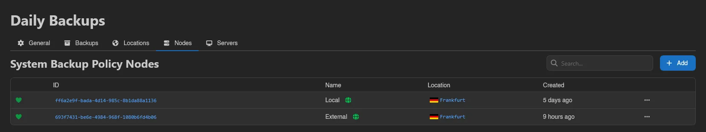
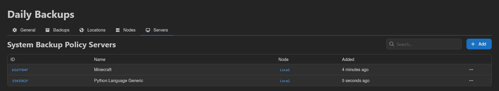
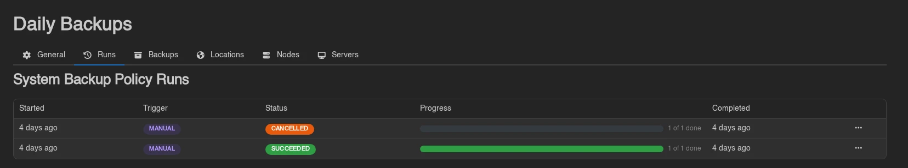
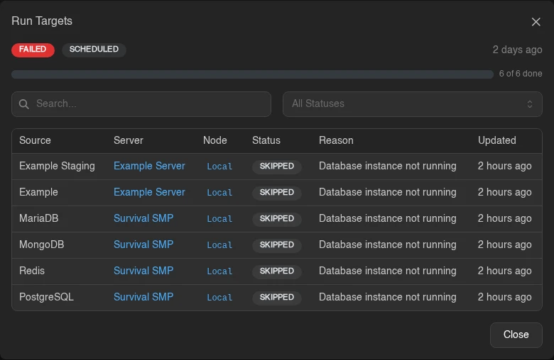
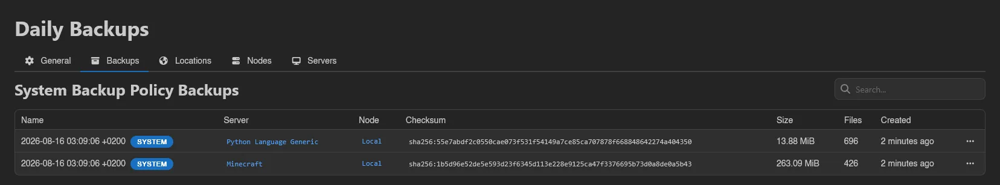

# System Backup Policies

System backup policies (**Storage** > **System Backup Policies**) take backups automatically on a schedule, without users or per-server [schedules](../server/schedules.md) being involved. A policy covers a set of servers, runs on a cron schedule, and cleans up after itself with retention rules.

A policy backs up one of two things, chosen by its **Backup Kind**: the files of every covered server, or the contents of every [database instance](../server/databases/managed.md) of every covered server. The kind decides what the policy can be scoped to, so it is fixed when the policy is created.

The list shows each policy's ID, Name, **Schedule** (the cron expression), **Backups** (how many it has taken), **Last Run**, and Created. Next to the name sit its badges:

- **Server** or **Database** for the backup kind.
- **Retention** (hover it to see the rules, the same tooltip [backup groups](../server/backups.md#backup-groups) use) or **No retention rules**.
- **Disabled** on disabled policies.

Since Panel 1.2.9, **Last Run** shows the state of the policy's most recent [run](#runs) and when it started. It replaces the **Run pending** badge older versions showed next to the name.

Use the search box to filter.

## Creating a Policy

Click **Create** in the top right.

| Field                      | Description                                                                                                                                                                                                                                                                                                                                                                                                                            |
| -------------------------- | -------------------------------------------------------------------------------------------------------------------------------------------------------------------------------------------------------------------------------------------------------------------------------------------------------------------------------------------------------------------------------------------------------------------------------------- |
| **Name** / **Description** | Display name and optional free text.                                                                                                                                                                                                                                                                                                                                                                                                   |
| **Backup Kind**            | **Server** archives the files of each covered server. **Database** dumps each covered [database instance](../server/databases/managed.md). The choice is locked once the policy exists, because it decides which scopes apply.                                                                                                                                                                                                         |
| **Backup Configuration**   | Which [backup configuration](./backup-configurations.md) the policy's backups are written to. Defaults to **Inherit from Server**, the same resolution a manual backup would use.                                                                                                                                                                                                                                                      |
| **Schedule**               | "Cron expression (with seconds) that determines when backups are taken, in UTC." The field has a helper popover for building the expression segment by segment, describes the current expression in plain English underneath, and previews when the next run would be.                                                                                                                                                                 |
| **Retention**              | Six rules deciding which of the policy's backups survive: **Keep latest**, **Keep all within days**, **Keep daily**, **Keep weekly**, **Keep monthly**, and **Keep yearly**, each off when empty or 0. They work as they do for [backup groups](../server/backups.md#retention-rules), and the field has a helper popover describing them. The rules apply per server, and for a database policy separately to each database instance. |
| **Parallelism**            | "Maximum number of backups this policy runs at the same time on a single node." Database policies apply the same number per database agent host instead, since the dump is read from the host rather than the node.                                                                                                                                                                                                                    |
| **Enabled**                | "Disabled policies keep their backups but do not take new ones."                                                                                                                                                                                                                                                                                                                                                                       |

An existing policy also offers **Run Now** (after a **Confirm Manual Run** dialog) and **Delete**. **Run Now** starts a manual [run](#runs) covering every target that has no backup from this policy in progress. The button shows a spinner while the latest run still has targets waiting, and the panel refuses **Run Now** while any open run of the policy still has targets waiting ("a run of this system backup policy is still in progress"). It also works on a disabled policy.

## What Is Covered

A server policy has **Locations**, **Nodes**, and **Servers** tabs; a database policy has **Locations**, **Database Agent Hosts**, and **Servers**. Each tab has an **Add** button and right-click **Remove**.

For a server policy, a server is covered when it matches any of the three: it sits in an assigned location, runs on an assigned node, or is assigned directly.

For a database policy, a database instance is covered when its [database agent host](./database-agent-hosts.md) is assigned directly, when that host belongs to an assigned location, or when the instance's server is assigned directly.

Covered is not the same as backed up on every run. A scheduled run only picks up targets that were covered (and, for servers and instances, existed) before the cron time it belongs to, so a server added to the policy afterwards waits for the next scheduled run or a **Run Now**. A target whose previous backup from this policy is still in progress is left out of the new run.

Inside a run, some conditions only hold a target back. The panel retries it every two minutes and records the reason on the target. Such a target keeps the run open until it clears, the policy's next scheduled run starts, or the run is cancelled:

- The server has any status, including install failed or restore failed, or is being transferred, or the database instance is restoring a backup.
- The node is in maintenance mode, or for a database policy, the database agent host is.
- The backup configuration is in maintenance mode.
- For a database policy, the database instance isn't running or its database agent can't be reached, since a dump is taken through the running database.
- The panel could not collect the server's backup metadata.

Other conditions skip the target for that run straight away: the server or instance was removed, no backup configuration applies to it, or (for a database policy) the backup configuration resolves to btrfs or zfs, which cannot store dumps.

## Runs

Since Panel 1.2.9, every time the schedule fires the panel starts a run for the policy, and **Run Now** starts a manual one. The **Runs** tab lists them newest first, with **Started**, **Trigger** (**Scheduled** or **Manual**), **Status**, **Progress**, and **Completed**. The table refreshes every few seconds while a run is still open.

| Status                  | Meaning                                                                    |
| ----------------------- | -------------------------------------------------------------------------- |
| **Running**             | The run still has targets waiting or backups in progress.                  |
| **Cancelling**          | The run was cancelled, and backups it already started are still finishing. |
| **Cancelled**           | The run was cancelled and has finished.                                    |
| **Succeeded**           | Every target got a successful backup.                                      |
| **Partially Succeeded** | Some targets got a successful backup, others failed or were skipped.       |
| **Failed**              | No target got a successful backup.                                         |
| **Nothing to Back Up**  | The run had no targets.                                                    |

**Progress** is a bar split into successful, failed, skipped, and running targets (hover a segment for its count), with the number of finished targets out of the total next to it.

Right-click a run, or use its menu, for **View Targets** and **Cancel Run**. **View Targets** lists the run's servers (and, for a database policy, a **Source** column with the database instance) with **Node**, **Status**, **Reason**, and **Updated**, searchable by server or instance name and filterable by stored status: **Pending**, **Dispatched**, **Skipped**, or **Failed**. A target reads **Pending** while it waits, **Running** while its backup is in progress, then **Successful**, **Failed**, or **Skipped**. A backup that has not finished within a day counts as failed. The **Failed** filter only finds targets whose backup could not be created; a backup that started and then failed is listed under **Dispatched**.

The reasons a target shows are:

| Reason                                                 | When                                                                                  |
| ------------------------------------------------------ | ------------------------------------------------------------------------------------- |
| Server busy (installing, restoring or transferring)    | The server, or the database instance, had a status that blocks backups.               |
| Node in maintenance                                    | The server's node is in maintenance mode.                                             |
| Database agent host in maintenance                     | The instance's host is in maintenance mode.                                           |
| Backup configuration in maintenance                    | The backup configuration is in maintenance mode.                                      |
| Database instance not running                          | The instance's container was not running, or its database agent could not be reached. |
| Could not collect backup metadata                      | The panel could not gather the server's backup metadata.                              |
| No backup configuration                                | No backup configuration applies to the server.                                        |
| Backup configuration does not support database backups | A database policy resolved to a btrfs or zfs configuration.                           |
| Removed before it was backed up                        | The server or instance was deleted while the run was open.                            |
| Backup could not be created                            | Creating the backup failed. The target counts as failed.                              |
| Policy disabled                                        | The policy was disabled while a scheduled run still had targets waiting.              |
| Next scheduled run started first                       | The next run started before this target got its turn.                                 |
| Run cancelled                                          | The run was cancelled before this target got its turn.                                |

When the next scheduled run supersedes a target that was held back, the target keeps the reason it was last held back, so a target that waited out a whole run on a node in maintenance reads "Node in maintenance" rather than "Next scheduled run started first". Cancelling the run sets "Run cancelled" and disabling the policy sets "Policy disabled" in its place.

**Cancel Run** (requires `system-backup-policies.update`) asks for confirmation, then skips every target still waiting. Backups that already started keep running until they finish. Disabling a policy also skips the waiting targets of its scheduled runs, with "Policy disabled", but doesn't mark the run cancelled, so it ends as **Partially Succeeded** or **Failed**. A manual run keeps going.

Within a run, targets are handled oldest previous attempt first, and at most **Parallelism** backups run at once per node (per database agent host for a database policy). If the panel was offline over several scheduled times, only the most recent one gets a run when it comes back.

The panel keeps the last 200 finished runs of each policy and the target lists of the last 20, pruning older ones every hour.

## Backups

The **Backups** tab lists every backup the policy has taken, searchable: Name, Server, Node, Checksum, Size, Files, **Retention**, and Created, each row tagged with a **SYSTEM** badge and carrying a download action. A database policy adds a **Kind** column, and its rows report no file count because a dump is a single file.

Policy backups do not count towards each server's backup limit and no [backup group](../server/backups.md#backup-groups) touches them; the policy's own **Retention** rules manage them instead, re-checked once an hour. Unlocked failed attempts are cleaned up 24 hours after they finish.

When there are failed backups, a **Delete Failed** button appears above the table (requires `nodes.backups`), showing how many it would remove. It asks for confirmation, keeps locked backups and any whose configuration is in maintenance, and runs in the background. A **Force** switch removes them even when the configuration is missing or the remote storage is unreachable, at the risk of leaving orphaned files behind.

A backup whose deletion still fails after the panel's eight automatic attempts is marked as a failed deletion. Since Panel 1.2.8, when there are any, a **Retry Failed Deletions** button with their count sits next to it (requires `system-backup-policies.backups` and `nodes.backups`). It skips backups whose configuration is in maintenance, runs in the background, and has the same **Force** switch.

## Deleting a Policy

Deleting asks whether to also delete the policy's backups (**Do you want to delete backups created by this policy?**):

- Switch on: "All backups created by this policy will be permanently deleted from their storage backends."
- Switch off: "Backups created by this policy will become regular server backups. They will count towards each server backup limit and follow standard rotation." Released backups belong to no group, so no retention rule applies to them afterwards.

::: info
The buttons on these pages follow the `system-backup-policies.*` admin permission keys (`create`, `read`, `update`, `delete`, `backups`). The **Runs** tab and its targets need `read`, and **Run Now** and **Cancel Run** need `update`. See the [Permissions Reference](../dashboard/permissions.md).
:::
