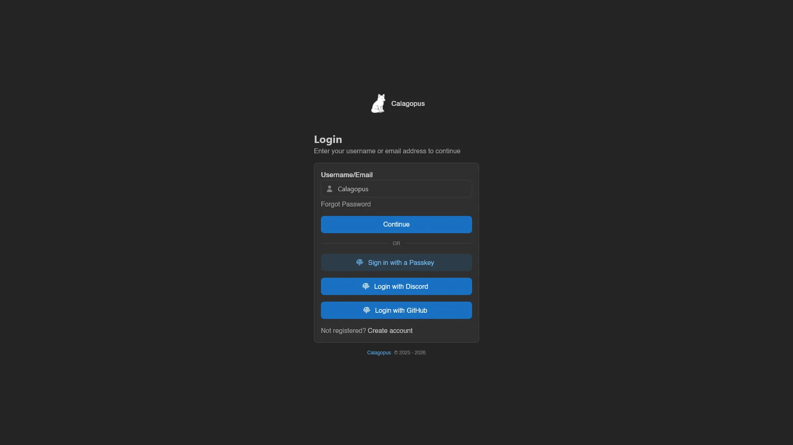
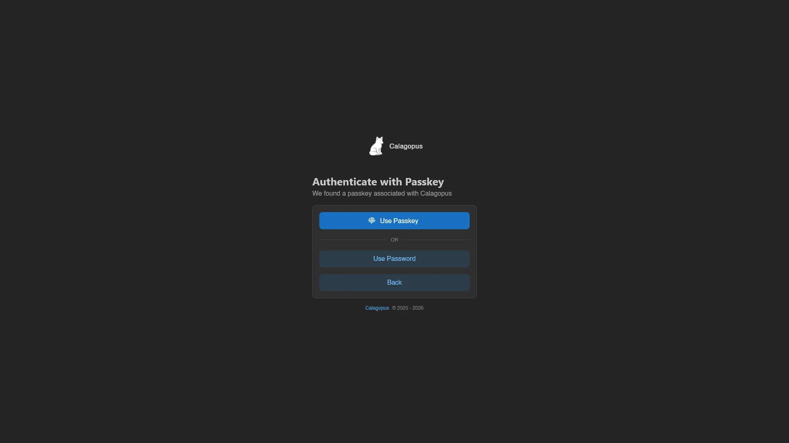
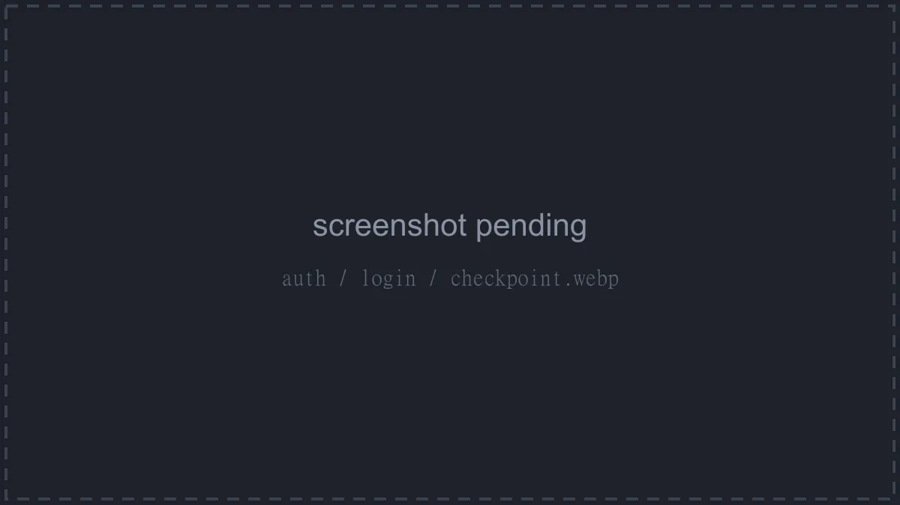

# Login

Logging in at `/auth/login` is a two-step flow: the panel first asks who you are, then how you want to prove it.

## Step 1: Username or Email

Enter your identifier into **Username/Email** ("Your username or email address") and hit **Continue**. The **Forgot Password** link underneath jumps to [password reset](./password-reset.md).

Below the **OR** separator are the alternate ways in:

- **Sign in with a Passkey**, for [passkeys stored on your device](#sign-in-with-a-passkey). Only shown when the admin has both security keys and usernameless login enabled.
- One **Login with `<name>`** button per enabled [OAuth provider](#oauth-login) that has **Viewable on Login** on (Panel 1.2.8). With more than three such providers they collapse into a single **OAuth Login** button instead, which leads to `/auth/login/oauth`, a page listing them all.

If registration is enabled, a "Not registered? **Create account**" link points to [Register](./register.md).

When an admin has turned off **Enable Password Login** in [Settings](../admin/settings.md#application), the **Forgot Password** and **Create account** links are gone, and so is the password step. What is left is whatever the panel still accepts: the OAuth buttons, plus the passkey options if security keys are on.

If security keys are off too, the identifier field disappears entirely and the OAuth buttons are the whole page. Typing a name that has no passkey then gets you "Password sign-in is turned off on this panel, use one of the options below instead" rather than a password prompt.

## Step 2: Passkey or Password

If your account has [security keys](../dashboard/security-keys.md) registered and passkeys are enabled panel-wide, **Continue** takes you to **Authenticate with Passkey** first ("We found a passkey associated with `<username>`"). **Use Passkey** triggers the browser's passkey prompt and logs you in on success; **Use Password** and **Back** below the separator let you fall back to the normal flow.

**Use Password** is hidden when password login is off panel-wide, leaving the passkey and **Back**.

Otherwise (or after **Use Password**) you land on **Enter Password** ("Please enter your password for `<username>`"). Type your password, it has a visibility toggle, and hit **Sign In**. **Forgot Password** and **Back** sit below the separator here too. There is no remember-me option; sessions last seven days by default (an instance setting).

## Sign in with a Passkey

**Sign in with a Passkey** on the first step skips the username entirely: the browser lists the passkeys stored on your device and you pick one. This only works for keys registered with the usernameless option; for any other key the panel tells you to enter your username first, after which it works through the normal flow. Passkeys require HTTPS and a valid domain; on a plain `http://` address (other than `localhost`) the browser offers no WebAuthn at all, so the button is not shown, the security key step after the username is skipped in favour of the password, and with password login also disabled only the OAuth buttons remain. Keep that in mind for `http://` addresses added under [Additional URLs](../admin/settings.md#additional-urls). See [Security Keys](../dashboard/security-keys.md) for registering them.

## OAuth Login

Each **Login with `<name>`** button sends you to the external provider to approve the login. Back on the panel:

- An account already [linked](../dashboard/oauth-links.md) to that provider is logged straight in.
- If that account has 2FA enabled, the [two-factor checkpoint](#two-factor-checkpoint) comes first, unless the admin has set **Bypass 2FA on Login** for the provider.
- With no linked account, the panel registers a new one from the provider's profile and logs you in. If the provider is set to **Only allow Login**, or an account with the same username or email already exists, you're sent back to the login page with an error instead.

::: info
For admins: providers, their **Bypass 2FA on Login** and **Only allow Login** flags, and automatic role mappings live under [OAuth Providers](../admin/oauth-providers.md).
:::

## Two-Factor Checkpoint

Accounts with [two-factor authentication](../dashboard/account.md) get one more step after the password, at `/auth/login/checkpoint`: the **Two-Factor Authentication** page greets you with your avatar and username and asks you to "Enter the 6-digit code from your authenticator app". Fill the six boxes and hit **Verify Code**.

The checkpoint stays valid for five minutes after the password step; take longer and login fails with "invalid confirmation token" and starts over. Each code works only once; if your device's clock is more than a few seconds off, a warning appears (on the login page too), since TOTP codes and passkeys depend on correct time.

Lost the authenticator? **Use Recovery Code** switches the form to a **Recovery Code** field. Recovery codes are ten characters and single-use, each one is deleted the moment it's accepted. **Use TOTP** switches back.

### Email Codes

When the administrator has enabled email two-factor and you've turned it on for your account, the checkpoint can mail you a code instead. If email is your only second factor the checkpoint opens straight on that step; otherwise the authenticator step gains an **Email me a code** button.

Nothing is sent until you press **Send Code**. The code is six digits, lands in the six boxes like a TOTP code, stays valid for 10 minutes, and allows 5 attempts before it's burned. **Resend Code** counts down 60 seconds between sends.

::: info
A security key is **not** a checkpoint factor. It replaces the password rather than following it, so if a security key is your only second factor, a successful password login finishes without a checkpoint step, while still counting towards an administrator's two-factor requirement.
:::

::: info
For admins: **Two-Factor Authentication Requirement** in [Settings > Application](../admin/settings.md#application) decides who has to set up 2FA at all. Login attempts are [rate limited](../admin/settings.md#ratelimits) per IP, and when a [captcha](../admin/settings.md#captcha) is configured it appears below the card and must be solved before **Sign In** works.
:::
