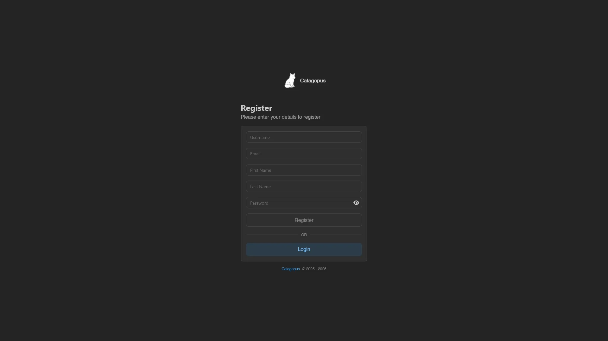

# Register

When registration is enabled, the **Create account** link on the [login page](./login.md) leads to `/auth/register` ("Please enter your details to register"). With registration off, the link is hidden and the page shows a not-found card.

The form asks for **Username**, **Email**, **Password** (with a visibility toggle), and optionally **First Name** and **Last Name**. Usernames are 3 to 15 characters of letters, numbers, and underscores; passwords need at least 8 characters. Hit **Register** to create the account, or **Login** below the separator to go back.

Registering logs you in immediately: your session starts the moment the account is created. If the username or email is already taken, you get an error instead. The first account ever registered on a fresh panel automatically becomes a root admin, and is marked verified straight away.

If the administrator has turned on **Require Email Verification**, a verification link is mailed to you and the rest of the panel stays locked until you open it. You can still reach your account page, change your email, and request a new link, but nothing else, including SFTP and SSH, works until the address is verified. See [Account](../dashboard/account.md) for the verification banner and the resend button.

When a captcha is configured, it renders below the card and **Register** stays disabled until it's solved.

The account is created in the language the page is shown in. That is the one picked in the language selector under the card, or detected from your browser on a first visit, as long as **Allow Changing Language** is on. Otherwise new accounts get the panel's default language.

::: info
For admins: the **Enable Registration** toggle lives in [Settings > Application](../admin/settings.md#application), and turning it on without a [captcha](../admin/settings.md#captcha) configured is asking for bot signups. The `auth/register` endpoint is [rate limited](../admin/settings.md#ratelimits) per IP.

[OAuth login](../admin/oauth-providers.md) also creates accounts from the provider's profile, regardless of this toggle, unless the provider is set to **Only allow Login**.

The page itself is only routed while registration is on, so `/auth/register` is a not-found card otherwise. Turning off **Enable Password Login** takes it away the same way, since the account it would create could never sign in. OAuth signup carries on as normal.
:::
