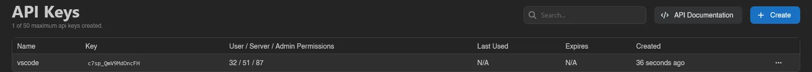
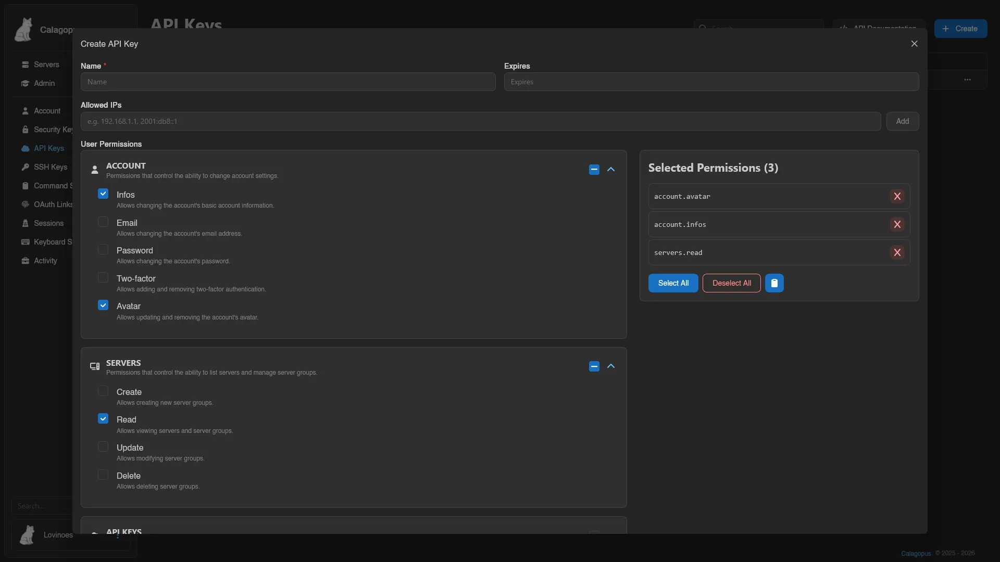
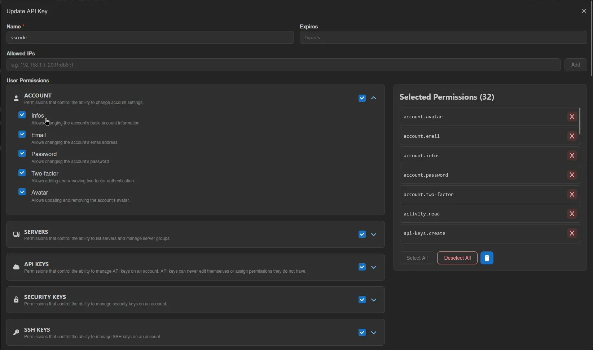

# API Keys

API keys are personal access tokens for the [API](https://demo.calagopus.com/api). Each key gets its own set of permissions, so you can hand out a key scoped to exactly what it needs rather than your full account access.

The list shows each key's name, the beginning of its key value, how many user/server/admin permissions it has, a **Status** badge reading **Enabled** or **Disabled**, and its last used, expiry, and created timestamps. A counter reads "N of M maximum api keys created.", and **API Documentation** in the top right opens your panel's `/api` reference.

## Creating a Key

Click **Create** in the top right. Give it a name, optionally an expiry date, and optionally a list of IPs it's allowed to be used from (leave empty to allow any IP).

Expiry uses a calendar picker with an optional time:

Below that are the permission categories: **User**, **Server**, and **Admin** (the last only shown if your own account has admin permissions). Check individual permissions, or toggle an entire category at once.

Everything you've selected shows up on the right under **Selected Permissions**, where **Select All** and **Deselect All** toggle everything and a clipboard menu offers **Copy Permissions** and **Paste Permissions**. See the [Permissions Reference](./permissions.md) for what every permission does.

Once you're happy with the selection, scroll down and hit **Save**, or **Close** to back out without creating anything. The full key value is shown exactly once, in an **API Key Created** modal: "Make sure to copy it now, as it will not be shown again."

## Editing, Duplicating, Recreating, and Removing

Right-click a key (or open the menu at the end of its row) for **Edit**, **Disable** (or **Enable**), **Duplicate**, **Recreate**, or **Remove**.

**Disable** switches the key off without deleting it: it keeps its name, permissions and value, but every request made with it is refused with "api key is disabled" until you enable it again. Use it when you suspect a key is being misused but aren't ready to invalidate it; unlike **Remove**, it can be undone. A key cannot disable itself, so you can't lock yourself out through the API with the very key you're calling with.

**Edit** opens the same form as creating one, letting you change the name, expiry, allowed IPs, and permissions.

**Duplicate** creates a separate key and shows its new token once. It copies the original's permissions, allowed IPs, enabled state, and expiry without invalidating the original. It needs permission to create keys and room under your account's key limit.

**Recreate** issues a new key value with the same name and permissions, immediately invalidating the old value; the new one appears once in an **API Key Recreated** modal. Use this if a key may have leaked. **Remove** deletes the key outright.

Saving a key's **Edit** form, disabling it, or removing it also cuts off what was already handed out through it on the nodes: console connections opened with the key are closed, and upload and download links issued through it stop working. The edit form always sends the permissions, allowed IPs and expiry, so this happens on every save, even when you only changed the name. Sessions you started by logging in are not affected. **Recreate** does not do this, so console tokens and upload and download links issued through the old value keep working until they expire, after 10, 15 and 15 minutes. To cut those off as well, disable the key and enable it again. See [When access changes](../../../about/security.md#when-access-changes).

### Bulk Actions

Select rows with their checkboxes, by dragging across them, by `Shift`-clicking a second checkbox for a range, or with `Ctrl+A` (`Esc` clears); only rows on the current page are selected. The action bar can **Enable**, **Disable** or **Delete** the selected keys; enabling and disabling skip keys already in that state, and deleting asks for confirmation first. Each action reports how many items it changed, skipped or failed in a toast.

## Third-Party Key Requests

External applications can send you to `/account/api-keys/create` or `/account/api-keys/update` to request a key with specific permissions, or changes to an existing one. The page shows exactly what is requested, with **Added**, **Granted**, and **Removed** badges on the permission diff, warns when admin permissions are involved, and returns you to the app's callback URL once you approve.

::: info
A key can never edit itself or grant permissions it doesn't already have, even with `api-keys.update`. The maximum number of API keys per account is set by the instance administrator under [Settings > User](../admin/settings.md#user).
:::
