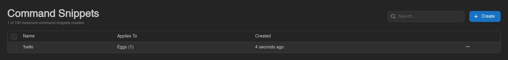
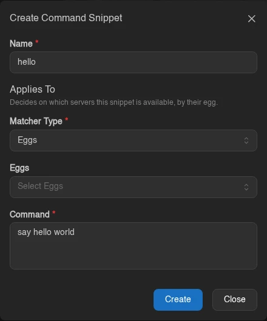
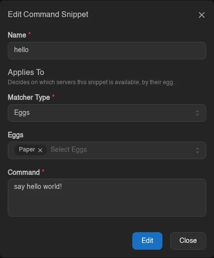
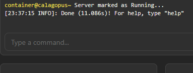
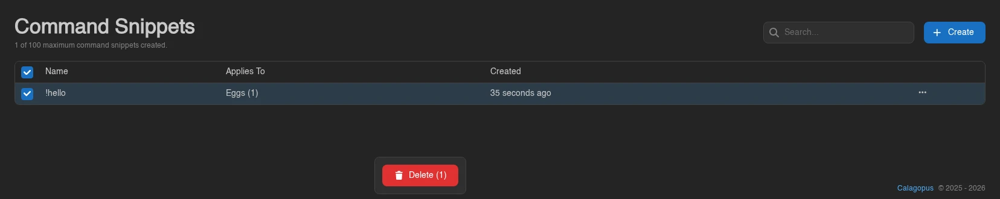

# Command Snippets

Command snippets are shortcuts for commands you type often into a server console. The list is empty by default and shows each snippet's name (with the `!` prefix you'll type), **Applies To** (a summary of where it is available, such as `Eggs (2)`), and when it was created.

## Creating a Snippet

Click **Create** and give it a short name, since that name is what you'll actually type in the console. **Applies To** decides on which servers the snippet is available, by their egg. Pick a **Matcher Type**:

| Matcher Type                        | Available when                           | Fields             |
| ----------------------------------- | ---------------------------------------- | ------------------ |
| **Never (Available nowhere)**       | Never, so the snippet shows nowhere      | none               |
| **All (Available on every server)** | Every server (the default)               | none               |
| **AND (All must match)**            | Every nested matcher matches             | nested matchers    |
| **OR (Any must match)**             | At least one nested matcher matches      | nested matchers    |
| **NOT (Must not match)**            | Its nested matcher does not match        | one nested matcher |
| **Eggs**                            | The server uses one of the selected eggs | eggs               |

**Add Matcher** adds a nested matcher to an AND or OR group. An **Eggs** list holds up to 100 eggs, and groups nest at most three levels deep. A **NOT** around an **Eggs** matcher, for example, makes a snippet available everywhere except on those eggs. These are the same matchers [egg configurations](../admin/egg-configurations.md#applies-to) use, limited to eggs.

Matchers arrived in Panel 1.2.10. Before that a snippet had a plain egg list, and an empty list meant every server. The update turned snippets with an empty list into **All** and the rest into an **Eggs** matcher with the same eggs, so they behave as before. An **Eggs** matcher with no eggs selected now matches nothing.

Then enter the command it should paste. For example, a snippet named `hello` with the command `say hello world!`:

Typing `!hello` in the console and pressing enter pastes `say hello world!` in its place, so you don't have to type the full command every time. Typing just `!` shows all your snippets as autocomplete suggestions; see [Sending Commands](../server/console.md#sending-commands).

Right-click an existing snippet (or open the menu at the end of its row) to edit, duplicate (the copy's name prefills as "`<name>` (copy)"), or delete it.

To delete several snippets at once, select them (checkboxes, `Shift`-click for a range, drag, or `Ctrl+A`) and use **Delete** in the action bar, which asks for confirmation.

::: info
The maximum number of command snippets per account is set by the instance administrator under [Settings > User](../admin/settings.md#user).
:::
