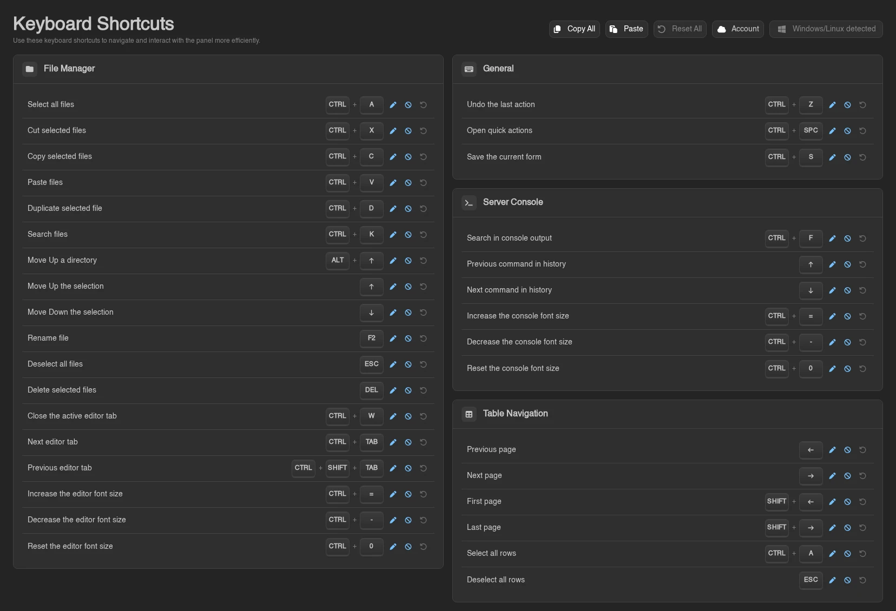
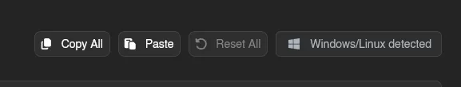

# Keyboard Shortcuts

Keyboard shortcuts let you navigate and interact with the panel without reaching for the mouse, grouped by where they apply: general, the file manager, the server console, and table navigation.



The panel detects whether you're on Windows/Linux or macOS and shows the matching modifier keys automatically.

## Default Bindings

| General | Binding |
| --- | --- |
| Undo the last action | `Ctrl+Z` |
| Open quick actions | `Ctrl+Space` |
| Save the current form | `Ctrl+S` |

| File Manager | Binding |
| --- | --- |
| Select all files | `Ctrl+A` |
| Cut selected files | `Ctrl+X` |
| Copy selected files | `Ctrl+C` |
| Paste files | `Ctrl+V` |
| Duplicate selected file | `Ctrl+D` |
| Search files | `Ctrl+K` |
| Move Up a directory | `Alt+↑` |
| Move Up the selection | `↑` |
| Move Down the selection | `↓` |
| Rename file | `F2` |
| Deselect all files | `Esc` |
| Delete selected files | `Del` |
| Close the active editor tab | `Ctrl+W` |
| Next editor tab | `Ctrl+Tab` |
| Previous editor tab | `Ctrl+Shift+Tab` |
| Increase the editor font size | `Ctrl+=` |
| Decrease the editor font size | `Ctrl+-` |
| Reset the editor font size | `Ctrl+0` |

| Server Console | Binding |
| --- | --- |
| Search in console output | `Ctrl+F` |
| Previous command in history | `↑` |
| Next command in history | `↓` |
| Increase the console font size | `Ctrl+=` |
| Decrease the console font size | `Ctrl+-` |
| Reset the console font size | `Ctrl+0` |

| Table Navigation | Binding |
| --- | --- |
| Previous page | `←` |
| Next page | `→` |
| First page | `Shift+←` |
| Last page | `Shift+→` |
| Select all rows | `Ctrl+A` |
| Deselect all rows | `Esc` |

(`Ctrl` shows as `Cmd` on macOS.)

The editor tab shortcuts apply to the tabs of the file manager's [tree view](../server/files.md#the-tree-view).

### Font Size Shortcuts

The font size shortcuts arrived in Panel 1.2.8. They only act while the code editor or the console has keyboard focus, so everywhere else `Ctrl+=` and `Ctrl+-` still zoom the browser page. Holding `Ctrl` while scrolling the mouse wheel (or pinching on a trackpad) over the editor or console resizes its font too, without focusing it first. As long as the increase and decrease bindings are left at their defaults, `Ctrl+Shift+=`, the numpad `+` and `-` keys, and an unshifted `+` key on layouts that have one work as well.

The editor font goes from 6 to 72 and the console font from 10 to 24, and reset returns both to 14. The new size is saved the same way as the **Editor Font Size** setting and the console's font buttons, so it follows your account by default. See [Settings Sync](./index.md#settings-sync).

## Rebinding, Disabling, and Resetting

Each shortcut has three buttons next to it. The pencil rebinds: click it and press the new key combination, which is captured as soon as you press it; `Esc` aborts the recording. The circle-slash disables the shortcut (and flips to a play icon that re-enables it), and the reset button restores the shipped default. Anything that differs from its default carries a **Modified** badge.

## Copy, Paste, and Reset All

The toolbar at the top shows which layout was detected ("Windows/Linux detected" or "macOS detected") next to three actions and a scope button:



- **Copy All** copies every current binding as text, in a format you can edit directly and paste back in to apply changes. It's also the easiest way to carry your keybinds over to another Calagopus panel: copy from one, paste into the other.
- **Paste** applies a previously copied (and optionally edited) set of bindings.
- **Reset All** restores every shortcut to its default at once.

The button at the end reads **Account** or **This Device** and controls where your rebinds live. By default they are saved to your account and follow you to every browser you log into - see [Settings Sync](./index.md#settings-sync). Copy and paste are still how you move bindings to a *different* panel.

```txt
# Calagopus keyboard shortcuts
#
# Edit the value after "=" then paste this back to apply your changes.
#   - a key combination such as  Ctrl+Shift+K  or  Mod+S  (Mod = Ctrl/Cmd)
#   - "disabled" turns the shortcut off
#   - "default" restores the shipped binding
# Lines starting with "#" and unknown ids are ignored.

[files] # File Manager
# Select all files
files.selectAll              = Mod+A
# Cut selected files
files.cut                    = Mod+X
# Copy selected files
files.copy                   = Mod+C
# Paste files
files.paste                  = Mod+V
# Duplicate selected file
files.duplicate              = Mod+D
# Search files
files.search                 = Mod+K
# Move Up a directory
files.moveUpDirectory        = Alt+ArrowUp
# Move Up the selection
files.moveUpSelection        = ArrowUp
# Move Down the selection
files.moveDownSelection      = ArrowDown
# Rename file
files.rename                 = F2
# Deselect all files
files.deselectAll            = Escape
# Delete selected files
files.delete                 = Delete
# Close the active editor tab
files.closeEditorTab         = Mod+W
# Next editor tab
files.nextEditorTab          = Mod+Tab
# Previous editor tab
files.previousEditorTab      = Mod+Shift+Tab
# Increase the editor font size
files.increaseEditorFontSize = Mod+=
# Decrease the editor font size
files.decreaseEditorFontSize = Mod+-
# Reset the editor font size
files.resetEditorFontSize    = Mod+0

[general] # General
# Undo the last action
general.undo                 = Mod+Z
# Open quick actions
general.quickActions         = Mod+Space
# Save the current form
general.save                 = Mod+S

[console] # Server Console
# Search in console output
console.search               = Mod+F
# Previous command in history
console.previousCommand      = ArrowUp
# Next command in history
console.nextCommand          = ArrowDown
# Increase the console font size
console.increaseFontSize     = Mod+=
# Decrease the console font size
console.decreaseFontSize     = Mod+-
# Reset the console font size
console.resetFontSize        = Mod+0

[table] # Table Navigation
# Previous page
table.previousPage           = ArrowLeft
# Next page
table.nextPage               = ArrowRight
# First page
table.firstPage              = Shift+ArrowLeft
# Last page
table.lastPage               = Shift+ArrowRight
# Select all rows
table.selectAll              = Mod+A
# Deselect all rows
table.deselectAll            = Escape
```
