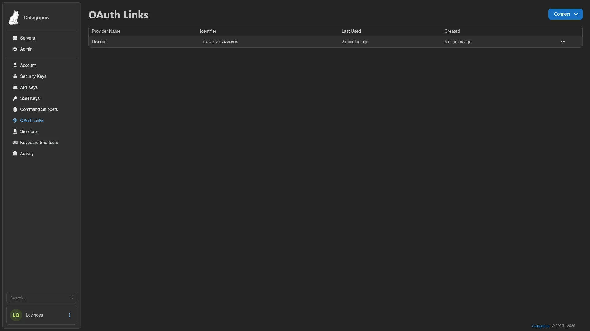

# OAuth Links

OAuth links let you log in with a third-party account instead of typing your username and password. The list shows the provider name, identifier, and last used and created timestamps for each linked account.

## Linking an Account

This only works once an administrator has configured at least one OAuth provider on the instance. If they have, click **Connect** in the top right and pick a provider.

You're sent to that provider to authorize the connection; accepting links it to your Calagopus account. Any OIDC-compliant provider works. Our docs cover setup for [Discord, Google, GitHub, and generic OIDC providers](../../../additional/setting-up-oauth/index.md) like Authentik or Pocket ID.

## Removing a Link

Right-click a linked account (or open the menu at the end of its row) and select **Remove**. It's disabled when the provider isn't set as user-manageable by the administrator. Since Panel 1.2.7 the API enforces this as well and answers "you cannot unlink this oauth provider"; older Panels only hid the option.

Several links can be removed at once: select them (checkboxes, `Shift`-click for a range, drag, or `Ctrl+A`) and use **Remove** in the action bar, which asks for confirmation. Links to providers that aren't user-manageable are left out: the button only counts the removable ones, the confirmation says how many will be skipped, and the button is disabled when nothing in the selection can be removed. Each action reports how many items it changed, skipped or failed in a toast.

