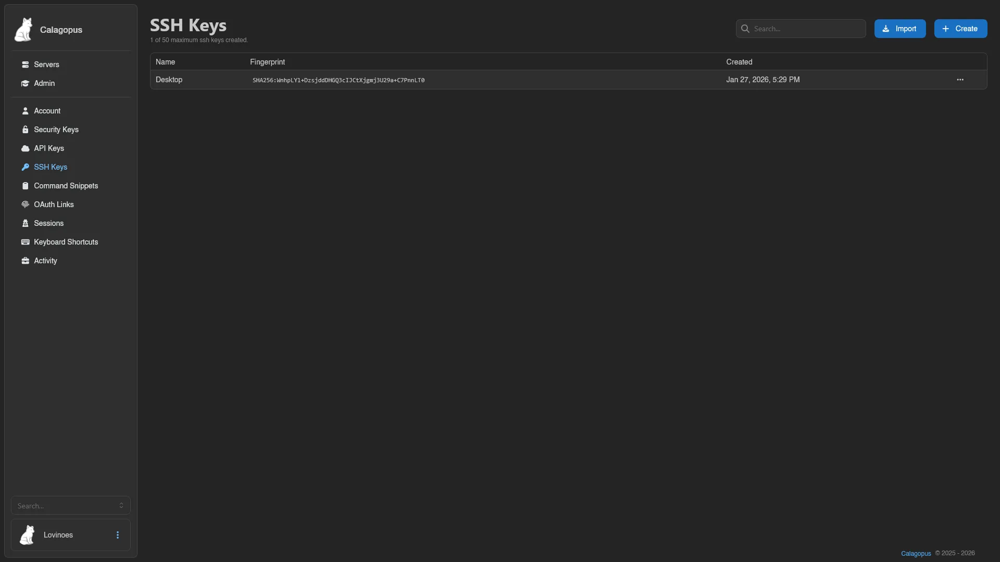
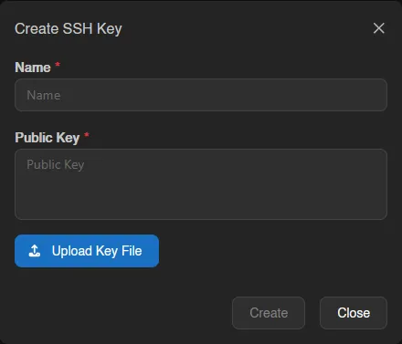
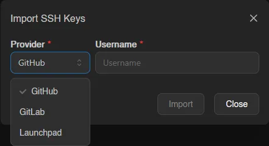
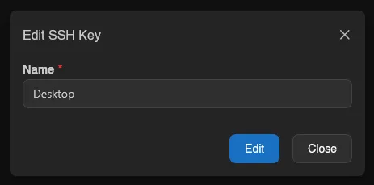

# SSH Keys

SSH keys added here are used for SFTP and SSH logins to Wings, the node daemon, instead of your panel password; the connection details themselves live on each server's [SSH Details](../server/console.md#ssh-details) and [SFTP](../server/files.md#connect) views. The list shows each key's name, fingerprint, and when it was created, with a counter against your key limit.

## Adding a Key

**Create** takes a name plus the public key itself: paste it, or pick a `.pub` file to fill the field.

**Import** skips the copy-pasting entirely: pick **GitHub**, **GitLab**, or **Launchpad**, enter your **Username** there, and the panel imports the public keys published on that account, all of them at once if there are several. If you are already at your key limit the import is refused outright with `maximum number of ssh keys reached`; otherwise it imports only as many keys as you have room left for.

Keys work for SFTP and SSH logins immediately after being added.

::: info
The maximum number of SSH keys per account is set by the instance administrator under [Settings > User](../admin/settings.md#user).
:::

## Editing and Removing

Right-click a key (or open the menu at the end of its row) to edit or delete it. Editing only changes the key's name, not the key material itself; add a new key instead if the underlying key pair changed.

Deleting a key logs you out of Wings everywhere: every SFTP and SSH session you have open on any node is closed, whichever key or password it used, and so is any server console you have open in the browser. Reconnect with your password or another key.

To remove several keys at once, select them (checkboxes, `Shift`-click for a range, drag, or `Ctrl+A`) and use **Delete** in the action bar, which asks for confirmation. Each action reports how many items it changed, skipped or failed in a toast.

