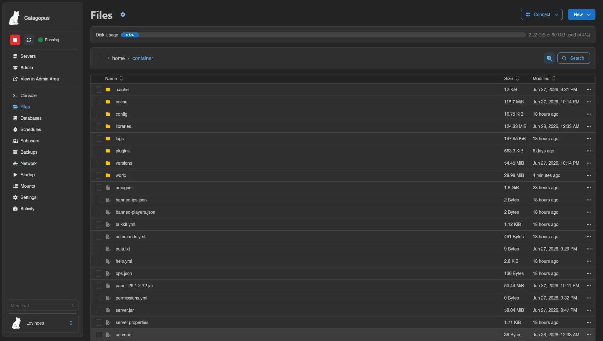
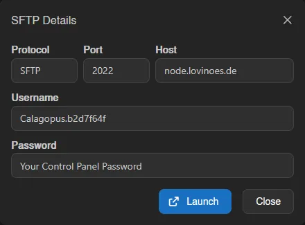
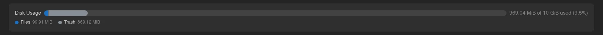
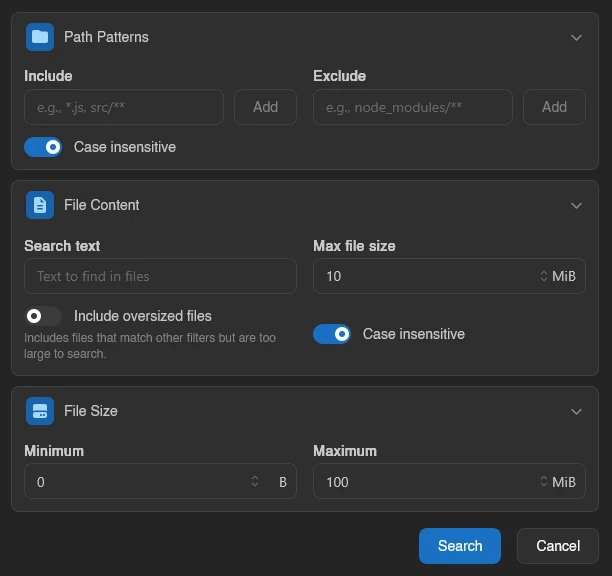
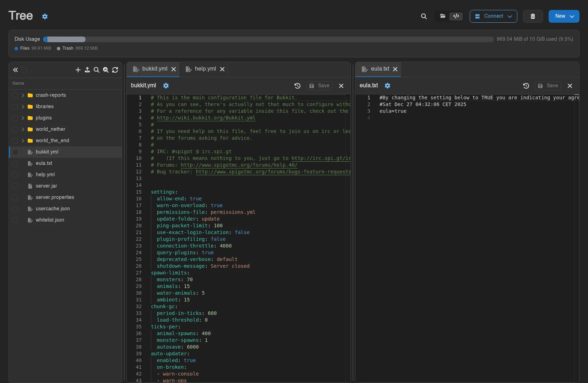
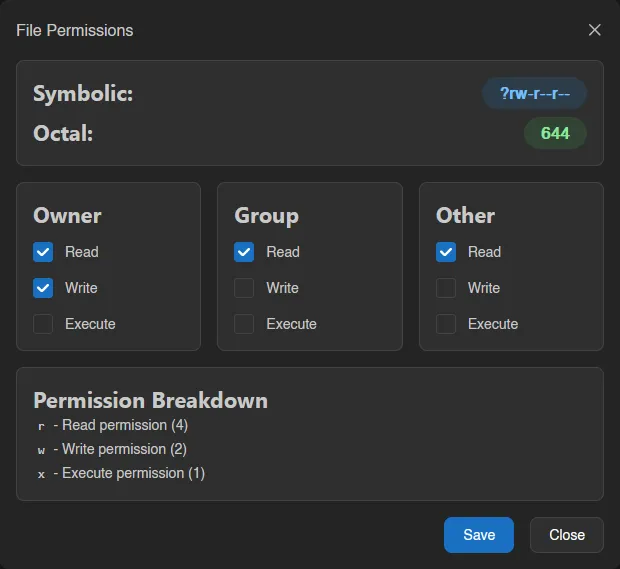
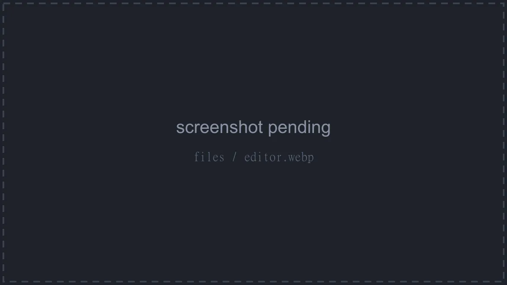
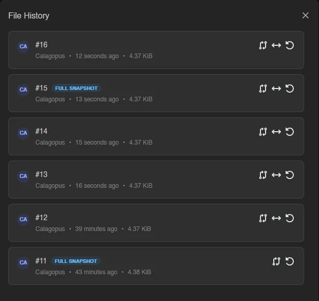
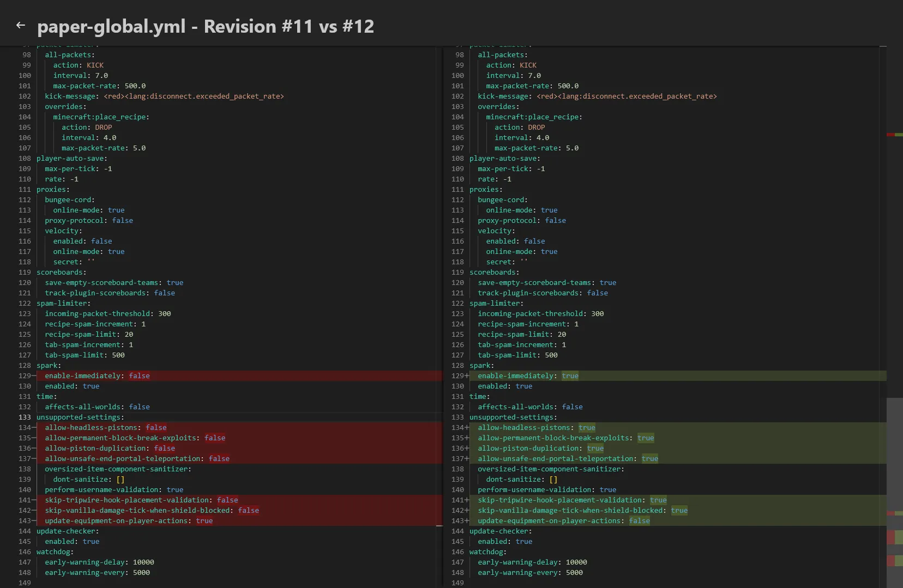

# Files

The Files tab is a full file manager for your server: browse and sort, upload and download, edit with a code editor, pack and unpack archives, roll files back to earlier revisions, and get deleted files back from the [trash](#trash). Everything is gated by the `files.*` permissions, see the [Permissions Reference](../dashboard/permissions.md).

The file manager has two views, and the page title tells you which one you are in. **List** is the table above, and **Tree** swaps it for a sidebar file tree next to tabbed editor panes, for working across several files at once (see [The Tree View](#the-tree-view)). The pair of buttons in the top right switches between them, as do the **Switch to List View** and **Switch to Tree View** [quick actions](../dashboard/index.md#quick-actions). Your choice is remembered per browser.

## The List View

Files are listed with **Name**, **Size**, and **Modified** columns; click a column header to sort, click again to flip the direction. Single-click selects a row, double-click opens it, and typing a few letters jumps to the first matching entry. Inside a subdirectory, the top row takes you back up one level.

The breadcrumb bar above the table always starts at `home / container` and every segment is clickable. It also holds the select-all checkbox, a directory-size analyzer, and the **Search** button.

The gear next to the page title opens the file manager settings:

| Setting | Effect |
|---|---|
| **Click once to open file or folder** | Single-click opens entries instead of selecting them. |
| **Always overwrite existing files** | Skips upload conflict choices and defaults file-copy operations to overwriting existing files. Off by default. |
| **Show physical size instead of logical size** | The Size column shows actual disk usage rather than file length. |
| **Preview files in tree tabs** | In the tree view, opening a file reuses a single preview tab until you edit it or double-click its tab. On by default. See [Editor Tabs](#editor-tabs). |
| **VS Code URI Scheme** | Which editor the **via VS Code** connect option launches (`vscode` by default, e.g. `vscodium` or `cursor` for forks). |

### Connect

The **Connect** menu offers two ways to work on your files outside the browser:

- **via SFTP** opens the **SFTP Details** modal with the connection info: **Protocol**, **Host**, **Port**, **Username** (your panel username plus the server's short ID, like `user.1a2b3c4d`), and a **Password** field that just reads "Your Control Panel Password". If your password cannot open that connection, a warning replaces the field and you need an [SSH Key](../dashboard/ssh-keys.md). That applies when the account has no password, when you have turned [Password Login](../dashboard/account.md#password-login) off, and when an admin has turned it off for the whole panel. Every field except the password copies on click, and **Launch** opens an `sftp://` link for clients registered to handle it. Holding Shift while clicking **via SFTP** skips the modal and launches directly. Requires the `files.sftp` permission.
- **via VS Code** mounts the server as a workspace folder in your editor. See the [VS Code integration](../../../integrations/vscode.md) for setup and everything it can do.

### New

The **New** menu (shown when you can write to the current directory and hold `files.create`) creates content in the directory you are browsing:

| Option | What it does |
|---|---|
| **File from Editor** | Opens an empty code editor; **Create** asks for a file name. |
| **Directory** | Creates a new directory. |
| **Symlink** | Creates a symbolic link. You give it a **Symlink Name** and a **Symlink Target**, "relative to the directory the symlink is created in", and the modal previews both resolved paths before you commit. |
| **File from Pull** | Downloads a file from a URL directly onto the server, see [Pulling from a URL](#pulling-from-a-url). |
| **File from Upload** | Uploads files from your device. |
| **Directory from Upload** | Uploads an entire folder, keeping its structure. |

### Disk Usage

Below the toolbar a **Disk Usage** bar shows how much of the server's disk limit is in use, for example `271.86 MiB of 20 GiB used (1.3%)`. It turns yellow at 80% and red at 95%, and is hidden on servers with unlimited disk. Since Panel 1.2.8 the bar also sits above the [tree view](#the-tree-view).

Files in the [trash](#trash) count towards that total, and since Panel 1.2.8 the bar shows how much of it they take up as a separate grey **Trash** segment, with a legend underneath giving the size of **Files** and **Trash**. Hover a segment for its size. The legend only appears while the trash holds something, and the node has to report the trash size, which needs Wings 1.2.8 or newer.

### Search

**Search** (or `Ctrl+K`) opens the **Search Files** modal, which remembers your last query when reopened. The plain text box matches file names anywhere below the current directory. **Advanced Filters** adds three optional sections:

| Filter | Fields |
|---|---|
| **Path Patterns** | **Include** and **Exclude** glob patterns (`*.js`, `node_modules/**`), plus a **Case insensitive** toggle. |
| **File Content** | Deep search: **Search text** looked for inside files, a **Max file size** per file, **Include oversized files** (list files that match the other filters but are too large to scan), and **Case insensitive**. |
| **File Size** | **Minimum** and **Maximum** file size. |

Results replace the listing, with a banner summarizing the query and active filters; close the banner to return to normal browsing. The content-search size cap is limited by a panel-wide maximum under [Settings > Server](../admin/settings.md#server), and the **File Content** section only appears on filesystems where the daemon supports fast content scanning.

#### Result Previews

Every search result carries an inline preview you can expand and collapse per file, in both the list and the tree view.

With a **File Content** search running, the preview shows the matching lines themselves, with a line of context either side and the match highlighted, headed by the line range ("Lines 41-43"). Without a content filter, it shows the first few lines of the file instead, so you still get a sense of what you matched. Archives never get a preview.

Previews are capped: at most six lines are shown per file, and **More matches not shown** appears when a file matched more times than fit.

Some results show a short status instead of content:

| Status | Meaning |
| --- | --- |
| **Content permission required** | You have `files.read` but not `files.read-content`, so the panel may list matching files but not show what is inside them. |
| **Match found, preview unavailable** | The file matched, but the node returned no context for it, usually because it is larger than the node's preview limit. |
| **Preview unavailable** | The file's contents could not be read back. |
| **Empty file** | The file matched the name or size filters and has no content. |

A search that actually returns previews is recorded in the [activity log](./activity.md) as a `server:file.read-content` entry naming the directory searched, the files that matched, and a truncated copy of the query. A search by a user who only holds `files.read` never reaches file contents and so records nothing.

::: info
How much the node will read for previews is capped by [`api.file_search_context`](../../../wings/configuration.md#api-file-search-context-max-matches) in the Wings configuration, separately from the **Max file size** on the search itself. A file over the node's budget still counts as a match; it just comes back without preview content.
:::

### Analyzing Disk Usage

The chart icon next to **Search** ("Analyze directory sizes") opens **Largest Directories**, a treemap of which directories eat your disk. Click a directory in the map to zoom into its contents; use the breadcrumbs to step back. **Open Folder** opens the selected directory in the file manager. The map also accounts for files, grouped smaller folders, and inaccessible space, so hidden content still contributes to disk usage without exposing its names.

### Browsing Backups

Backups can be browsed read-only through the same file manager; the breadcrumb root switches to `backups / <backup name>` and an **Exit Backup** button brings you back to the live filesystem. Actions that modify files are hidden while browsing a backup.

## The Tree View

The tree view puts the server's files in a sidebar on the left and opens files next to it in tabbed editor panes, so you can keep several files open while you browse. The [Disk Usage](#disk-usage) bar sits above both.

Drag the gap between the tree and the editors to make the tree wider or narrower; with the handle focused, the arrow keys resize it in steps and `Home` resets it. The width is remembered on this device. The double-arrow button at the top of the tree (**Hide file tree** / **Show file tree**) folds the tree away to give the editors the full width. On narrow screens the tree and the editors take turns: the editors only show while the tree is folded away, and opening a file folds it for you.

The icon row at the top of the tree has the select-all checkbox, **Create** (**New File**, **New Directory** and **Symlink**), **Upload** (**Upload from computer** for files or a directory, or **Upload from URL**), **Search Files**, **Analyze directory sizes**, and **Reload files**. Right-clicking a directory adds **New File** and **New Directory** to its menu, which create the entry inside that directory.

Drag entries onto a directory to move them there. While you drag, the target directory and everything listed under it is highlighted, so it is clear where the files will land.

### Searching the Tree

The magnifying glass (**Search Files**) opens a **Search files...** box that filters the tree by name as you type. The sliders icon at the end of the box (**Advanced search**) opens the [Search Files](#search) modal with what you typed already filled in, for path patterns, content and size filters. Running an advanced search closes the quick filter and shows the results in the tree, with the same [previews](#result-previews) as in the list view.

### Editor Tabs

Every file you open gets a tab. With **Preview files in tree tabs** on (the default), opening a file from the tree uses a preview tab, shown in italics, which the next file you open replaces. Editing the file, or double-clicking its tab, turns it into a normal tab that stays open; the **Keep File Open** quick action does the same. A dot marks a tab with unsaved changes.

Right-click a tab for **Close**, **Close Others**, **Close to the Right**, **Close Saved**, **Close All**, and **Reveal in Tree**, which expands the tree to the file and selects it. `Ctrl+W` closes the active tab and `Ctrl+Tab` / `Ctrl+Shift+Tab` switch between tabs (both rebindable under [Keyboard Shortcuts](../dashboard/keyboard-shortcuts.md)); `Ctrl+PageUp` / `Ctrl+PageDown` switch too, and `Ctrl+1` to `Ctrl+8` jump to that tab, `Ctrl+9` to the last one. Many browsers keep `Ctrl+W` and `Ctrl+Tab` for their own tabs, so rebind those two if they close or switch the browser tab instead. Drag a tab along the tab strip to reorder it.

Since Panel 1.2.8, the five tabs you used most recently stay loaded, so switching back to one keeps its cursor, scroll position and undo history. Older tabs load the file again when you return to them. Open tabs and panes are remembered per server in your browser.

### Editor Panes

To work on files side by side, drag a tab, or a file from the tree, onto the left or right edge of an editor; a highlighted outline shows where the new pane will go. Dropping it in the middle of a pane, or on its tab strip, moves the tab into that pane instead. A pane closes when its last tab does.

Splitting needs room: each pane has to stay at least 280 pixels wide, and dragging the only tab of a pane cannot split that same pane. Drag the handle between two panes to resize them, double-click it to make all panes the same width, or focus it and use the arrow keys (`Home` splits the two evenly). On small screens only one pane is shown at a time, and a **Select editor pane** dropdown above the editor switches between them.

## Selecting Files and Mass Actions

Use the row checkboxes, `Ctrl`-click to toggle, `Shift`-click for a range, drag a selection box across rows, or the breadcrumb checkbox / `Ctrl+A` for everything. A click anywhere in the checkbox column toggles the row, and `Shift` plus a checkbox click selects (or clears) every row between it and the last checkbox you clicked, adding to what is already selected instead of replacing it. As soon as anything is selected, an action bar appears with quick buttons for download (as a `.zip`), remote copy, copy, archive, rename, move, and delete. With the [trash](#trash) on, the delete button turns blue and reads **Move to Trash**.

Right-clicking a selected row opens the mass action menu:

| Item | What it does |
|---|---|
| **Download** | Bundles the selection into an archive; pick the format from **Download as** (`.tar`, `.tar.gz`, `.tar.xz`, `.tar.lz`, `.tar.bz2`, `.tar.lz4`, `.tar.zst`, `.zip`). |
| **Remote Copy** | Copies the selection to another server, see [Remote Copy](#remote-copy). |
| **Copy** | Marks the selection for copying. |
| **Archive** | Packs the selection into an archive on the server. |
| **Rename** | Opens the batch [Rename Files](#renaming) modal. |
| **Move** | Marks the selection for moving. |
| **Delete** | Deletes the selection after confirmation. Called **Move to Trash** while the [trash](#trash) is on. |

**Copy** and **Move** work like cut and paste: the marked files stay highlighted while you navigate to the target directory, then the action bar offers **Copy ... here** or **Move ... here** (or `Ctrl+V`), with a cancel button to back out.

If names collide while copying, a **Resolve Copy Conflicts** modal lists each clash with the source and destination details and lets you **Skip**, **Overwrite**, or **Rename** each file individually, or **Skip all** / **Overwrite all** at once. With **Always overwrite existing files** turned on in the file-manager settings, pasting overwrites clashing files straight away and the modal never appears.

Drag rows onto a directory row or a breadcrumb segment to move them; dragging any selected row drags the whole selection.

## Per-File Actions

Right-click a row (or use its menu button) for the single-file context menu below. Middle-clicking a row opens it in a new browser tab straight away, and that includes the parent-directory row and the entries of the tree view:

| Item | What it does |
|---|---|
| **Open** | Opens the file or directory, the same as clicking it. Its submenu offers **Open in Virtual Window** (a floating window inside the panel, so you can keep browsing next to it), **Open in Popup** (a separate 1280x800 browser window), and **Open in New Tab**. On touch devices the menu shows **Open in New Tab** alone. |
| **Rename** | Renames the file. |
| **Copy** | Copies it; in read-only directories you pick a destination instead. |
| **Remote Copy** | Copies it to another server. |
| **Move** | Marks it for moving, same paste-style flow as mass move. |
| **Symlink** | Creates a symlink pointing at this entry, with the target pre-filled. |
| **Archive** / **Extract** | Packs the entry into an archive; for archive files the item becomes **Extract** instead. |
| **Download** | Downloads the file directly; for directories, pick an archive format from the **Download as** submenu. |
| **More** > **Details** | Shows **Path**, **Mode**, **Logical Size**, **Physical Size**, **MIME Type**, **Last Modified At**, and **Created At**. |
| **More** > **Fingerprint** | Computes a checksum: MD5, CRC32, SHA-1, SHA-224, SHA-256, SHA-384, SHA-512, or CurseForge. |
| **More** > **Permissions** | Unix permissions editor, see below. |
| **Delete** | Deletes the file after confirmation. While the [trash](#trash) is on, the item reads **Move to Trash** and the file can be restored later. |

The folder a [mount](./mounts.md) appears at can't be renamed, moved, or deleted, so those items are missing from its menu. Wings (1.2.6 and newer) also refuses to delete, rename, or change the permissions of a folder that contains a mount point, with "path is a mount point or virtual directory".

### Permissions (chmod)

**File Permissions** shows the current mode as both **Symbolic** (`-rw-r--r--`) and **Octal** (`644`), with Read/Write/Execute checkboxes for **Owner**, **Group**, and **Other** and a breakdown of what each bit means.

For directories, a switch applies the change recursively to everything inside. Changes can be undone straight from the confirmation toast.

### Renaming

A single **Rename** is a simple name prompt (also `F2`), undoable from the toast.

Renaming a selection opens **Rename Files**, a batch tool:

| Field | What it does |
| --- | --- |
| **Find** / **Replace with** | Text or, with **Case sensitive** on, a regular expression with `$1` group references. **Replace all occurrences** controls whether every match or just the first is replaced. |
| **Apply to** | Which part of the name the find/replace runs against: **Name**, **Extension**, or **Full name**. |
| Prefix / Suffix | Text added before or after the result. |
| Case conversion | Forces the result to a case. |
| Automatic numbering | A `{n}` token in the name, with **Start at**, **Step**, and **Minimum digits** controls. |

A live preview shows every resulting name and flags conflicts before anything is renamed.

### Remote Copy

**Remote Copy Files** sends files to other servers you have access to. Pick one or more **Destination Servers** (or **Add servers from a group** to add a whole [server group](../dashboard/servers.md#grouped-servers)), browse to a destination directory, and optionally give a single file a new name. The browser shows the first server you picked, and the path you choose is used on every destination. You need `files.create` on each destination server; the modal names the ones where you lack it and won't copy until you remove them.

Before copying, Wings checks each destination for files that already exist. Those are left out of the copy and listed in the **Resolve Copy Conflicts** modal, each labelled with its server, where you can **Skip**, **Overwrite**, or **Rename** each one, the same as for a local paste. Everything without a conflict is already on its way. **Always overwrite existing files** in the file-manager settings skips the check and overwrites straight away.

::: info
The check needs Wings 1.2.6 or newer on both the source and the destination node. If only the destination is older, a copy without overwrite fails with "failed to check the destination for existing files", reported by the source node. If the source node is older, no check happens at all and the conflicts modal never appears.
:::

### Archives

**Archive** opens **Create Archive** with an optional **Archive Name** (a timestamped name is generated if you leave it empty) and a **Format**: `.tar`, `.tar.gz`, `.tar.xz`, `.tar.lz`, `.tar.bz2`, `.tar.lz4`, `.tar.zst`, `.zip`, or `.7z`.

**Extract** unpacks an archive into any directory you pick in the browser. `.zip`, `.7z`, and `.ddup` archives can also be browsed in place, double-click one to navigate into it like a directory (where the filesystem supports it).

Both run in the background; progress appears next to the toolbar, where operations (compressing, extracting, pulling, copying) can be cancelled individually or all at once via **Cancel all operations**.

## Trash

While the trash is on, deleting doesn't remove anything straight away. **Delete** turns into **Move to Trash**, and the confirmation says the files will be moved to the trash and how long they can be restored for, using the server's retention. The files leave the listing but stay on the node until they expire, and the toast that follows has an **Undo** button that puts them back. Turn on **Delete permanently instead of moving to the trash** in the same dialog to skip the trash for that delete.

Out of the box the trash keeps files for 7 days. Admins set that default under [Settings > Server](../admin/settings.md#trash), and a server can have its own values on its [Settings](./settings.md#trash) page. A retention of 0 turns the trash off, and deleting is permanent again.

::: warning
The trash needs Wings 1.2.6 or newer. On a node with an older Wings, **Move to Trash** fails with "route not found". Switch on **Delete permanently instead of moving to the trash**, or set the server's retention to 0, until the node is updated.
:::

### The Trash Page

The trash can button in the toolbar, between **Connect** and **New**, opens the trash at `/files/trash`, as does the **Open Trash** [quick action](../dashboard/index.md#quick-actions). The subtitle says how long deleted files are kept. Entries are listed newest first with their **Name**, **Original Location**, **Size**, and when they were **Deleted**.

Each row's menu, and the action bar that appears once you select rows, offer:

| Action | What it does |
| --- | --- |
| **Restore** | Puts the entry back where it was deleted from, recreating missing parent folders. |
| **Restore to...** | Opens **Restore to Directory**: pick a **Destination Directory** and, per entry, the name it should get. |
| **Delete Permanently** | Removes the entry for good, after confirmation. |

**Empty Trash** in the header deletes every entry at once. All of these need the `files.delete` permission; opening the page only needs `files.read`.

If something already exists where an entry would be restored, **Resolve Restore Conflicts** lists each clash with both sides' size and date. Choose **Skip**, **Overwrite**, or **Rename** per entry, or **Skip all** / **Overwrite all**. **Overwrite** deletes the existing file or folder permanently; it doesn't go to the trash. A restore can be undone from its toast, which moves the entries back into the trash, unless you overwrote something to make it. If any entry in the conflict dialog overwrote something, that toast has no **Undo** at all, not even for the entries you renamed.

A subuser only sees entries whose original path their [ignored files](./subusers.md#ignored-files) don't hide, and **Empty Trash** leaves the hidden ones alone.

### What Goes to the Trash

Only deletes made in the file manager on the server's own disk go to the trash. Files inside a [mount](./mounts.md) are always deleted permanently, and when a selection mixes both, the toast says so: "3 Files moved to the trash, 1 File deleted permanently." Deleting over SFTP, or from inside the game server, is permanent too. A schedule's [Delete Files](./schedules.md#files) step can use the trash with its **Move to Trash** switch.

### Storage and Expiry

The trash lives in a `.trash` folder at the root of the server's disk. The file manager and SFTP never show it, the container sees an empty read-only folder at `/home/container/.trash`, and backups leave it out.

Files in the trash still count towards the server's disk limit, so Wings removes them on its own:

- Entries older than the retention go when Wings next checks, which it does every 5 minutes.
- Once disk usage reaches the **Clear at Disk Usage** percentage (90% by default), the oldest entries go until usage is below it again. This is not immediate: it happens on the same 5-minute check, or sooner when a write checks for free space.
- When an upload, a save, or the running server would go over the disk limit, the oldest entries go first to make room. Only when the trash is empty and the server is still over the limit does Wings stop it.

The percentage rule does nothing on a server with unlimited disk. Each automatic clean-up shows up in the [activity log](./activity.md) as `server:file.trash.purge` with the number of entries removed. A reinstall that deletes all files, or a backup restore that does, empties the trash as well.

## Uploading

Drag files from your device anywhere onto the page and a **Drop files here to upload** overlay appears; drop to start. Alternatively use **New** > **File from Upload** or **Directory from Upload**. Upload progress lives in a popover next to the toolbar, where uploads can be paused, resumed, and cancelled.

Uploads keep going when you leave the page, and a progress toast follows you around the panel until they finish, one per destination, reading "Uploading 3 files to `server`...". Its **Show files** button takes you back to the directory being uploaded into, and its close button cancels every upload still heading there.

::: info
The maximum size per uploaded file is set by the Wings option [`api.upload_limit`](../../../wings/configuration.md#api-upload-limit). From Wings 1.2.6 the default is `0`, no limit; older versions default to 100 MiB. Configs generated by the Panel always set the key, to `0` since Panel 1.1.1, so that old default only applied to enrolled or hand-written configs. If a node sets a limit, use SFTP for anything bigger.
:::

### Upload Conflicts

With **Always overwrite existing files** off, the panel checks whether the names you are uploading already exist in the target directory before sending anything. If matching names exist, a **Resolve Upload Conflicts** modal lists them next to the existing entries, and you pick one of three actions per item:

| Action | Effect |
| --- | --- |
| **Skip** | Leaves the existing entry alone and drops that item from the upload. The default for every row. |
| **Overwrite** | Replaces the existing file. For a folder the option is called **Merge**: its files are written into the existing directory, overwriting any with the same name, and everything else in it stays. |
| **Rename** | Uploads under a different name, prefilled as `name copy.ext`. The name cannot be empty or contain `/`. |

**Skip all** and **Overwrite all** set every row at once. Files without a conflict are uploaded either way, and the modal says how many. The upload button stays disabled while every row is on **Skip**, so **Close** is how you back out, and it skips every conflicting item. Folders are compared by their top-level name only, and an upload of more than 1000 loose files skips the check for those files. If the check itself fails, the panel warns "Could not check for existing files; uploading anyway." and uploads everything as before.

Enable **Always overwrite existing files** in the file-manager settings to skip this dialog and overwrite matching files automatically.

### Shared Upload State

An upload in flight is staged as a `.upload-part` file next to its destination, and only gets its real name once every byte has arrived. A half-finished file therefore never sits in the listing looking complete.

Uploads are not private to the tab that started them. Wings tracks each one and pushes its progress to everyone watching the server, so the same row updates for your other sessions and for anyone else with access to the file. The listing shows the name the file will end up with, never the `.upload-part` suffix, and replaces the size column with progress while the upload runs:

| Row state | What you see |
| --- | --- |
| Uploading | Green row with an **Uploading 42%** badge, and `137.2 MiB / 320 MiB` in place of the size. |
| Incomplete | Yellow row with an **Incomplete** badge. The upload has stopped without finishing. |
| Someone else's | The same badges, plus `by <user>` next to them. Your own uploads are not attributed. |

Seeing an upload needs the `files.read` permission, and a subuser whose [ignored files](./subusers.md#ignored-files) hide the destination does not see the upload either - the deny rule is matched against the name the file will end up with, so a partial cannot be used to peek at a path that is otherwise hidden.

### Incomplete Uploads

An upload that goes 30 seconds without progress is treated as incomplete. Its badge turns yellow, and a dismissible **Incomplete Uploads** banner appears above the listing:

> Some uploads to this server never finished and their partial files are still on disk.

**Review Uploads** on the banner, or the **Review Incomplete Uploads** entry in the [quick actions](../dashboard/index.md#quick-actions) palette (`Ctrl+Space`), opens a modal listing every partial file and how far it got. Dismissing the banner hides it for that server until you open the panel in a new tab; the quick action stays available as long as something is unfinished.

How to clear one depends on where it came from:

| Partial file | How to deal with it |
| --- | --- |
| Yours, still in this session | Right-click the row for **Pause**, **Resume**, and **Cancel**, or use the upload popover next to the toolbar. Cancelling deletes the partial file from the node for you. |
| Yours, after a page reload | The browser no longer holds the file's contents, so the row offers **Re-select file to resume**. Pick the same file again and it carries on from where it stopped. |
| Someone else's, or left by a wings restart | Delete the partial file from the listing. Restart leftovers are listed without an owner or a total size and cannot be resumed at all. |

::: info
Files larger than the current request size are sent in chunks, and only those can be paused and resumed. Smaller files are bundled into shared requests, so **Cancel** is the only action offered on their rows. The request size starts at 8 MiB for each server and adapts to your connection as the upload runs, aiming for requests that take about a minute, never below 4 MiB or above 95 MiB. A slow connection therefore uses small chunks rather than running into proxy timeouts, and whether a file counts as large is decided when you start the upload.

Network errors, timeouts and 5xx responses are retried, and every cut-off request at least halves the request size for what follows. A chunked upload asks the node how far it got and carries on from there, giving up after five attempts in a row that make no progress. A bundled request is retried up to three times, and is split back into smaller bundles first if it is now over the request size. Rate-limit responses are retried up to five times, waiting as long as the node asks.

The 30-second threshold only decides when the panel calls an upload incomplete. Wings keeps tracking an abandoned partial for 24 hours before it drops the record, and the `.upload-part` file itself stays on disk until something deletes it. Nothing reclaims that space on its own, so a server that repeatedly loses connections mid-upload is worth checking.
:::

::: warning
Staging appends `.upload-part` to the name, so a file whose name is longer than 243 bytes cannot be uploaded through the file manager at all - wings rejects it with `file name too long`. Use SFTP for those, or shorten the name.
:::

### Pulling from a URL

**New** > **File from Pull** makes the server download a file itself, no round trip through your browser. Enter the **File URL** and hit **Query** to fetch the file's name and size in advance, adjust the **File Name** if needed, then **Pull**. The download runs on the node and shows up in the background operations progress.

## The Editor

Openable files launch a code editor at `/files/edit` with syntax highlighting and search. **Save** or `Ctrl+S` writes the file back; leaving with unsaved changes prompts you first. The gear next to the title holds the editor settings:

| Setting | Effect |
|---|---|
| **Editor Engine** | **Monaco** or **Pierre**. Monaco is the full desktop editor; Pierre is lighter and built for touch. Touch devices default to Pierre, everything else to Monaco. |
| **Show File Minimap** | Toggles the code overview strip on the right. Monaco only. |
| **Wrap Line Overflow** | Wraps long lines instead of scrolling horizontally. |
| **Editor Font Size** | Font size, 6 to 72. Since Panel 1.2.8, `Ctrl+=`, `Ctrl+-` and `Ctrl+0` (reset to 14) change it from inside the editor, as does `Ctrl` + mouse wheel; see [Font Size Shortcuts](../dashboard/keyboard-shortcuts.md#font-size-shortcuts). |
| **VS Code URI Scheme** | Same setting as in the list view; the editor's **Connect** menu can hand the open file straight to your editor. |

While you type, the editor keeps a local draft in your browser (for up to three days). If you come back to a file with an abandoned draft, a **Restore Draft** modal offers to **Restore** or **Discard** it, and warns if the file changed on the server in the meantime. A revert button next to the title discards your unsaved changes and reloads the file from disk.

A single compressed file whose contents are text, such as a rotated `latest.log.gz`, opens decompressed and read-only: there is no **Save**, no file history, and no live collaboration for it.

Files above the panel-wide view-size limit ([Settings > Server](../admin/settings.md#server)) show a warning instead of opening; images open in a zoomable viewer (its own gear has a **Smoothen Image (Anti-Aliasing)** toggle, turn it off to inspect pixel art), and audio files open in a player with a waveform, 15-second skips, and playback speed control.

## SQLite Databases

SQLite files (`.db`, `.db3`, `.sqlite`, `.sqlite3`) don't open in the editor: they open the same [data explorer](./databases/index.md#data-explorer) the panel uses for managed databases, at `/files/sqlite` - browsing rows, inspecting and editing the schema, and a raw query console. This requires the `files.query-raw` permission, which grants full read and write access to the file's contents; changing rows or structure additionally needs `files.update`.

Wings (1.2.4 and newer) fences raw queries in: `ATTACH` only works for `:memory:` and temporary databases, setting the `temp_store_directory`, `data_store_directory`, `hard_heap_limit` and `soft_heap_limit` pragmas is refused, `PRAGMA threads` is ignored, a single string or blob value can be at most 32 MiB, and all queries running on one server at the same time share 128 MiB of memory.

## File History

The clock icon ("File History") in the editor header opens a drawer listing the file's revisions, newest first. Each entry shows the revision number, who made the change, when, its size, and a **Full Snapshot** badge where the daemon stored the entire file rather than a diff. Per revision you can:

- **View diff against current file**, which opens `/files/diff` titled `<file> - Revision #N vs Current`. The current side is editable; **Save** writes it back, and **Restore this revision into the editor** replaces the file with the old revision.
- **Compare to previous revision**, a read-only `Revision #N vs #M` diff.
- **Restore this revision into the editor**, which loads the old content into the editor as an unsaved change so you can review before saving.

::: info
Revisions are recorded by Wings for edits made through the file manager and SFTP. Admins control this via the [`system.file_history`](../../../wings/configuration.md#system-file-history-enabled) options, including retention and the per-file size cap; files above the cap are not tracked.
:::

## Live Collaboration

Collaborative editing normalizes mixed line endings to one style when saving. Files with mostly CRLF or CR line endings use CRLF; otherwise they use LF. An existing UTF-8 byte-order mark is preserved.

When several people open the same file, the editor switches to a shared real-time session: everyone's avatar appears in the header, and edits merge live. **Save** persists the shared document for everyone. Each participant also gets a colored cursor and selection labeled with their name, in both Monaco and Pierre. The [VS Code extension](../../../integrations/vscode.md) supports the same real-time collaboration, synchronized through the panel.

If the file changes on disk outside the session (for example via SFTP), a warning banner appears with **View Diff** to compare, **Load Disk Version** to replace the session contents with the file on disk, or **Keep Editor Version** to overwrite the disk with what the session has.

## Keyboard Shortcuts

The file manager is fully keyboard-driven: `Ctrl+A` select all, `Ctrl+X`/`Ctrl+C`/`Ctrl+V` cut/copy/paste, `Delete`, `F2` rename, `Ctrl+K` search, `Ctrl+Z` undo, arrow keys to move the selection, and `Alt+ArrowUp` to go up a directory. See [Keyboard Shortcuts](../dashboard/keyboard-shortcuts.md) for the full list and how to rebind them.

## Undo

These operations can be taken back: moving files by dragging them, a single rename, a batch rename, a permissions change, moving files to the trash, and restoring them from it. Each one shows an **Undo** button on its confirmation toast, and `Ctrl+Z` undoes the most recent one without having to reach for the toast.

The window is short: an entry expires when its toast does, after about seven and a half seconds, and only the last ten are kept. **Permanent deletes and copies are not undoable.** A file moved to the trash can still be restored from the [Trash](#trash) page after its toast is gone.
