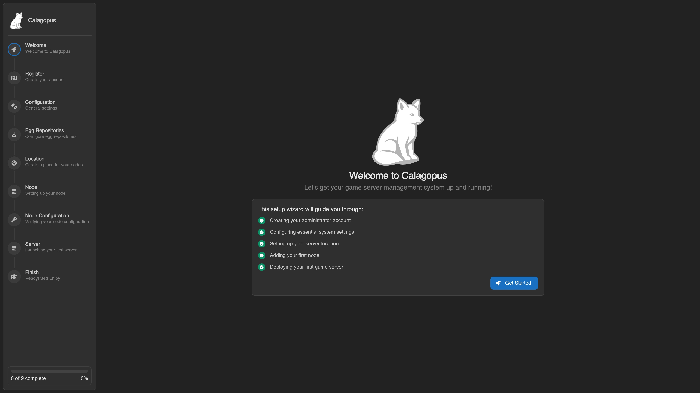

# ZimaOS Panel Installation

Calagopus is available for [ZimaOS](https://www.zimaspace.com/zimaos) through the [Calagopus ZimaOS App Store](https://github.com/calagopus/zimaos-appstore). Each app bundles its own PostgreSQL and Valkey containers, and generates the encryption key for you on first start, so there is nothing to configure before installing. The same store also works on [CasaOS](https://casaos.zimaspace.com/).

::: info Running game servers on a home server
Wings will run fine on ZimaOS, but game servers are CPU- and RAM-intensive workloads that compete with your other ZimaOS apps. This is well-suited for homelab use. For production hosting, consider running Wings on a dedicated machine connected to a standalone Panel instead.
:::

## 1. Add the App Store source

In the ZimaOS dashboard, open the **App Store** and choose **Add community store**. Paste the store URL and confirm:

```
https://calagopus.github.io/zimaos-appstore
```

ZimaOS fetches the store in the background. Once it has finished, the Calagopus apps show up in the **App Store**.

## 2. Install the app

Search the **App Store** for `Calagopus`. The store offers three apps, pick the one that matches your needs and click **Install**:

| App | Use when |
| --- | --- |
| **Calagopus AIO** | Standard install, Panel + Wings, no extensions. The best choice for most people. |
| **Calagopus Heavy AIO** | You plan to install [extensions](../../extensions/index.md), includes the build tooling needed to compile them |
| **Calagopus** | Panel only, you connect one or more separate [Wings](../../../wings/installation/index.md) nodes to run game servers |

::: warning Install only one variant
All three apps publish the panel on port `8000`, and both AIO variants publish SFTP on port `2022`, so only one of them can run on the same ZimaOS device at a time.
:::

ZimaOS pulls the images and starts the app. The first start runs the database migrations, which can take a minute.

## 3. Access the Panel

Click the Calagopus tile on your ZimaOS dashboard, or open your browser and navigate to:

```
http://<zimaos-ip>:8000
```

You will see the OOBE (Out Of Box Experience) setup screen where you create your first admin account and complete initial configuration.



The ports used are:

| Port | Purpose |
| --- | --- |
| `8000` | Panel web UI and API |
| `2022` | SFTP access to game server files via Wings (AIO variants only) |

Your game servers will also need their own port allocations, configure those on the Wings node after setup.

## Backing up the encryption key

All app data is stored under `/DATA/AppData/<app>/` on your ZimaOS device. The encryption key generated on first start is saved to `/DATA/AppData/<app>/data/.encryption-key`. Back it up together with the database, without it encrypted data cannot be recovered.

::: tip Using your own encryption key
To use your own key instead, set `APP_ENCRYPTION_KEY` in the app settings before the first start. Do **not** change it after installation.
:::

## Updating

The ZimaOS App Store is updated shortly after each new Calagopus release. ZimaOS shows available updates in the **App Store**, click **Update** on the Calagopus app to pull the new image and restart it; your data is preserved.
