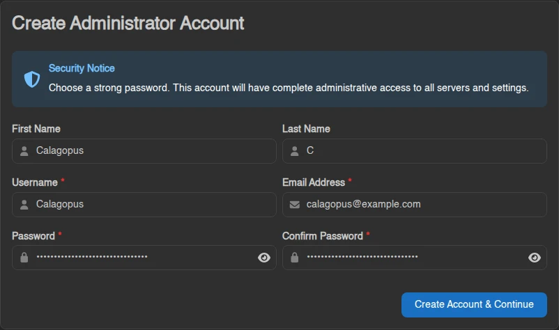
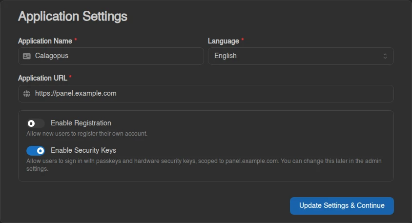
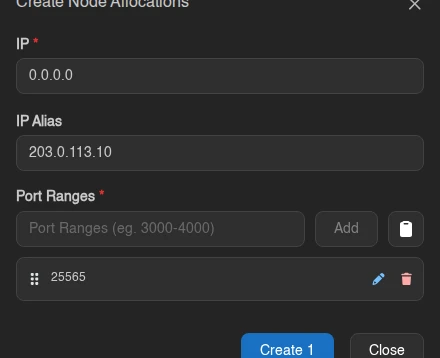
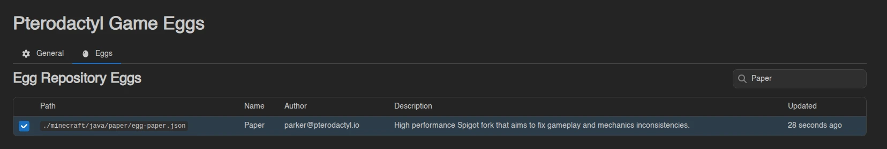
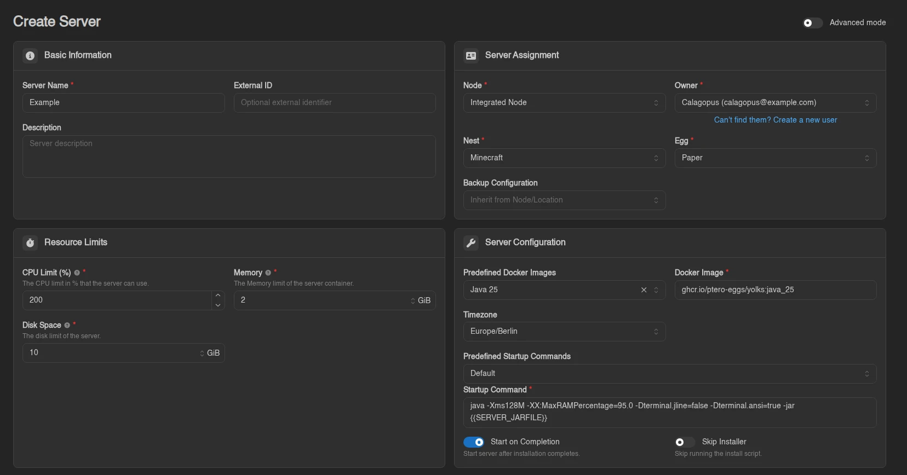
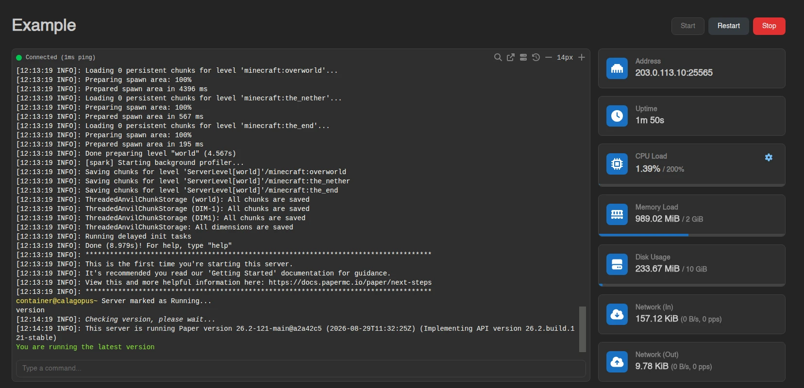

# Set up Calagopus on your first VPS

By the end of this guide, one VPS runs the Panel and Wings, and you can join a Minecraft Java server hosted on it. Already running something? Use the [installation guides](./index.md) instead.

## Before you start

You need:

- A fresh **Ubuntu 26.04 LTS** VPS with sudo access and a public IPv4 address. On another distribution, only the `apt` and `ufw` commands and the Caddy package differ.
- **Minecraft Java Edition** on your computer. Bedrock needs a different egg and different ports.
- A **domain** whose DNS records you can edit, if you want HTTPS. It's optional:

| | With a domain | Without a domain |
| --- | --- | --- |
| Panel address | `https://panel.example.com` | `http://203.0.113.10:8000` |
| Encryption | Yes, Caddy gets a certificate | No, your password crosses the internet in plain text |
| Passkeys | Available | Unavailable, use an authenticator app instead |

Running without a domain is reasonable for one administrator on a hobby server. You can add a domain later with the [reverse proxy guide](../next-steps/reverse-proxy.md). The **With a domain** and **Without a domain** tabs below switch together, so you only pick once.

The examples assume **2 vCPUs, 4 GB RAM and 40 GB disk**. The game gets 2 GiB RAM and 10 GiB disk, which leaves room for the operating system, the Panel, its database, container images and backups.

Replace `203.0.113.10` with your VPS address, `ubuntu` with its SSH user, and `panel.example.com` with your hostname.

## 1. Open the ports

::::tabs key:domain
=== With a domain

In your domain's DNS settings, create an `A` record for `panel` pointing at your VPS's IPv4 address. On Cloudflare, set it to **DNS only** (grey cloud). Don't add an `AAAA` record unless the VPS has working IPv6, and remove any old one.

In your provider's firewall (sometimes called a security group), allow these inbound:

| Port | Source | Used for |
| --- | --- | --- |
| TCP `22` | Your IP where practical | SSH, or your provider's port if it differs |
| TCP `80` | Internet | Certificate validation and HTTP redirects |
| TCP `443` | Internet | The Panel |
| TCP `25565` | Your players | The Minecraft server |
| TCP `2022` | Your IP, optional | SFTP access to game files |

If `sudo ufw status` says it's active, allow the same ports there:

```bash
sudo ufw allow 22/tcp
sudo ufw allow 80/tcp
sudo ufw allow 443/tcp
sudo ufw allow 25565/tcp
```

=== Without a domain

In your provider's firewall (sometimes called a security group), allow these inbound:

| Port | Source | Used for |
| --- | --- | --- |
| TCP `22` | Your IP where practical | SSH, or your provider's port if it differs |
| TCP `25565` | Your players | The Minecraft server |
| TCP `2022` | Your IP, optional | SFTP access to game files |

Leave port `8000` closed for now. You'll open it in step 4, once your administrator account exists, so nobody else can claim it first.

If `sudo ufw status` says it's active, allow the same ports there:

```bash
sudo ufw allow 22/tcp
sudo ufw allow 25565/tcp
```

::::

Keep everything else closed. Docker's published ports [bypass UFW](https://docs.docker.com/engine/network/packet-filtering-firewalls/#docker-and-ufw), so the provider firewall is what actually protects them.

On **Oracle Cloud**, also open the ports in the instance's own `iptables` rules, which `ufw status` doesn't show. [This guide](https://github.com/mochman/Bypass_CGNAT/wiki/Oracle-Cloud--(Opening-Up-Ports)) covers both places.

## 2. Install Calagopus

Connect to your VPS. If your provider gave you a custom SSH port, add `-p PORT` to each `ssh` command in this guide.

```bash
ssh ubuntu@203.0.113.10
```

From here on, commands run **on the VPS** unless marked otherwise. Run `sudo -v` first so a password prompt doesn't swallow the rest of a pasted block.

This installs Docker, downloads Calagopus to `/opt/calagopus-panel`, generates its encryption key, and starts it. The Panel only listens on `127.0.0.1` for now, so it stays private until your account exists.

```bash
sudo apt update
sudo apt install -y ca-certificates curl openssl dnsutils
curl -sSL https://get.docker.com/ | sudo CHANNEL=stable bash

sudo mkdir -p /opt/calagopus-panel
cd /opt/calagopus-panel
sudo curl -fL https://raw.githubusercontent.com/calagopus/panel/refs/heads/main/compose.aio.yml -o compose.yml
echo 'app_name: Calagopus' | sudo tee wings-config.yml > /dev/null
sudo sed -i "s/CHANGEME/$(openssl rand -hex 16)/g" compose.yml
sudo sed -i 's/- 8000:8000/- 127.0.0.1:8000:8000/' compose.yml
sudo chmod 600 compose.yml wings-config.yml

sudo docker compose up -d
until curl -s -o /dev/null http://127.0.0.1:8000; do sleep 3; done
sudo docker compose ps
```

The first start takes a while. At the end, `ps` should show `web`, `db` and `cache` running. Run every `docker compose` command in this guide from `/opt/calagopus-panel`. If it never finishes, press `Ctrl+C`, run `sudo docker compose logs --tail 80 web db`, and see [Troubleshooting](../../additional/troubleshooting.md#the-panel-won-t-start).

::: warning Run this block once
`compose.yml` now holds the key that decrypts your stored secrets. Running the block again replaces it, so back the file up and keep it.
:::

## 3. Create your administrator account

The first account becomes the administrator, so create it while the Panel is still private. In a **second terminal on your computer**, open an SSH tunnel and leave it running. It prints nothing once connected.

```bash
ssh -N -o ExitOnForwardFailure=yes -L 127.0.0.1:8000:127.0.0.1:8000 ubuntu@203.0.113.10
```

Visit `http://localhost:8000`, click **Get Started**, and create your account with a strong, unique password. If port 8000 is taken on your computer, change the first `8000` to `8001` and use that port instead.



On **Application Settings**:

- Set **Application URL** to the address you'll really use, with no trailing slash: `https://panel.example.com` or `http://203.0.113.10:8000`. Logging in and the console break if this doesn't match exactly. A yellow notice about the URL not matching is expected while you're on the tunnel.
- Leave **Enable Registration** off.



Click **Update Settings & Continue**, then close the tab. You'll finish the wizard at the real address next.

## 4. Make the Panel reachable

::::tabs key:domain
=== With a domain

Check DNS first. The first line should print your VPS's IPv4 address and the second nothing:

```bash
dig +short A panel.example.com
dig +short AAAA panel.example.com
```

This tells the Panel to trust Caddy, so it sees real visitor IPs, then installs Caddy in front of it. Caddy gets and renews the certificate on its own. Change the hostname on the first line:

```bash
DOMAIN=panel.example.com

cd /opt/calagopus-panel
GATEWAY=$(sudo docker inspect -f '{{range .NetworkSettings.Networks}}{{.Gateway}}{{end}}' $(sudo docker compose ps -q web))
sudo sed -i "/- APP_ENCRYPTION_KEY=/a\      - APP_TRUSTED_PROXIES=$GATEWAY" compose.yml
sudo docker compose up -d

sudo apt install -y caddy
printf '%s {\n    reverse_proxy 127.0.0.1:8000\n}\n' "$DOMAIN" | sudo tee /etc/caddy/Caddyfile > /dev/null
sudo caddy validate --config /etc/caddy/Caddyfile
sudo systemctl enable --now caddy
sudo systemctl reload caddy
```

Open `https://panel.example.com` and sign in. The setup wizard resumes at **Egg Repositories**: click **Skip** there and on **Location**, then **Go to Dashboard**.

Open **Account → Activity** to check it worked. The login IP should be your computer's public IP, not a Docker address. You can now close the SSH tunnel with `Ctrl+C`.

::: details If HTTPS doesn't work
- `apt` can't find `caddy`: run `sudo apt install -y software-properties-common && sudo add-apt-repository -y universe && sudo apt update`, then run the block again.
- The hostname doesn't resolve: check the DNS record and allow time for caches to update.
- The connection times out: check the provider firewall and any host firewall for TCP 80 and 443.
- Caddy says the address is already in use: another web server holds the port. Find it with `sudo ss -ltnp`.
- `502` response: run `sudo docker compose ps` from `/opt/calagopus-panel`.
- Certificate errors: run `sudo journalctl -u caddy --no-pager -n 80`, check for stray IPv6 records, and keep Cloudflare on DNS only.

Don't click through a certificate warning. The [reverse proxy guide](../next-steps/reverse-proxy.md#troubleshooting) has more checks.
:::

=== Without a domain

This makes the Panel listen on all addresses:

```bash
cd /opt/calagopus-panel
sudo sed -i 's/- 127.0.0.1:8000:8000/- 8000:8000/' compose.yml
sudo docker compose up -d
```

Now allow TCP `8000` in your provider's firewall. Limit it to your own IP if you can: without HTTPS that's the best protection you have. If your IP changes often, allow the internet and rely on a strong password and two-factor authentication.

Open `http://203.0.113.10:8000` and sign in. The setup wizard resumes at **Egg Repositories**: click **Skip** there and on **Location**, then **Go to Dashboard**. Your browser will mark the site as not secure, which is accurate.

Open **Account**, click **Setup Two-Factor**, and enable an [authenticator app](../features/dashboard/account.md#two-factor-authentication). You can now close the SSH tunnel with `Ctrl+C`.

::: details If the Panel doesn't load or you can't stay logged in
- The connection times out: check the provider firewall rule for TCP `8000`.
- Logging in sends you back to the login page, or the console never connects: **Application URL** must be exactly `http://203.0.113.10:8000`. Fix it through the SSH tunnel under **Admin → Settings**, then sign in again.
- It still won't load: run `sudo docker compose ps` and `sudo docker compose logs --tail 80 web` from `/opt/calagopus-panel`.

[Troubleshooting](../../additional/troubleshooting.md#the-panel-won-t-start) has more checks.
:::

::::

## 5. Add a game port

Open **Admin → Nodes**. Calagopus already created **Integrated Node** for you, so open it instead of creating another.

1. In **General**, keep the connection URL as it is and set **Memory** to 3 GiB and **Disk** to 20 GiB, then **Save**. These are budgets for planning, not measurements. If you want SFTP later, also set **SFTP Host** to your public IP.
2. In **Overview**, check that **Wings Version** shows a number. If it says **Unavailable**, check `sudo docker compose logs --tail 80 web` before continuing.
3. In **Allocations**, click **Create** and fill it in, then click **Create 1**:

| Field | Value |
| --- | --- |
| IP | `0.0.0.0` |
| IP Alias | Your VPS's public IPv4 address |
| Port Ranges | `25565`, then click **Add** |



## 6. Add the Paper egg

An **egg** describes how a game server is installed and run, and a **nest** is a category of eggs.

1. Go to **Admin → Nests → Create**, set **Name** to `Minecraft` and **Author** to your email address, and save.
2. Go to **Admin → Egg Repositories → Create**, set **Name** to `Pterodactyl Game Eggs` and **Git Repository** to `https://github.com/pterodactyl/game-eggs`, and save.
3. Open the repository and wait until its **Eggs** tab lists eggs. It syncs on its own, so only click **Sync** if the tab stays empty.
4. Search for `Paper`, select the egg, click **Install**, and choose the `Minecraft` nest.



## 7. Create the server

Go to **Admin → Servers → Create** with **Advanced mode** off and fill in the fields below. Leave everything else as it is.

| Field | Value |
| --- | --- |
| Server Name | `Example` |
| Node | `Integrated Node` |
| Owner | Your administrator account |
| Nest | `Minecraft` |
| Egg | `Paper` |
| CPU Limit | `200`, which is two threads |
| Memory | `2 GiB` |
| Disk Space | `10 GiB` |
| Docker Image | `Java 25` |
| Primary Allocation | Your public IP alias and port `25565` |



Save, then open **View in Client Area** and watch the **Console**. The first install downloads the game files and a Java image, so it takes a while. If nothing appears, check `sudo docker compose logs --tail 100 web`, which includes the Wings messages.

Minecraft stops on its first start until the EULA is accepted. If you agree, click **Accept EULA** and the Panel restarts the server. Wait for the startup-complete message before connecting.



## 8. Join the game

In Minecraft Java Edition, using the version from the server's startup output, go to **Multiplayer → Add Server** and enter your VPS's address with the port:

```text
203.0.113.10:25565
```

Your player should appear in the server console.

::: details Minecraft won't connect
Check the console first and fix any startup error. Then confirm the server's primary allocation uses port `25565`, its alias is your public IP, and the provider firewall allows TCP `25565`. The Panel working doesn't prove this port is open, because Minecraft traffic doesn't go through the Panel.

An incompatible-client message means the client and server versions differ. A timeout means traffic isn't reaching the port. See [server troubleshooting](../../additional/troubleshooting.md#servers-won-t-install-or-start).
:::

## Back up your VPS

A backup stored on the VPS disappears with it, so keep a copy elsewhere. A game backup also doesn't include the Panel's users, nodes and settings. You need both.

**The game:** stop the server and wait until it's offline. Open **Backups → Create Backup**, keep **Source** on **Server Files**, click **Create**, then **Download** it from the backup row's menu. To automate this, use a [schedule](../features/server/schedules.md) or a [system backup policy](../features/admin/system-backup-policies.md).

**Everything else:** the simplest option is a **VPS snapshot** from your provider. Stop your games in the Panel, run `sudo docker compose stop` from `/opt/calagopus-panel`, take the snapshot, then run `sudo docker compose start`.

::: details Back up without a provider snapshot
This exports the Panel database:

```bash
cd /opt/calagopus-panel
sudo install -m 600 /dev/null panel.backup
sudo docker compose exec -T db pg_dump -U panel -d panel -F c | sudo tee panel.backup > /dev/null
```

Copy these to another machine, and treat them as secrets:

| What | Where |
| --- | --- |
| Database export, `compose.yml` (holds your encryption key) and `wings-config.yml` | `/opt/calagopus-panel/` |
| Panel files | `/opt/calagopus-panel/data/` |
| Wings configuration and game data | `/etc/calagopus-wings/` and `/var/lib/calagopus-wings/` |
| Caddy configuration, with a domain | `/etc/caddy/Caddyfile` |

When restoring, reuse the original encryption key, because a new key can't decrypt stored values. The [database import instructions](../../additional/migrations/calagopus/docker.md#import-the-database-into-docker) cover the PostgreSQL side.
:::

## Updating later

Read the [release notes](../../releases/index.md) and take a backup first. This updates the Panel, Wings, the database and the cache, and the Panel and console disconnect briefly:

```bash
cd /opt/calagopus-panel
sudo docker compose pull
sudo docker compose up -d
sudo docker compose ps
sudo docker compose logs --tail 50
```

Keep your existing `compose.yml` rather than downloading a fresh copy over it.

## Need help?

Collect `sudo docker compose ps` and the relevant logs, remove passwords and tokens, and ask in the [Discord community](https://discord.gg/uSM8tvTxBV). [Troubleshooting](../../additional/troubleshooting.md) explains which logs matter.
